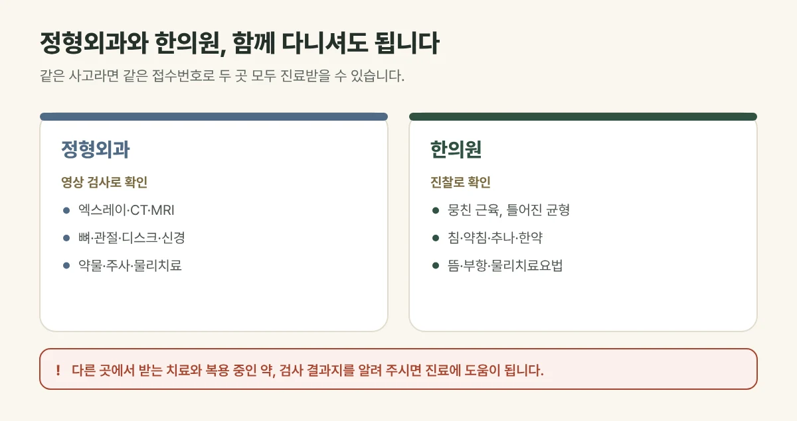

## 함께 다니셔도 됩니다

교통사고 후 정형외과와 한의원은 **함께 다니셔도 됩니다.** 두 곳은 살피는 부분과 치료 방법이 달라, 서로를 대신하기보다 함께할 때 도움이 되는 경우가 많습니다. 같은 날 두 곳에서 진료받으셔도 되고, 자동차보험으로 접수했다면 두 곳 모두 같은 접수번호로 진료받을 수 있습니다.

## 진료실에서 자주 보는 경우

정형외과에서 엑스레이상 이상이 없다는 말을 듣고 물리치료를 받다가, 목과 허리가 계속 뻐근해 함께 진료받으러 오시는 분이 많습니다. 두통이나 어지럼, 잠을 설치는 증상이 함께 있다고 말씀하시는 경우도 흔합니다.

## 검사는 어디서 받나요?

뼈가 부러졌는지, 디스크나 신경에 이상이 있는지는 **엑스레이·CT·MRI 같은 영상 검사**로 확인합니다. 이런 검사는 정형외과나 병원에서 받으시고, 그 결과지를 가져오시면 한의원 진료에 참고합니다. 검사에서 큰 이상이 없다는 결과를 받았는데도 통증이 이어진다면, 근육과 인대의 손상이나 몸의 균형이 틀어진 상태를 함께 살펴볼 필요가 있습니다.

## 두 곳의 치료는 이렇게 다릅니다

| | 정형외과 | 한의원 |
| --- | --- | --- |
| 주로 확인하는 것 | 뼈·관절·디스크·신경 (영상 검사) | 뭉친 근육, 틀어진 균형, 몸 전체 상태 (진찰) |
| 주요 치료 | 약물, 주사, 물리치료, 필요 시 수술 | 침·약침, 추나, 한약, 뜸·부항·물리치료요법 |
| 이럴 때 먼저 | 골절·신경 손상이 의심될 때 | 검사는 정상인데 통증·두통·어지럼이 이어질 때 |

<figure style="margin: 8px 0 24px">

<figcaption style="margin-top: 8px; font-size: 14px; color: #5d655f">두 곳은 살피는 부분과 치료 방법이 달라 함께 다니셔도 됩니다. (갈창림 한의원 제작 설명 그림)</figcaption>
</figure>

## 이렇게 함께 다니시면 좋습니다

- 진료받으실 때 다른 곳에서 받는 치료와 **복용 중인 약**을 알려 주세요. 한약을 함께 드실 때 특히 중요합니다.
- 다른 병원에서 받은 **검사 결과지**를 가져오시면 진료에 도움이 됩니다.
- 치료 후 통증이 갑자기 심해지거나 저림, 어지럼처럼 새로운 증상이 생기면 바로 알려 주세요.

## 이런 경우는 먼저 큰 병원에서 확인하세요

- 의식을 잃었거나, 머리를 세게 부딪힌 뒤 두통과 구토가 심해지는 경우
- 팔다리에 힘이 빠지거나 감각이 둔해진 경우
- 대소변을 보기 어렵거나 조절이 잘 되지 않는 경우
- 뼈가 부러진 것처럼 붓고 움직이기 어려운 경우

치료 기간과 회복 정도는 사고의 정도와 몸 상태에 따라 개인차가 있습니다.

## 자주 묻는 질문

Q. 정형외과에서 물리치료를 받는데 한의원도 다녀도 되나요?
A. 네, 함께 다니셔도 됩니다. 다른 곳에서 받는 치료를 알려 주시면 겹치지 않도록 상태에 맞게 치료를 정합니다.

Q. 같은 날 정형외과와 한의원을 둘 다 가도 되나요?
A. 네, 같은 날 두 곳 모두 진료받으실 수 있습니다. 다른 곳에서 받은 치료를 알려 주시면 상태에 맞게 치료를 정합니다.

Q. 한의원에서도 엑스레이를 찍을 수 있나요?
A. 엑스레이·MRI 같은 영상 검사는 정형외과나 병원에서 받으시고, 결과지를 가져오시면 진료에 참고합니다.

Q. 자동차보험 접수번호를 두 곳에 따로 받아야 하나요?
A. 아닙니다. 같은 사고라면 같은 접수번호로 두 곳 모두 진료받을 수 있습니다.
