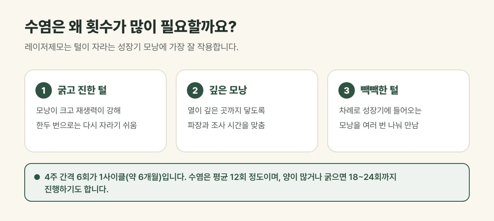

## 수염은 왜 횟수가 많이 필요할까요?

레이저제모는 털이 자라는 **성장기 모낭**에 가장 잘 작용합니다. 그런데 수염은 다른 부위와 비교해 세 가지가 다릅니다.

- **털이 굵고 진합니다.** 멜라닌이 많아 레이저에 잘 반응하지만, 모낭이 크고 재생력이 강해 한두 번으로는 다시 자라기 쉽습니다.
- **모낭이 깊습니다.** 열이 모낭 깊은 곳까지 충분히 전달되어야 해 파장과 조사 시간을 세심하게 맞춥니다.
- **털이 빽빽합니다.** 좁은 면적에 모낭이 많아, 차례로 성장기에 들어오는 모낭을 여러 번에 나누어 만나야 합니다.

그래서 수염은 가늘고 옅은 털보다 횟수가 많이 필요한 편이며, 갈창림 한의원에서는 **평균 12회 정도**를 안내해 드립니다. 수염의 양이 많거나 굵으면 **18~24회**까지 진행하기도 하며, 털의 굵기와 양에 따라 개인차가 있습니다.

<figure style="margin: 8px 0 24px">

<figcaption style="margin-top: 8px; font-size: 14px; color: #5d655f">수염의 양이 많거나 굵으면 18~24회까지 진행하기도 하며, 털의 굵기와 양에 따라 개인차가 있습니다. (갈창림 한의원 제작 설명 그림)</figcaption>
</figure>

## 진료실에서 자주 보는 경우

매일 아침 면도가 번거롭고, 면도 뒤 턱과 목이 자주 붉어지고 따가워서 오시는 분이 많습니다. 처음 몇 회 뒤 털이 가늘어지고 자라는 속도가 느려지는 것을 느끼다가, 다시 굵은 털이 올라와 실망하시는 경우도 흔합니다. 이는 새로 성장기에 들어온 모낭 때문이라 횟수를 이어 가는 것이 중요합니다.

## 일정은 이렇게 잡습니다

- **4주 간격 6회 = 1사이클(약 6개월).** 털이 성장기부터 휴지기까지 한 바퀴 도는 데 약 6개월이 걸려, 그동안 차례로 성장기에 들어오는 모낭을 만납니다.
- 수염은 보통 **두 사이클(약 12회)** 정도를 기준으로 하고, 양이 많거나 굵으면 **18~24회**까지 경과를 보며 횟수를 조정합니다.
- 간격을 너무 좁히면 휴지기 털이 많아 효과가 덜하고, 너무 벌리면 흐름이 끊기기 쉽습니다.

## 시술 기간에 지켜 주세요

- **면도는 괜찮습니다.** 다만 털을 뽑거나 왁싱하면 레이저가 작용할 모낭이 함께 빠져 효과가 떨어집니다.
- 시술 전날이나 당일에 면도해 털을 짧게 정리해 오시면 시술이 수월합니다.
- 시술 뒤 붉어짐과 열감은 냉찜질로 가라앉히고, 자외선 차단제를 발라 주세요.
- 좁쌀처럼 올라오는 모낭염이 생기면 짜지 말고 깨끗하게 관리해 주세요.

시술 후 모낭 주변이 붉어지고 살짝 부어오르는 반응은 흔하며 대부분 몇 시간에서 하루 안에 가라앉습니다. 드물게 화상, 물집, 색소 변화가 생길 수 있어, 이상이 있으면 바로 연락해 주세요.

## 자주 묻는 질문

Q. 수염 제모를 하면 다시는 안 나나요?
A. 레이저제모는 털이 다시 자라는 힘을 약하게 해 털을 가늘고 적게 만드는 시술입니다. 횟수를 채운 뒤에도 일부 털이 남거나 다시 날 수 있어, 필요하면 간격을 두고 유지 시술을 합니다.

Q. 수염 일부만 제모할 수도 있나요?
A. 네. 턱 아래나 목처럼 면도 자극이 심한 부위만 하거나, 수염 모양을 남기고 정리하는 방식도 가능합니다. 상담 때 원하시는 모양을 말씀해 주세요.

Q. 아픈가요?
A. 악센토N은 조사 전후로 냉각 가스를 뿌리는 쿨링이 있어 마취 없이 시술할 수 있습니다. 수염은 털이 굵어 다른 부위보다 따끔하게 느끼실 수 있으며, 느끼는 정도는 개인차가 있습니다.
