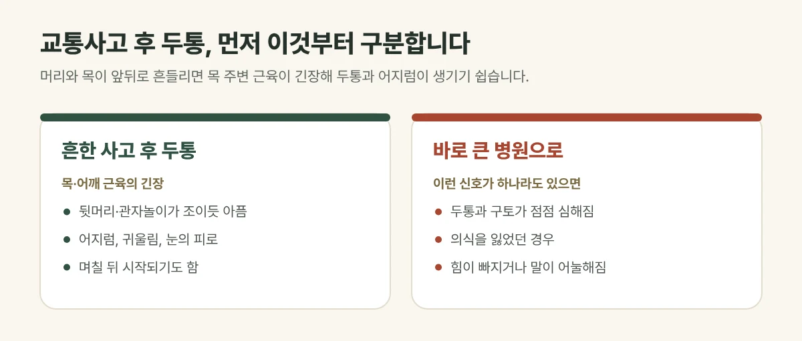

## 사고 후 두통은 왜 생길까요?

뒤에서 부딪히면 머리가 뒤로 젖혀졌다가 곧바로 앞으로 꺾이며, 목 주변 근육과 인대가 순간적으로 늘어납니다. 이후 목과 어깨 근육이 굳고 긴장하면 **뒷머리와 관자놀이가 조이듯 아픈 두통**이 생기기 쉽습니다. 목 주변이 긴장하면 **어지럼, 귀울림, 눈의 피로**가 함께 오기도 합니다.

사고 직후에는 놀라고 긴장해 잘 느끼지 못하다가, 며칠 뒤 두통이 시작되는 경우도 흔합니다.

## 이런 두통은 바로 큰 병원으로 가세요

- 의식을 잃었거나, 머리를 부딪힌 뒤 두통과 구토가 점점 심해지는 경우
- 팔다리에 힘이 빠지거나 감각이 둔해진 경우, 말이 어눌해진 경우
- 뼈가 부러진 것처럼 붓고 움직이기 어려운 경우
- 숨쉬기 어렵거나 가슴·배 통증이 심한 경우

머리를 부딪혔거나 위 증상이 하나라도 있다면 한의원보다 **영상 검사가 가능한 병원**에서 먼저 확인해야 합니다.

<figure style="margin: 8px 0 24px">

<figcaption style="margin-top: 8px; font-size: 14px; color: #5d655f">머리를 부딪혔거나 위험 신호가 있다면 영상 검사가 가능한 병원에서 먼저 확인하세요. (갈창림 한의원 제작 설명 그림)</figcaption>
</figure>

## 진료실에서 자주 보는 경우

검사에서는 이상이 없다는데 사고 뒤로 오후만 되면 뒷머리가 무겁고, 고개를 돌리면 핑 도는 느낌이 있다며 오시는 분이 많습니다. 목과 어깨를 만져 보면 한쪽이 단단하게 굳어 있는 경우가 흔합니다.

## 이렇게 치료합니다

| 살펴보는 것 | 치료 |
| --- | --- |
| 굳은 목·어깨 근육 | 침·약침, 뜸·부항·물리치료 |
| 틀어진 목의 균형 | 추나 |
| 놀란 몸, 어혈, 잠 못 드는 상태 | 한약 |

사고 정도와 지금 상태에 따라 조합과 강도를 조절하며, 회복 기간에는 개인차가 있습니다.

## 생활 속 관리

- 사고 후 며칠은 무리한 운동과 음주를 피해 주세요.
- 휴대전화를 오래 내려다보는 자세를 줄여 주세요.
- 두통이 갑자기 심해지거나 양상이 바뀌면 바로 알려 주세요.

## 자주 묻는 질문

Q. 진통제를 먹으면 괜찮은데 치료를 받아야 하나요?
A. 진통제로 통증이 줄어도 목 주변 긴장이 남아 있으면 두통이 반복될 수 있습니다. 통증이 이어진다면 진찰을 받아 보세요.

Q. 어지럼이 있는데 운전해도 되나요?
A. 어지럼이 있는 동안에는 운전을 피하는 것이 안전합니다. 어지럼이 심하거나 오래가면 원인을 확인하는 검사가 필요할 수 있습니다.
