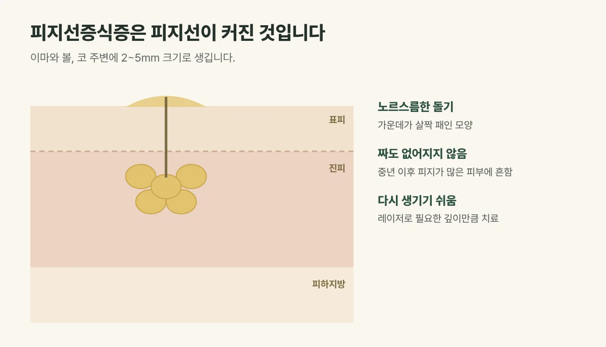

## 피지선증식증은 어떤 돌기인가요?

피부에는 피지를 만들어 모공으로 내보내는 피지선이 있습니다. 피지선증식증은 이 **피지선이 나이가 들며 커져** 피부 위로 도드라진 양성 병변입니다.

- **모양:** 지름 2~5mm의 노르스름하거나 살색인 부드러운 돌기로, **가운데가 배꼽처럼 살짝 패여** 있는 것이 특징입니다.
- **위치:** 이마, 볼, 코 주변에 잘 생깁니다.
- **누구에게:** 40대 이후, 피지가 많은 피부에 흔합니다. 자외선과 호르몬 변화도 영향을 줍니다.

<figure style="margin: 8px 0 24px">

<figcaption style="margin-top: 8px; font-size: 14px; color: #5d655f">피지를 만드는 피지선이 커져 생긴 양성 돌기입니다. (갈창림 한의원 제작 설명 그림)</figcaption>
</figure>

## 여드름, 비립종과는 무엇이 다를까요?

- **여드름 좁쌀:** 모공이 막혀 생겨 짜면 피지가 나오고, 시간이 지나면 가라앉습니다. 피지선증식증은 짜도 거의 나오지 않고 그대로 남습니다.
- **비립종:** 하얗고 단단한 알갱이로, 가운데가 패여 있지 않습니다.
- **기저세포암:** 드물지만 피지선증식증과 비슷해 보이는 피부암입니다. 진주처럼 반짝이는 테두리와 실핏줄이 보이고, 점점 커지거나 피가 날 수 있습니다. 이런 모습이면 제거보다 검사가 먼저입니다.

## 피지선증식증 치료는 이렇게 합니다

피지선증식증은 건강에 해롭지 않지만 저절로 없어지지 않습니다. 보기 싫다면 레이저로 커진 피지선 조직을 제거합니다. 갈창림 한의원은 유펄스 CO2 레이저로 돌기를 얇은 층씩 기화시켜 필요한 깊이만큼 제거합니다.

- 마취 크림을 바른 뒤 진행합니다.
- 너무 깊게 제거하면 패인 자국이 남을 수 있어 깊이를 조절합니다.

## 치료 전에 꼭 알아 두세요: 다시 생기기 쉽습니다

피지선증식증은 **재발이 잦은 병변**입니다. 레이저로 솟은 부분을 제거해도 피지선 자체는 피부 속에 남아 있어, 시간이 지나면 같은 자리가 다시 커지거나 주변에 새 돌기가 생기는 경우가 많습니다. 피지가 많은 피부일수록 더 그렇습니다.

그래서 피지선증식증 치료는 한 번에 끝내기보다, 다시 올라오는 돌기를 그때그때 정리해 가는 관리로 생각하시는 것이 좋습니다. 치료 전 진료 때 재발 가능성을 충분히 설명드립니다.

## 치료 후 관리

- 딱지는 억지로 떼지 말고 자연스럽게 떨어지게 두세요.
- 붉은 자국이 옅어지는 동안 자외선 차단제를 꼭 발라 주세요.
- 피지가 많은 피부라면 순한 세안제로 깨끗하게 세안하고, 모공을 막는 무거운 화장품은 줄여 주세요.

## 자주 묻는 질문

Q. 피지선증식증은 짜면 없어지나요?
A. 커진 피지선 자체가 솟아 있는 것이라 짜도 없어지지 않고, 오히려 상처와 염증이 생길 수 있습니다.

Q. 치료 후 다시 생기나요?
A. 네, 재발이 잦습니다. 피지선은 피부 속에 남아 있어 시간이 지나며 같은 자리가 다시 커지거나 다른 곳에 새로 생기는 경우가 많아, 다시 올라오면 그때 다시 정리합니다.

Q. 여러 개를 한 번에 치료할 수 있나요?
A. 가능합니다. 개수와 크기에 따라 한 번에 시술할 범위를 진료 때 함께 정합니다.
