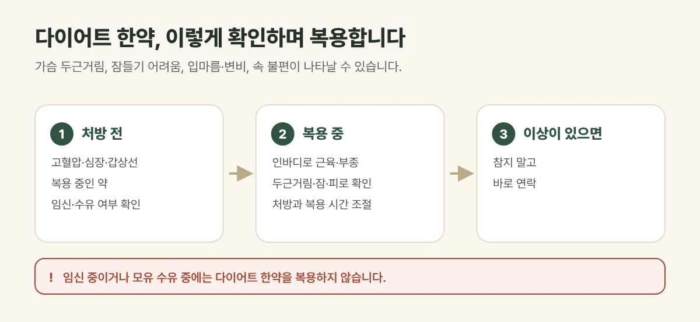

## 부작용이 생길 수 있습니다

다이어트 한약에는 식욕을 조절하고 몸이 쓰는 에너지를 높이는 약재가 들어갑니다. 이 작용 때문에 복용하는 동안 몸이 반응하기도 합니다. 미리 알고 있으면 당황하지 않고 바로 알려 주실 수 있습니다.

| 반응 | 빈도 | 이럴 때는 |
| --- | --- | --- |
| 가슴 두근거림, 맥박이 빨라짐 | 가끔 | 바로 알려 주세요. 처방을 조절합니다 |
| 잠들기 어려움 | 가끔 | 복용 시간을 앞당기거나 처방을 조절합니다 |
| 입마름, 변비 | 가끔 | 물을 충분히 드세요 |
| 속 불편, 메스꺼움 | 가끔 | 공복을 피해 드세요 |
| 어지럼, 심한 피로 | 드묾 | 식사량이 지나치게 줄었을 수 있어 바로 연락 주세요 |

## 진료실에서 자주 보는 경우

예전에 다른 곳에서 다이어트 약을 먹고 가슴이 두근거려 그만두었다는 분이 있습니다. 이런 경험이 있다면 미리 말씀해 주세요. 체질과 체력에 맞춰 약재와 양을 조절해 처방합니다.

<figure style="margin: 8px 0 24px">

<figcaption style="margin-top: 8px; font-size: 14px; color: #5d655f">반응의 종류와 정도에는 개인차가 있어 복용하는 동안 컨디션을 보며 처방을 조절합니다. (갈창림 한의원 제작 설명 그림)</figcaption>
</figure>

## 처방 전에 꼭 알려 주세요

- 고혈압, 심장 질환, 갑상선 질환, 당뇨
- 지금 먹고 있는 약 (특히 혈압약, 갑상선약, 우울증·불안 약)
- 커피나 에너지 음료를 많이 드시는지
- 임신 중이거나 임신 가능성이 있는지, 모유 수유 중인지

**임신 중이거나 수유 중에는 다이어트 한약을 복용하지 않습니다.** 건강 상태에 따라 다이어트 한약이 맞지 않다고 판단되면 다른 방법을 안내해 드립니다.

## 복용 중에는 이렇게 확인합니다

- 내원할 때마다 체중과 함께 **인바디로 근육량과 부종**을 확인합니다.
- 식욕, 잠, 두근거림, 피로를 여쭤보고 처방을 조절합니다.
- 매일 카카오톡 식단 관리로 식사량이 지나치게 줄지 않았는지 살핍니다.

## 이런 경우는 복용을 멈추고 연락해 주세요

- 가슴 두근거림이 쉬어도 가라앉지 않는 경우
- 가슴 통증, 숨참이 있는 경우
- 피부 발진이나 심한 가려움이 생긴 경우

## 자주 묻는 질문

Q. 부작용이 있으면 다이어트를 그만둬야 하나요?
A. 대부분 처방이나 복용 시간을 조절하면 이어 갈 수 있습니다. 참지 말고 바로 알려 주세요.

Q. 커피를 마셔도 되나요?
A. 카페인이 두근거림이나 불면을 더할 수 있어, 복용하는 동안에는 줄이시는 것이 좋습니다.
