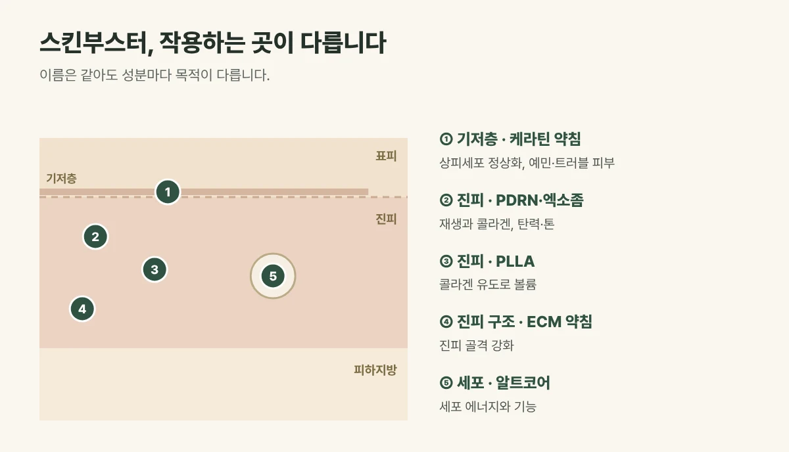

## 스킨부스터, 목적부터 정합니다

스킨부스터는 피부 속에 필요한 성분을 직접 채워 넣는 시술입니다. 이름은 같아도 성분마다 **작용하는 곳과 목적**이 다르기 때문에, "어떤 게 제일 좋아요?"보다 "지금 내 피부에 무엇이 필요한가"를 먼저 정하는 것이 중요합니다.

| 스킨부스터 | 주로 작용하는 곳 | 핵심 목적 | 이런 고민에 |
| --- | --- | --- | --- |
| PDRN·엑소좀 | 진피층 | 콜라겐 생성 촉진, 재생 | 탄력, 재생, 칙칙한 톤 |
| PLLA | 진피층 | 콜라겐 생성 유도, 볼륨 | 꺼진 볼, 얇아진 피부 |
| 케라틴 약침 | 기저층 | 상피세포 정상화 | 예민하고 트러블이 잦은 피부 |
| 알트코어 | 세포·미토콘드리아 | 세포 에너지와 기능 | 세포 건강, 기미 |
| ECM 진피재생약침 | 진피 구조 | 진피 골격 강화 | 진피가 약해지는 30대 중반 이후 |

<figure style="margin: 8px 0 24px">

<figcaption style="margin-top: 8px; font-size: 14px; color: #5d655f">야누스프로 분석과 상담으로 지금 피부에 필요한 것을 먼저 정합니다. (갈창림 한의원 제작 설명 그림)</figcaption>
</figure>

## 진료실에서 자주 보는 경우

주변에서 좋다고 들은 스킨부스터 이름을 정해 오시는 분이 많습니다. 막상 피부를 살펴보면 탄력보다 장벽이 약해 예민한 것이 먼저인 경우도 있고, 볼륨이 줄어든 것이 주된 고민인 경우도 있어 순서를 바꾸기도 합니다.

## 이렇게 고릅니다

- 야누스프로 분석과 상담으로 **수분, 탄력, 피부결, 색소, 예민도**를 확인합니다.
- 고민이 여러 가지면 한 번에 다 하기보다 **우선순위를 정해 순서대로** 진행하거나 목적이 맞는 두 가지를 조합합니다.
- 주입 방법은 레이저·LDM 또는 손주사 가운데 피부 상태와 부위에 맞게 고릅니다. 알트코어처럼 화장품으로 허가된 제품은 바늘로 주입하지 않고 레이저·LDM으로 흡수시킵니다.

## 시술 후 알아 두세요

주입 방법에 따라 작은 주입 자국, 오돌토돌함, 가벼운 붉음이 생길 수 있으며 대부분 며칠 안에 가라앉습니다. 드물게 멍이나 염증이 생길 수 있어 이상이 있으면 바로 연락해 주세요.

## 자주 묻는 질문

Q. 여러 스킨부스터를 함께 맞아도 되나요?
A. 목적이 맞는 경우 함께 계획할 수 있습니다. 다만 무조건 많이 섞기보다 피부가 회복할 시간을 두고 순서를 정하는 것이 좋습니다.

Q. 몇 번 받아야 하나요?
A. 성분마다 다릅니다. PDRN·엑소좀은 보통 2~4주 간격 3~5회, PLLA는 4~6주 간격 2~3회를 기준으로 피부 상태에 맞춰 조정합니다.
