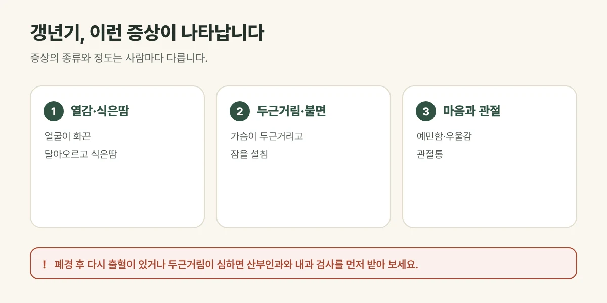

## 갱년기 증후군은 어떤 상태인가요?

여성은 보통 40대 후반에서 50대 초반 사이에 난소 기능이 줄어들며 생리가 멈추는 **폐경**을 맞습니다. 마지막 생리 후 1년 동안 생리가 없으면 폐경으로 봅니다. 폐경 앞뒤 몇 년 동안 여성호르몬이 크게 줄고 흔들리면서 여러 증상이 나타나는데, 이를 갱년기 증후군이라고 합니다. 증상의 종류와 정도, 기간은 사람마다 크게 다릅니다.

## 이런 증상이 나타납니다

- **안면홍조:** 얼굴과 목, 가슴이 갑자기 화끈 달아오르고 땀이 남
- **식은땀:** 밤에 땀에 젖어 깨는 경우
- 두근거림, 가슴 답답함
- 잠들기 어렵고 자주 깸
- 예민함, 짜증, 우울감, 기억력과 집중력 저하
- 관절과 근육의 통증, 피로
- 질 건조감, 잦은 소변

## 진료실에서 자주 보는 경우

얼굴이 갑자기 화끈 달아오르고 땀이 나며, 밤에 자주 깨서 피곤하다고 오시는 분이 많습니다. 이유 없이 마음이 가라앉거나 짜증이 늘었다고 함께 말씀하시는 경우가 흔합니다.

<figure style="margin: 8px 0 24px">

<figcaption style="margin-top: 8px; font-size: 14px; color: #5d655f">폐경 전후로 여성호르몬이 줄면서 나타나는 증상입니다. (갈창림 한의원 제작 설명 그림)</figcaption>
</figure>

## 이런 경우는 먼저 확인이 필요합니다

- **폐경 후에 다시 출혈**이 있는 경우 — 산부인과 진료를 꼭 받아 주세요.
- 두근거림이 심하거나 체중이 갑자기 변한 경우 — 갑상선과 심장 검사가 필요할 수 있습니다.
- 운동할 때 가슴 통증과 숨 가쁨이 있는 경우 — 바로 진료를 받아 주세요.
- 우울감이 2주 넘게 계속되거나, 스스로를 해치고 싶은 생각이 드는 경우 — 정신건강의학과 진료를 받아 주세요. 위급할 때는 자살예방 상담전화 **109**로 연락하세요.

폐경 이후에는 뼈가 약해지기 쉬워 **골밀도 검사**를 받아 보시기를 권합니다. 호르몬 치료가 필요한지, 받아도 되는지는 산부인과 의사와 상의해 정해 주세요.

## 갈창림 한의원의 갱년기 치료

**한약:** 같은 갱년기라도 열감과 식은땀이 심한지, 잠을 못 이루는지, 예민함과 우울감이 큰지, 기운이 없고 관절이 아픈지에 따라 처방이 달라집니다. 지금 가장 힘든 증상과 체질, 소화와 수면 상태를 함께 살펴 처방하고, 경과에 따라 조절합니다.

## 갱년기를 편하게 보내는 생활 관리

- **열감을 키우는 것 줄이기:** 술, 카페인, 맵고 뜨거운 음식, 더운 실내는 열감을 부를 수 있습니다.
- 얇은 옷을 겹쳐 입어 열감이 올라올 때 벗을 수 있게 하고, 침구는 시원하게 해 주세요.
- **뼈 건강:** 걷기, 계단 오르기 같은 체중이 실리는 운동과 가벼운 근력 운동을 꾸준히 하고, 칼슘과 비타민 D가 부족하지 않게 챙겨 주세요.
- 매일 같은 시간에 자고 일어나 수면 리듬을 지켜 주세요.
- 혼자 견디기보다 가족에게 지금의 변화를 이야기해 도움을 받는 것도 중요합니다.

## 자주 묻는 질문

Q. 호르몬 치료를 받고 있어도 한약을 먹어도 되나요?
A. 받고 계신 치료와 복용 중인 약을 알려 주시면 확인한 뒤 함께 관리합니다. 호르몬 치료를 줄이거나 끊는 것은 처방한 의사와 상의해 주세요.

Q. 갱년기 증상은 언제까지 가나요?
A. 사람마다 달라 몇 달 만에 줄어드는 분도 있고 몇 년 이어지는 분도 있습니다. 증상이 일상을 힘들게 한다면 참기보다 관리를 시작하는 것이 좋습니다.

Q. 남성도 갱년기가 있나요?
A. 남성도 나이가 들며 남성호르몬이 줄어 피로, 의욕 저하, 수면 변화 등을 겪을 수 있습니다. 증상과 몸 상태를 살펴 진료하며, 결과에는 개인차가 있습니다.
