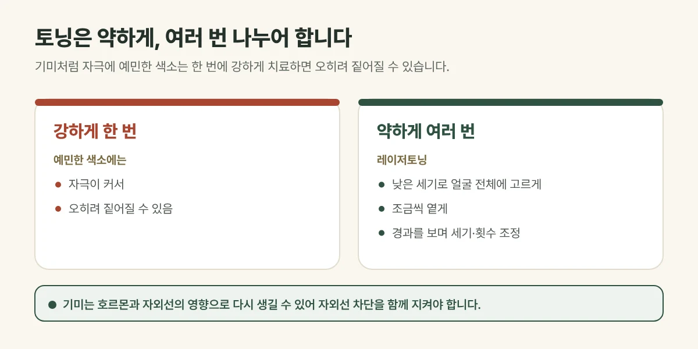

## 토닝은 왜 여러 번 받을까요?

레이저토닝은 **낮은 세기의 레이저를 얼굴 전체에 고르게** 여러 번 나누어 조사하는 방법입니다. 특히 기미처럼 자극에 예민한 색소는 한 번에 강하게 치료하면 오히려 짙어질 수 있어, **약하게 여러 번** 나누어 조금씩 옅게 합니다. 그래서 횟수가 필요합니다.

<figure style="margin: 8px 0 24px">

<figcaption style="margin-top: 8px; font-size: 14px; color: #5d655f">횟수는 몇 회 뒤 변화를 확인하며 조정하고, 결과에는 개인차가 있습니다. (갈창림 한의원 제작 설명 그림)</figcaption>
</figure>

## 목적에 따라 간격이 다릅니다

| 목적 | 주로 쓰는 방식 | 간격 (기준) |
| --- | --- | --- |
| 기미, 칙칙한 피부톤 | 1064nm 토닝 | 2주 간격 |
| 붉은 자국, 갈색 자국 | 혈관 토닝 · 색소 토닝 | 2주 간격 |
| 붉은기, 피부결, 모공 | 제네시스 토닝 (1064nm 롱펄스) | 1~2주 간격 |

정해진 횟수를 미리 약속하기보다, **몇 회 뒤 변화를 확인하며** 횟수와 세기를 조정합니다.

## 트리플토닝과 제네시스토닝

- **트리플토닝:** 532nm·1064nm 큐스위치로 얕은 색소와 깊은 색소를 함께 다루고, 755nm·1064nm 롱펄스로 붉은기와 피부결, 피부톤을 관리합니다.
- **제네시스토닝:** 1064nm 롱펄스를 낮은 세기로 여러 번 나눠 조사해 피부를 고르게 데우는 방식으로, 붉은기와 거친 피부결, 모공 관리에 씁니다.

## 진료실에서 자주 보는 경우

토닝 몇 번이면 기미가 없어지냐는 질문을 가장 많이 받습니다. 기미는 호르몬과 자외선의 영향을 받아 다시 생길 수 있어, 횟수만큼 중요한 것이 **자외선 차단과 생활 관리**라고 말씀드립니다.

## 시술 후 관리

- 자외선 차단제를 매일 꼼꼼히 발라 주세요.
- 시술 당일은 뜨거운 사우나와 강한 각질 제거를 피해 주세요.
- 보습을 충분히 해 주세요.

1064nm 토닝은 딱지가 거의 생기지 않아 바로 일상생활이 가능합니다. 드물게 색소가 오히려 짙어지거나 옅어지는 변화가 생길 수 있어, 이상이 있으면 연락해 주세요.

## 자주 묻는 질문

Q. 토닝을 오래 받으면 피부가 얇아지나요?
A. 낮은 세기로 피부 상태를 보며 진행하므로 일반적으로 걱정하실 정도는 아닙니다. 다만 짧은 간격으로 지나치게 반복하지 않도록 간격을 지킵니다.

Q. 색소가 없어도 받을 수 있나요?
A. 가능합니다. 칙칙한 피부톤을 관리하는 미백 토닝으로 1064nm를 낮은 세기로 고르게 조사합니다.
