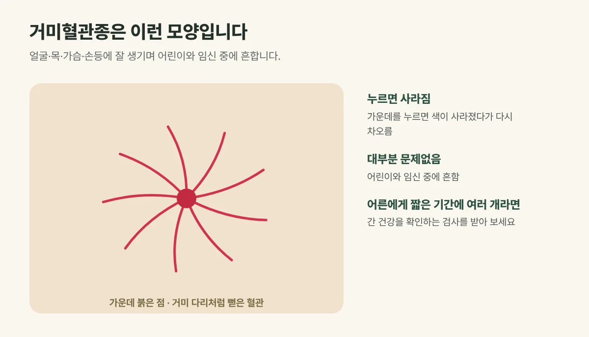

## 거미혈관종은 어떤 모양인가요?

거미혈관종은 피부 아래의 작은 동맥이 늘어나 생긴 혈관 병변입니다.

- **모양:** 가운데에 붉은 점(몸통)이 있고, 그 주위로 가는 혈관(다리)이 사방으로 퍼져 **거미처럼** 보입니다. 지름은 보통 몇 mm에서 1cm 정도입니다.
- **특징:** 가운데를 누르면 혈관이 비면서 색이 사라지고, 손을 떼면 가운데부터 다시 빨갛게 차오릅니다.
- **위치:** 얼굴(특히 볼과 코), 목, 가슴 윗부분, 팔, 손등처럼 상체에 잘 생깁니다.

<figure style="margin: 8px 0 24px">

<figcaption style="margin-top: 8px; font-size: 14px; color: #5d655f">가운데를 누르면 색이 사라졌다가 다시 차오릅니다. (갈창림 한의원 제작 설명 그림)</figcaption>
</figure>

## 왜 생길까요?

- **어린이:** 아이들에게 흔하며, 자라면서 저절로 옅어지는 경우도 있습니다.
- **임신·호르몬:** 임신 중이나 경구 피임약을 먹는 동안 여성 호르몬의 영향으로 생기기 쉽고, 출산 뒤 몇 달 안에 옅어지기도 합니다.
- **간 질환:** 간 기능이 떨어지면 호르몬 대사가 달라져 거미혈관종이 여러 개 생길 수 있습니다.
- **특별한 원인 없이:** 건강한 어른에게 하나둘 생기는 경우도 흔합니다.

## 이런 경우 내과 진료를 함께 받아 보세요

임신이나 피임약과 관계없이 **어른에게 거미혈관종이 짧은 기간에 여러 개** 생겼다면, 간 건강을 확인하는 검사를 받아 보시기를 권합니다. 특히 술을 자주 드시거나, 피로감, 눈이나 피부가 노래지는 증상, 손바닥이 붉어지는 증상이 함께 있다면 내과 진료가 먼저입니다.

## 거미혈관종 치료는 이렇게 합니다

건강상 문제가 없는 거미혈관종은 치료하지 않아도 되지만, 얼굴에 있어 신경 쓰인다면 레이저로 치료할 수 있습니다. 핵심은 **가운데의 굵은 혈관**을 치료하는 것으로, 가운데 혈관이 닫히면 주변의 가는 혈관도 함께 옅어집니다.

- 갈창림 한의원은 혈관 속 적혈구에 흡수되는 1064nm 롱펄스 레이저(악센토N)로 가운데 혈관을 겨냥해 치료합니다.
- 크기와 깊이에 따라 한 번 이상 치료가 필요할 수 있습니다.

## 치료 후 관리

- 시술 부위가 일시적으로 붉거나 작은 딱지가 생길 수 있습니다.
- 자외선 차단제를 꼼꼼히 발라 주세요.
- 약 1주일간 사우나, 찜질방, 음주처럼 혈관을 넓히는 것은 피해 주세요.

## 자주 묻는 질문

Q. 아이 얼굴에 거미혈관종이 있어요. 치료해야 하나요?
A. 아이들에게 흔하고 자라면서 옅어지는 경우도 있어, 바로 치료하지 않고 지켜보기도 합니다. 크기나 위치 때문에 신경 쓰이신다면 진료 후 상담해 드립니다.

Q. 임신 중 생긴 거미혈관종은 없어지나요?
A. 출산 뒤 몇 달 안에 옅어지는 경우가 많아, 출산 뒤에도 남아 있을 때 치료를 고려하셔도 됩니다.

Q. 치료하면 다시 생기나요?
A. 가운데 혈관이 다시 열리거나 다른 곳에 새로 생길 수 있어, 경과를 보며 필요하면 추가로 치료합니다.
