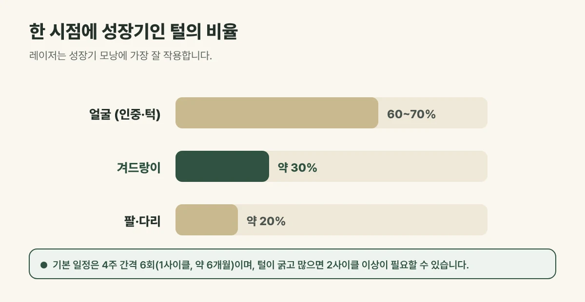

## 겨드랑이는 레이저에 잘 반응하는 부위입니다

겨드랑이 털은 굵고 색이 진해 멜라닌이 많습니다. 레이저 빛이 멜라닌에 선택적으로 흡수되어 열로 바뀌는 원리라, 겨드랑이는 **레이저제모에 잘 반응하는 부위**입니다. 갈창림 한의원은 겨드랑이 제모를 주로 755nm로 시술하며, 털과 피부 상태에 따라 1064nm를 함께 고려합니다.

## 그래도 여러 번 받아야 하는 이유

한 시점에 **성장기인 털은 겨드랑이에서 약 30%** 정도입니다. 레이저는 성장기 모낭에 가장 잘 작용하므로, 나머지 털이 차례로 성장기에 들어올 때마다 다시 만나야 합니다.

- 기본 일정은 **4주 간격 6회(1사이클, 약 6개월)** 입니다.
- 털이 굵고 많으면 2사이클 이상이 필요한 경우도 있습니다.

<figure style="margin: 8px 0 24px">

<figcaption style="margin-top: 8px; font-size: 14px; color: #5d655f">나머지 털이 차례로 성장기에 들어올 때마다 다시 만나야 해 여러 번 시술합니다. (갈창림 한의원 제작 설명 그림)</figcaption>
</figure>

## 진료실에서 자주 보는 경우

매번 면도하다 보니 피부가 거뭇해 보이고, 면도 뒤 따갑고 오돌토돌해져서 오시는 분이 많습니다. 여름 전에 급하게 시작하시는 경우가 흔한데, 한 사이클이 약 6개월 걸리므로 여유 있게 시작하시는 것이 좋습니다.

## 땀과 냄새도 줄어들까요?

털이 줄면 땀과 노폐물이 털에 덜 머물러 **상쾌하다고 느끼는 분이 많습니다.** 다만 레이저제모는 땀샘을 줄이는 시술이 아니어서, 땀의 양 자체가 줄어든다고 기대하기는 어렵습니다. 땀이 지나치게 많아 일상이 불편하다면 다한증 여부를 따로 살펴봐야 합니다.

## 시술 전후 주의사항

- 시술 기간에는 **면도만** 하고, 털을 뽑거나 왁싱하지 마세요.
- 시술 당일에는 데오드란트, 향이 강한 제품을 피해 주세요.
- 시술 후 하루 이틀은 사우나, 땀을 많이 흘리는 운동을 피하고 냉찜질로 열감을 가라앉혀 주세요.
- 모낭염처럼 좁쌀이 올라오면 짜지 말고 깨끗하게 관리해 주세요.

붉어짐, 따끔거림은 흔하고 대부분 금방 가라앉습니다. 드물게 화상이나 색소 변화가 생길 수 있어, 이상이 있으면 바로 연락해 주세요.

## 자주 묻는 질문

Q. 겨드랑이가 거뭇한 것도 좋아지나요?
A. 면도한 털이 피부 아래 비쳐 거뭇해 보이는 경우는 털이 줄면서 덜해 보일 수 있습니다. 피부 자체의 색소침착은 따로 살펴봐야 합니다.

Q. 여름에 받아도 되나요?
A. 가능합니다. 다만 겨드랑이는 땀이 많고 마찰이 잦아 시술 후 관리에 더 신경 써 주세요.
