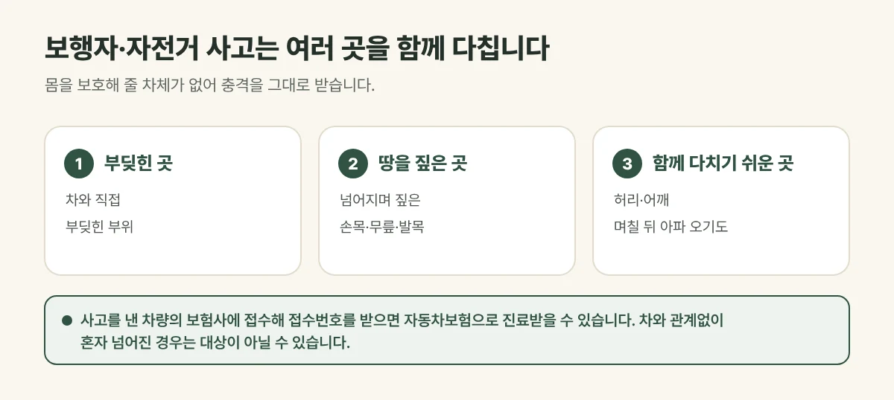

## 보행자와 자전거 사고는 더 많이 다칩니다

차 안에 있으면 안전띠와 차체가 충격을 일부 막아 주지만, 걷거나 자전거를 타다 부딪히면 **몸이 그대로 충격을 받습니다**. 부딪힌 곳뿐 아니라 넘어지면서 땅을 짚은 **손목, 무릎, 발목**과 허리, 어깨까지 함께 다치는 경우가 많습니다.

<figure style="margin: 8px 0 24px">

<figcaption style="margin-top: 8px; font-size: 14px; color: #5d655f">골절이나 머리 부상이 의심되면 큰 병원 검사가 먼저입니다. (갈창림 한의원 제작 설명 그림)</figcaption>
</figure>

## 접수는 이렇게 합니다

- **차와 부딪힌 경우:** 사고를 낸 차량의 보험사에 접수하고 접수번호를 받아 두세요.
- **차량이 보험에 들지 않았거나 달아난 경우:** 처리 방법이 따로 있어 경찰 신고와 함께 보험사나 관련 기관에 문의해 주세요.
- **차와 관계없이 혼자 넘어진 경우:** 자동차보험 대상이 아닐 수 있습니다.

접수번호와 신분증을 가지고 오시면 자동차보험으로 진료를 시작합니다. 보험 처리 방식은 담당 보험사에 확인해 주세요.

## 진료실에서 자주 보는 경우

자전거를 타다 골목에서 나온 차와 부딪힌 뒤, 처음엔 무릎만 아팠는데 며칠 지나 손목과 허리까지 아파 오는 분이 있습니다. 넘어질 때 짚은 손목은 붓기가 가라앉은 뒤에도 비틀 때 아픈 경우가 흔합니다.

## 이런 경우는 먼저 큰 병원에서 확인하세요

- 의식을 잃었거나, 머리를 부딪힌 뒤 두통과 구토가 점점 심해지는 경우
- 팔다리에 힘이 빠지거나 감각이 둔해진 경우, 말이 어눌해진 경우
- 뼈가 부러진 것처럼 붓고 움직이기 어렵거나, 체중을 싣지 못하는 경우
- 숨쉬기 어렵거나 가슴·배 통증이 심한 경우

## 이렇게 치료합니다

아픈 곳이 여러 군데인 경우가 많아, 부위마다 상태를 살핀 뒤 **침·약침, 추나, 한약, 뜸·부항·물리치료요법**을 조합합니다. 넘어지며 놀란 몸과 이후의 불안, 잠 못 드는 상태도 함께 살펴봅니다.

## 자주 묻는 질문

Q. 전동킥보드를 타다 차와 부딪혀도 자동차보험으로 진료받을 수 있나요?
A. 차와 부딪힌 사고라면 사고를 낸 차량의 보험으로 처리되는 경우가 많지만, 상황에 따라 달라질 수 있어 담당 보험사에 확인해 주세요.

Q. 엑스레이에서 뼈에 이상이 없다는데 계속 아파요.
A. 인대와 근육의 손상은 엑스레이로 잘 드러나지 않습니다. 통증이 이어진다면 진찰을 받아 보세요.
