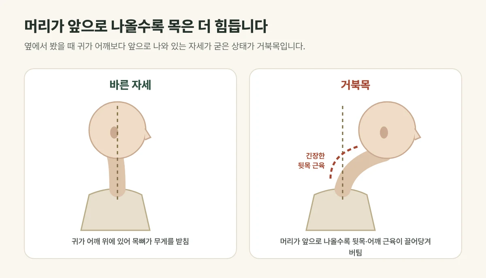

## 거북목은 어떤 상태인가요?

옆에서 봤을 때 **귀가 어깨보다 앞으로 나와 있는** 자세가 굳은 상태를 거북목이라고 합니다. 정상적인 목뼈는 앞쪽으로 완만하게 휘어 있는데, 이 곡선이 곧게 펴진 **일자목**과 함께 오는 경우가 많습니다.

## 머리가 앞으로 나올수록 목은 더 힘듭니다

머리는 볼링공만큼 무겁습니다. 머리가 어깨 위에 있으면 목뼈가 무게를 받쳐 주지만, 앞으로 나올수록 **뒷목과 어깨 근육이 끌어당겨 버텨야** 해 부담이 커집니다. 그래서 이런 증상이 생깁니다.

- 뒷목과 어깨가 늘 뭉치고 결림
- 오후가 되면 뒷머리가 무거운 두통
- 눈의 피로, 쉽게 지침
- 심해지면 팔이 저리기도 함

<figure style="margin: 8px 0 24px">

<figcaption style="margin-top: 8px; font-size: 14px; color: #5d655f">자세 습관을 바꾸는 것이 기본이며, 굳은 근육과 균형은 치료로 함께 풀어 줍니다. (갈창림 한의원 제작 설명 그림)</figcaption>
</figure>

## 집에서 확인해 보세요

벽에 등을 대고 섰을 때 **뒤통수가 벽에 편하게 닿지 않거나**, 턱을 당겨야만 닿는다면 머리가 앞으로 나와 있을 가능성이 있습니다.

## 진료실에서 자주 보는 경우

하루 종일 모니터를 보는 직장인과 스마트폰을 오래 보는 학생이 많습니다. 마사지를 받으면 잠깐 시원하다가 다음 날 다시 뭉친다며 오시는 경우가 흔합니다. 자세가 그대로라면 근육은 다시 긴장하기 때문입니다.

## 생활 속 교정이 기본입니다

- 모니터는 눈높이에, 스마트폰은 가슴 높이로 들어 보세요.
- 30~40분마다 일어나 어깨를 펴고 턱을 가볍게 당겨 주세요.
- 너무 높은 베개는 피해 주세요.

## 이렇게 치료합니다

이미 굳은 근육과 틀어진 균형은 습관만으로 잘 풀리지 않기도 합니다. 물리치료로 근육을 먼저 따뜻하게 풀고, **침·약침**으로 뭉친 곳을 풀어 준 뒤 **추나**로 목과 등의 균형을 바로잡습니다. 추나 뒤 하루 이틀 가벼운 뻐근함이 있을 수 있습니다.

## 이런 경우는 검사가 필요할 수 있습니다

- 팔과 손이 저리고 힘이 빠지는 경우
- 손놀림이 둔해지거나 걸음이 불안정해지는 경우

목디스크 등 신경이 눌린 상태일 수 있어 영상 검사가 필요할 수 있습니다.

## 자주 묻는 질문

Q. 거북목은 다시 정상으로 돌아오나요?
A. 오래 굳은 자세는 시간이 걸리지만, 치료와 함께 생활 습관을 바꾸면 통증과 불편함을 줄이는 데 도움이 됩니다. 정도에는 개인차가 있습니다.

Q. 거북목 교정 베개가 도움이 되나요?
A. 목의 곡선을 편하게 받쳐 주는 높이가 중요합니다. 베개 하나로 자세가 바뀌기보다, 낮 동안의 자세 습관이 더 큰 영향을 줍니다.
