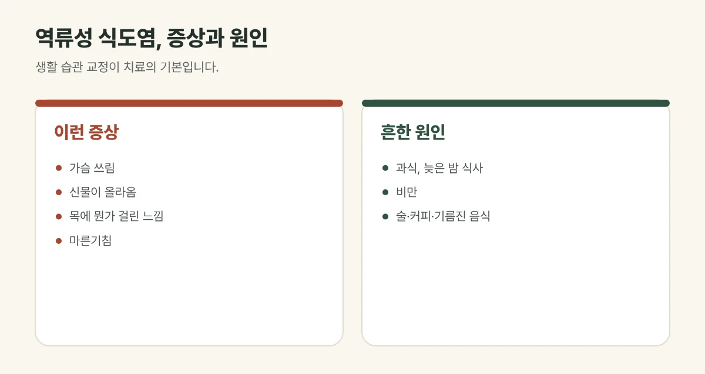

## 역류성 식도염은 어떤 질환인가요?

식도와 위 사이에는 위산이 거꾸로 올라오지 않게 막아 주는 **조임근**이 있습니다. 이 조임근이 느슨해지거나 위 안의 압력이 높아지면 위산이 식도로 올라와 식도 점막을 자극하는데, 이것이 역류성 식도염(위식도 역류 질환)입니다.

## 이런 증상이 나타납니다

- 명치 위쪽, 가슴이 **타는 듯 쓰림**
- 입으로 **신물이나 쓴 물**이 올라옴
- 목에 뭔가 걸린 듯한 **이물감**, 잦은 헛기침
- 쉰 목소리, 마른기침
- 눕거나 허리를 숙일 때 심해짐

## 진료실에서 자주 보는 경우

가슴이 타는 듯 쓰리고 신물이 올라오며, 목에 뭔가 걸린 느낌이 계속된다고 오시는 분이 많습니다. 늦은 저녁이나 야식을 먹고 바로 누운 날 심해진다고 말씀하시는 경우가 흔합니다.

<figure style="margin: 8px 0 24px">

<figcaption style="margin-top: 8px; font-size: 14px; color: #5d655f">위산과 위 내용물이 식도로 거꾸로 올라와 생깁니다. (갈창림 한의원 제작 설명 그림)</figcaption>
</figure>

## 왜 생길까요?

- **과식**과 **늦은 밤 식사**, 먹고 바로 눕는 습관
- 술, 커피, 탄산음료, 초콜릿, 기름지고 매운 음식
- **복부 비만**, 꽉 끼는 옷과 벨트
- 흡연
- 스트레스와 긴장

## 이런 경우는 먼저 검사를 받아 보세요

- 음식이 **잘 삼켜지지 않거나** 삼킬 때 아픈 경우
- 이유 없는 **체중 감소**, 빈혈, 검은 변
- 계속되는 구토
- **가슴 통증**이 있는 경우 — 심장 질환과 구별이 필요합니다. 운동할 때 가슴이 조이거나 식은땀이 나면 바로 응급실로 가세요.

## 갈창림 한의원의 역류성 식도염 치료

1. **침:** 위장 기능과 관련된 자리와 굳은 가슴·등 근육에 침을 놓아 위장의 움직임과 긴장을 돕습니다.
2. **뜸:** 배를 따뜻하게 해 위장의 순환을 돕습니다.
3. **한약:** 위장의 상태와 스트레스, 식습관을 살펴 처방합니다.

생활 습관 교정이 치료의 기본이라, 식사와 수면 습관을 함께 정합니다.

## 역류를 줄이는 생활 습관

- **잠들기 3시간 전**에는 먹지 마세요.
- 식후 바로 눕지 말고, 잘 때는 상체를 10~15cm 정도 높여 주세요.
- 한 번에 많이 먹지 말고 조금씩 나누어 드세요.
- 술, 커피, 탄산음료, 기름진 음식, 흡연을 줄여 주세요.
- 배를 조이는 옷은 피하고, 체중이 늘었다면 조금씩 줄여 주세요.

## 자주 묻는 질문

Q. 위산 억제제를 먹고 있어도 치료받을 수 있나요?
A. 네. 복용 중인 약을 알려 주시면 확인한 뒤 함께 관리합니다. 약을 줄이거나 끊는 것은 처방한 의사와 상의해 주세요.

Q. 목에 뭔가 걸린 느낌도 역류성 식도염 때문인가요?
A. 위산이 목까지 올라와 이물감과 헛기침을 일으키는 경우가 많습니다. 다만 다른 원인도 있을 수 있어 증상이 계속되면 검사를 받아 보세요.

Q. 다 나은 뒤에도 다시 생기나요?
A. 생활 습관이 그대로라면 다시 생기기 쉽습니다. 증상이 좋아진 뒤에도 식사와 수면 습관을 꾸준히 지키는 것이 중요합니다.
