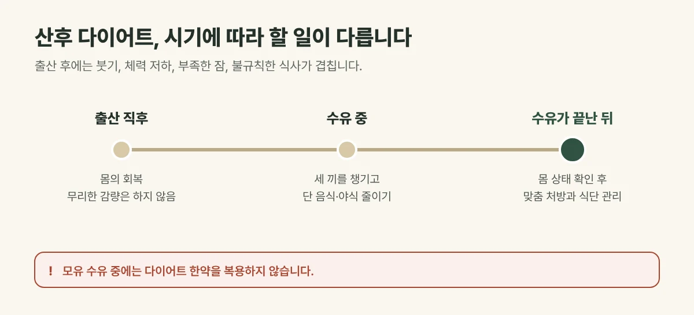

## 출산 후 살은 왜 잘 안 빠질까요?

- **붓기:** 임신 중 늘어난 수분이 빠지는 데 시간이 걸립니다.
- **체력 저하:** 출산과 육아로 지친 몸은 쉽게 피로합니다.
- **부족한 잠:** 밤중 수유로 잠이 끊기면 식욕이 흔들리기 쉽습니다.
- **불규칙한 식사:** 아기를 돌보다 끼니를 거르고, 밤늦게 몰아서 먹기 쉽습니다.

## 시기에 따라 할 일이 다릅니다

| 시기 | 중심 | 이렇게 해 주세요 |
| --- | --- | --- |
| 출산 직후 | 몸의 회복 | 충분히 쉬고 무리한 감량은 하지 않습니다 |
| 수유 중 | 식사와 생활 관리 | 세 끼를 챙기고 단 음식과 야식을 줄입니다 |
| 수유가 끝난 뒤 | 본격적인 감량 | 몸 상태를 확인하고 맞춤 처방과 식단 관리를 시작합니다 |

**모유 수유 중에는 다이어트 한약을 복용하지 않습니다.** 수유가 끝난 뒤 몸 상태를 확인하고 시작하시는 것을 권합니다.

<figure style="margin: 8px 0 24px">

<figcaption style="margin-top: 8px; font-size: 14px; color: #5d655f">시작 시기는 출산 방법과 회복 정도, 수유 여부에 따라 진찰로 함께 정합니다. (갈창림 한의원 제작 설명 그림)</figcaption>
</figure>

## 진료실에서 자주 보는 경우

수유를 마치고 나서 임신 전 옷이 맞지 않아 오시는 분이 많습니다. 아이를 돌보느라 끼니를 거르다 저녁에 한꺼번에 먹게 되는 패턴이 흔해, 체중보다 **식사 시간을 바로잡는 것**부터 함께 시작합니다.

## 이렇게 도와드립니다

- 진찰과 **인바디**로 체지방, 근육량, 부종 상태를 확인합니다.
- 체력과 회복 상태에 맞춘 **맞춤 탕약**을 처방합니다.
- 매일 식사 사진을 카카오톡으로 보내 주시면 원장이 직접 확인하고 답장해 드립니다.
- 산후 관절이 시리고 아픈 증상이 함께 있다면 산후 관리도 함께 살펴봅니다.

## 무리하게 굶지 마세요

출산 후 몸은 아직 회복 중입니다. 급하게 굶으면 체력이 떨어지고 근육이 줄어, 오히려 요요와 폭식으로 이어지기 쉽습니다. 얼마나 빨리 빼느냐보다 **건강하게 유지하는 것**이 중요합니다.

## 자주 묻는 질문

Q. 수유 중에도 다이어트를 할 수 있나요?
A. 한약은 복용하지 않지만, 세 끼를 챙기며 단 음식과 야식을 줄이는 식사 관리는 수유 중에도 할 수 있습니다.

Q. 출산 후 몇 달이 지나야 시작할 수 있나요?
A. 출산 방법과 회복 정도, 수유 여부에 따라 다릅니다. 진찰로 몸 상태를 확인한 뒤 시작 시기를 함께 정합니다.
