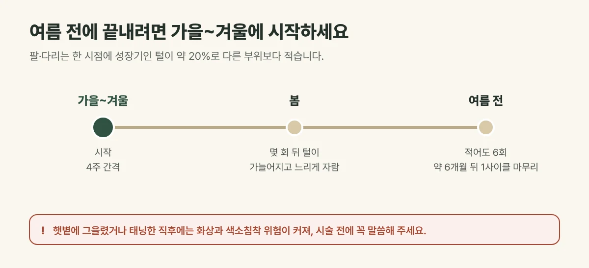

## 팔·다리 털은 왜 시간이 걸릴까요?

레이저제모는 털이 자라는 **성장기 모낭**에 잘 작용합니다. 팔·다리는 한 시점에 성장기인 털이 **약 20%** 로 다른 부위보다 적어, 나머지 털이 차례로 성장기에 들어올 때마다 다시 시술해야 합니다. 그래서 **4주 간격 6회, 약 6개월**을 한 사이클로 봅니다.

## 여름 전에 끝내려면

- 레이저제모는 시작하면 몇 회 안에 변화를 느끼지만, **적어도 6회는 받아야** 효과가 충분해집니다.
- 4주 간격 6회면 약 6개월이 걸리므로, 여름(6~7월)을 목표로 한다면 **최소 6개월 전인 가을~겨울에 시작**하는 것이 좋습니다.
- 굵고 진한 털은 2사이클 이상 필요할 수 있어, 여유 있게 계획하세요.

<figure style="margin: 8px 0 24px">

<figcaption style="margin-top: 8px; font-size: 14px; color: #5d655f">굵고 진한 털은 2사이클 이상 필요할 수 있어 여유 있게 계획하세요. (갈창림 한의원 제작 설명 그림)</figcaption>
</figure>

## 진료실에서 자주 보는 경우

여름 휴가를 몇 주 앞두고 급하게 오시는 분이 많습니다. 한두 번만으로는 원하는 만큼 줄기 어렵다는 말씀을 드리면, 다음 해를 목표로 미리 시작하시는 경우가 많습니다.

## 여름에 시술할 때 주의할 점

- **햇볕에 그을렸거나 태닝한 직후**에는 피부의 멜라닌도 레이저를 흡수해 화상과 색소침착 위험이 커집니다. 이런 경우는 시술 전에 꼭 말씀해 주세요.
- 시술 부위는 옷으로 가리거나 자외선 차단제를 충분히 발라 주세요.
- 시술 기간에는 면도만 하고, 털을 뽑거나 왁싱하지 마세요.

## 팔·다리에 쓰는 파장

갈창림 한의원의 듀얼 악센토N은 755nm와 1064nm 두 파장을 갖추고 있습니다. 갈창림 한의원은 팔·다리도 주로 755nm로 시술하며, 털이 아주 굵고 깊거나 피부톤이 어두운 경우에는 1064nm를 함께 고려합니다.

## 자주 묻는 질문

Q. 팔과 다리를 같은 날 받을 수 있나요?
A. 네, 가능합니다. 면적이 넓어 시술 시간이 길어지므로 예약 때 함께 말씀해 주세요.

Q. 면도 대신 제모 크림을 써도 되나요?
A. 제모 크림은 피부 자극이 생길 수 있어, 시술 기간에는 면도로 정리하시는 것을 권합니다.
