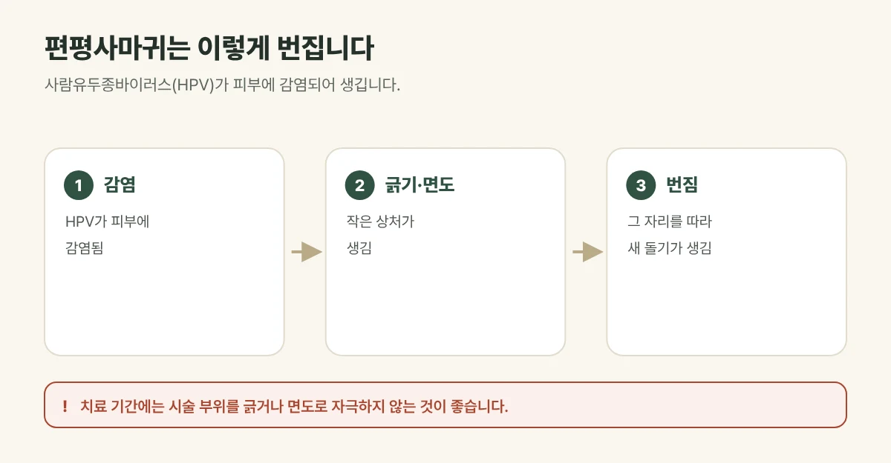

## 편평사마귀는 어떤 돌기인가요?

편평사마귀는 **사람유두종바이러스(HPV)**가 피부의 작은 상처로 들어가 생기는 사마귀의 한 종류입니다.

- **모양:** 지름 1~5mm의 납작하고 표면이 매끈한 돌기로, 살색이나 연갈색이라 잡티나 좁쌀로 착각하기 쉽습니다.
- **위치:** 이마, 볼, 턱 같은 얼굴과 손등, 팔에 잘 생깁니다.
- **누구에게:** 어린이와 젊은 성인에게 흔하며, 피곤하거나 면역력이 떨어지면 늘어나기도 합니다.

## 왜 면도하면 안 될까요?

편평사마귀는 바이러스가 있는 병변이라, **긁거나 면도할 때 생긴 작은 상처를 따라 바이러스가 옮겨 가** 새 사마귀가 줄지어 생길 수 있습니다. 얼굴에 생긴 사마귀를 무심코 만지거나 면도기로 밀면 수가 빠르게 늘어나는 이유입니다.

- 사마귀 부위를 손으로 뜯거나 긁지 마세요.
- 면도할 때는 사마귀가 있는 곳을 피하거나 아주 가볍게 해 주세요.
- 수건과 면도기는 따로 쓰는 것이 좋습니다.

<figure style="margin: 8px 0 24px">

<figcaption style="margin-top: 8px; font-size: 14px; color: #5d655f">긁거나 면도하면 그 자리를 따라 번질 수 있습니다. (갈창림 한의원 제작 설명 그림)</figcaption>
</figure>

## 편평사마귀 치료는 이렇게 합니다

편평사마귀는 저절로 없어지기도 하지만 시간이 오래 걸리고, 그 사이 번질 수 있습니다. 갈창림 한의원은 **유펄스 CO2 레이저**로 보이는 병변을 꼼꼼히 제거합니다.

- 마취 크림을 바른 뒤 진행합니다.
- 짧은 순간 높은 출력을 내는 울트라펄스 방식으로 주변 피부의 열 손상을 줄이며, 필요한 깊이만큼 제거합니다.
- 작은 사마귀가 숨어 있을 수 있어 꼼꼼히 확인하고, 시술 뒤 새로 생기는 곳이 없는지 경과를 확인합니다.
- 2mm 이하는 개당 5,000원이며, 더 큰 병변은 크기를 확인한 뒤 상담해 드립니다.

## 치료 후 관리

- 시술 당일에는 시술 부위에 물이 닿지 않게 하고, 다음 날부터 가볍게 세안해 주세요.
- 딱지와 재생 테이프는 억지로 떼지 마세요.
- 시술 부위를 긁거나 면도로 자극하지 마세요. 다른 곳으로 번질 수 있습니다.
- 붉은 자국이 옅어지는 동안 자외선 차단제를 꼭 발라 주세요.
- 충분히 자고 쉬면서 몸 상태를 관리하는 것도 도움이 됩니다.

## 자주 묻는 질문

Q. 편평사마귀는 다시 생기나요?
A. 바이러스로 생기는 병변이라 다시 생기거나 다른 부위로 번질 수 있습니다. 보이는 병변을 꼼꼼히 제거하고 경과를 확인하며, 시술 부위를 긁거나 면도로 자극하지 않는 것이 좋습니다.

Q. 다른 사람에게 옮나요?
A. 피부 접촉이나 수건, 면도기를 함께 쓰며 옮을 수 있습니다. 개인 물건은 따로 쓰는 것이 좋습니다.

Q. 잡티인 줄 알았는데 편평사마귀일 수도 있나요?
A. 편평사마귀는 납작하고 연갈색이라 잡티나 좁쌀과 헷갈리기 쉽습니다. 색소 치료로는 잘 없어지지 않으므로 진료로 먼저 구분하는 것이 좋습니다.
