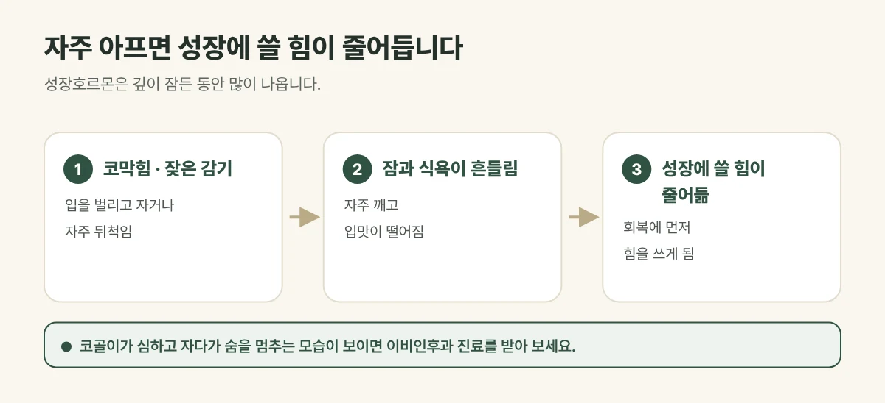

## 자주 아프면 성장에 쓸 힘이 줄어듭니다

아이의 몸은 먹고 자는 동안 얻은 힘으로 자랍니다. 감기와 비염을 달고 살면 이 힘을 **회복하는 데** 먼저 쓰게 됩니다. 특히 이런 변화가 겹치기 쉽습니다.

- **잠:** 코가 막혀 입을 벌리고 자거나 자주 뒤척이고 깹니다.
- **식욕:** 콧물과 기침으로 입맛이 떨어지고 덜 먹습니다.
- **컨디션:** 낮에 피곤해 활동량이 줄고 예민해지기 쉽습니다.

성장호르몬은 **깊이 잠든 동안** 많이 나오기 때문에, 코막힘으로 잠이 자주 깨지 않는지 살피는 것이 중요합니다.

<figure style="margin: 8px 0 24px">

<figcaption style="margin-top: 8px; font-size: 14px; color: #5d655f">비염이 키를 직접 줄이거나 늘리는 것은 아니며, 결과에는 개인차가 있습니다. (갈창림 한의원 제작 설명 그림)</figcaption>
</figure>

## 집에서 살펴보세요

- 입을 벌리고 자거나 코를 고는지
- 자다가 자주 뒤척이거나 깨는지
- 아침에 일어나기 힘들어하고 낮에 피곤해하는지
- 콧물과 코막힘 때문에 밥을 잘 안 먹는지

## 진료실에서 자주 보는 경우

어린이집에 다니기 시작한 뒤로 감기가 끊이지 않는다는 아이, 환절기마다 코막힘이 심해 밤새 뒤척인다는 아이가 많습니다. 키가 고민이라 오셨는데 진찰해 보면 코와 잠이 먼저 걸림돌인 경우가 흔합니다.

## 이렇게 도와드립니다

- **체질과 증상에 맞춘 한약:** 잦은 감기와 비염, 약한 소화와 잠까지 아이에게 필요한 방향으로 처방합니다.
- **생활 관리:** 잠드는 시간, 실내 습도, 식사와 간식 습관을 보호자와 함께 정합니다.
- **정기 확인:** 키와 체중을 재며 성장 속도를 기록하고 처방을 조절합니다.

## 이런 경우는 다른 진료가 필요합니다

- 코골이가 심하고 자다가 숨을 멈추는 모습이 보이는 경우 → 이비인후과
- 고열이 계속되거나 숨쉬기 힘들어하는 경우 → 소아청소년과
- 키가 또래보다 눈에 띄게 작거나 1년에 4cm도 자라지 않는 경우 → 소아청소년과 성장 검사

## 자주 묻는 질문

Q. 비염약을 먹고 있는데 한약을 함께 먹어도 되나요?
A. 드시는 약을 알려 주시면 함께 복용할 수 있는지 확인하고 복용 시간을 안내해 드립니다.

Q. 비염이 좋아지면 키가 크나요?
A. 비염이 키를 직접 줄이거나 늘리는 것은 아닙니다. 잠과 식욕, 컨디션을 회복해 아이가 가진 성장 가능성을 충분히 발휘하도록 돕는 것이 목표이며, 결과에는 개인차가 있습니다.
