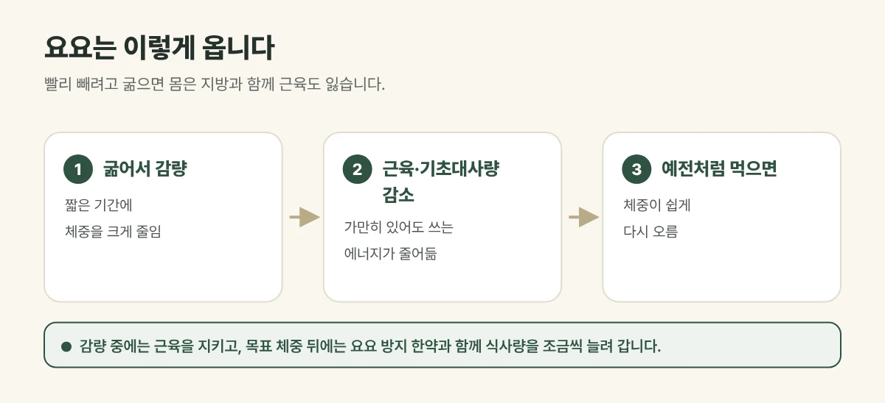

## 요요는 왜 올까요?

빨리 빼려고 굶으면 몸은 **지방과 함께 근육도** 잃습니다. 근육이 줄면 가만히 있어도 쓰는 에너지, 곧 **기초대사량**이 줄어듭니다. 이 상태에서 예전처럼 먹기 시작하면 쓰는 에너지보다 먹는 양이 많아져 체중이 쉽게 다시 오릅니다.

여기에 오래 참았던 식욕이 한꺼번에 터지면서 **폭식**이 겹치면 요요는 더 빨리 옵니다.

<figure style="margin: 8px 0 24px">

<figcaption style="margin-top: 8px; font-size: 14px; color: #5d655f">감량 후에는 식사량을 천천히 늘리며 유지 기간을 둡니다. 결과에는 개인차가 있습니다. (갈창림 한의원 제작 설명 그림)</figcaption>
</figure>

## 체중보다 체성분을 봐야 합니다

| 같은 3kg 감량이라도 | 근육을 지키며 감량 | 굶어서 감량 |
| --- | --- | --- |
| 줄어든 것 | 주로 체지방 | 체지방 + 근육 |
| 기초대사량 | 비교적 유지 | 줄어듦 |
| 감량 뒤 | 유지가 수월함 | 요요가 오기 쉬움 |

그래서 체중계 숫자만 보지 않고 **인바디로 체지방과 근육량**을 함께 확인합니다.

## 진료실에서 자주 보는 경우

원푸드 다이어트나 굶는 다이어트로 몇 번이나 뺐다가 다시 쪘다는 분이 많습니다. 반복할수록 빼기는 더 어렵고 찌는 것은 쉬워졌다고 말씀하십니다.

## 감량 후가 더 중요합니다

목표 체중에 이르렀다고 바로 예전 식사로 돌아가면 요요가 오기 쉽습니다.

- **요요 방지 한약**으로 식욕과 체중이 다시 흔들리지 않도록 돕습니다.
- 그와 함께 줄였던 식사량을 **서서히 늘려, 예전만큼 먹어도 체중이 유지되도록** 하는 것이 중요합니다.
- 식사 시간, 수면, 활동 습관이 유지되는지 함께 점검합니다.

## 생활 속에서 지켜 주세요

- 세 끼를 거르지 말고, 단백질과 채소를 챙겨 주세요.
- 일주일에 여러 번 근력 운동을 해 근육을 지켜 주세요.
- 일주일에 한두 번 같은 시간에 체중을 재며 변화를 확인해 주세요.

## 자주 묻는 질문

Q. 다이어트 한약을 끊으면 바로 살이 찌나요?
A. 갑자기 끊고 예전 식사로 돌아가면 체중이 오를 수 있어, 감량 후에는 요요 방지 한약과 함께 식사량을 천천히 늘려 갑니다.

Q. 유지 기간은 얼마나 필요한가요?
A. 감량한 양과 기간, 생활 습관에 따라 다릅니다. 체중과 체성분 변화를 보며 함께 정합니다.
