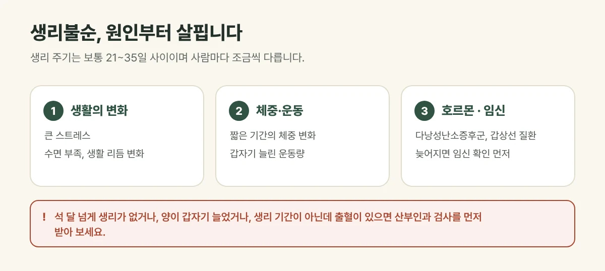

## 생리불순은 어떤 상태인가요?

생리 주기는 보통 **21~35일** 사이이며, 사람마다 조금씩 다릅니다. 이 범위를 자주 벗어나거나, 주기가 들쭉날쭉하거나, **생리를 건너뛰는** 경우를 생리불순이라고 합니다. 초경 뒤 몇 년, 그리고 폐경이 다가오는 시기에는 주기가 불규칙한 경우가 흔합니다.

## 흔한 원인

| 원인 | 이런 경우 |
| --- | --- |
| 생활의 변화 | 큰 스트레스, 수면 부족, 생활 리듬이 바뀐 경우 |
| 체중의 변화 | 짧은 기간 체중이 많이 줄거나 늘어난 경우 |
| 무리한 운동 | 갑자기 운동량을 크게 늘린 경우 |
| 호르몬 이상 | 다낭성난소증후군, 갑상선 질환 등 |
| 임신 | 생리가 늦어진다면 먼저 확인이 필요합니다 |

<figure style="margin: 8px 0 24px">

<figcaption style="margin-top: 8px; font-size: 14px; color: #5d655f">원인에 따라 살피는 방법이 달라 검사가 먼저 필요한 경우를 확인합니다. (갈창림 한의원 제작 설명 그림)</figcaption>
</figure>

## 산부인과 검사가 먼저 필요한 경우

- 임신 가능성이 있는 경우
- **석 달 넘게** 생리가 없는 경우
- 생리 양이 갑자기 많아졌거나 큰 덩어리가 자주 나오는 경우
- 생리 기간이 아닌데 출혈이 있는 경우
- 여드름이 심해지거나 털이 갑자기 늘어난 경우

이런 경우는 원인을 확인하는 검사가 먼저입니다. 검사 결과가 있다면 함께 보며 상담해 드립니다.

## 진료실에서 자주 보는 경우

취업 준비나 이직처럼 스트레스가 큰 시기에 생리가 두세 달씩 건너뛰었다는 분, 무리한 다이어트 뒤로 주기가 흔들렸다는 분이 많습니다. 손발과 아랫배가 차고 생리통이 함께 있는 경우도 흔합니다.

## 한의원에서는 이렇게 살핍니다

검사에서 큰 이상이 없다면, 생리 주기와 양, 생리통, 냉증, 잠과 스트레스, 체중 변화를 함께 여쭤보고 몸의 균형을 살핍니다.

- **한약:** 체질과 지금의 상태에 맞춰 순환을 돕고 몸을 따뜻하게 하는 방향으로 처방합니다.
- **침·뜸:** 아랫배에 따뜻한 자극을 주어 냉증과 생리통 관리를 돕습니다.
- 산부인과 치료를 받고 있다면 함께 진행할 수 있는지 확인해 안내합니다.

## 생활 속 관리

- 생리 시작일을 달력이나 앱에 기록해 주세요. 진료에 큰 도움이 됩니다.
- 급하게 굶는 다이어트는 피해 주세요.
- 잠드는 시간을 일정하게 지키고, 몸을 차게 하지 않도록 해 주세요.

## 자주 묻는 질문

Q. 생리가 한 번 건너뛰었는데 병원에 가야 하나요?
A. 임신 가능성이 있다면 먼저 확인이 필요합니다. 그렇지 않고 한 번만 늦어졌다면 기록하며 지켜볼 수 있지만, 석 달 넘게 없거나 반복된다면 검사를 받아 보세요.

Q. 생리 중에도 치료를 받을 수 있나요?
A. 네. 생리 중의 몸 상태에 맞춰 치료를 조절해 진행합니다.
