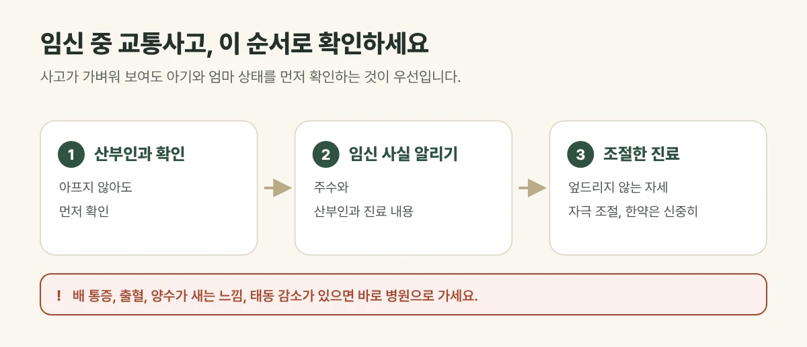

## 산부인과 확인이 먼저입니다

임신 중에는 사고가 가벼워 보여도, 안전띠나 핸들에 배가 눌리거나 몸이 크게 흔들렸다면 **산부인과에서 아기와 엄마 상태를 먼저 확인**하는 것이 우선입니다. 겉으로 아프지 않아도 확인이 필요합니다.

## 이런 증상은 바로 병원으로 가세요

- 배가 아프거나 단단하게 뭉치는 느낌이 계속되는 경우
- 질 출혈이 있거나 양수가 새는 느낌이 있는 경우
- 태동이 평소보다 줄었다고 느끼는 경우
- 어지럽고 기운이 빠지는 경우

<figure style="margin: 8px 0 24px">

<figcaption style="margin-top: 8px; font-size: 14px; color: #5d655f">진찰 결과에 따라 치료보다 산부인과 경과 관찰이 먼저라고 안내드리기도 합니다. (갈창림 한의원 제작 설명 그림)</figcaption>
</figure>

## 진료실에서 자주 보는 경우

산부인과에서 아기는 괜찮다는 이야기를 들었는데, 며칠 지나 목과 허리가 뻐근해지며 약을 먹기도 걱정된다며 오시는 분이 있습니다. 임신 중에는 배가 나오며 허리에 부담이 커 사고 뒤 통증이 더 불편하게 느껴지기도 합니다.

## 한의원 진료에서는 이렇게 조절합니다

산부인과 확인을 마친 뒤 통증이 남는다면, **임신 사실과 주수, 산부인과 진료 내용**을 먼저 알려 주세요.

- **자세:** 엎드리지 않고 옆으로 눕거나 앉은 자세로 진료합니다.
- **자극:** 부위와 강도를 조절해 무리한 자극을 피합니다.
- **한약:** 임신 중에는 꼭 필요한 경우에 한해 신중하게 판단합니다.
- 진찰 결과에 따라 치료보다 산부인과 경과 관찰이 먼저라고 안내드리기도 합니다.

## 접수와 보험

임신 중이어도 교통사고 진료 접수는 같습니다. 보험사 접수번호와 신분증을 가지고 오시면 자동차보험으로 진료합니다. 보험 처리 범위는 담당 보험사에 확인해 주세요.

## 자주 묻는 질문

Q. 임신 중에 침 치료를 받아도 되나요?
A. 임신 주수와 상태를 확인한 뒤 부위와 자극을 조절해 진행합니다. 산부인과 진료를 먼저 받으시고, 진료 때 임신 사실을 꼭 알려 주세요.

Q. 산부인과에서 괜찮다고 했는데 허리가 계속 아파요.
A. 사고로 놀란 근육과 인대 때문일 수 있습니다. 진찰 뒤 임신 중에 맞는 방법으로 치료 여부를 안내해 드립니다.
