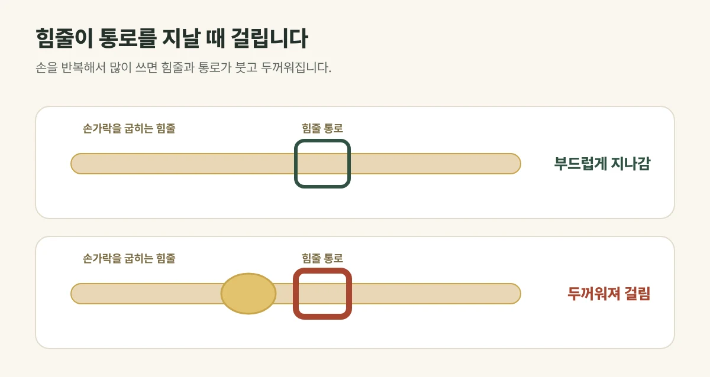

## 힘줄이 지나는 통로가 좁아진 상태입니다

손가락을 굽히는 힘줄은 손바닥 쪽의 좁은 **통로(활차)** 를 지나갑니다. 손을 반복해서 많이 쓰면 힘줄과 통로가 붓고 두꺼워져, 힘줄이 통로를 지날 때 **걸렸다가 딸깍 하고 넘어가는** 증상이 생깁니다. 총의 방아쇠를 당기는 모습과 비슷하다고 해서 방아쇠수지라고 부릅니다.

<figure style="margin: 8px 0 24px">

<figcaption style="margin-top: 8px; font-size: 14px; color: #5d655f">손을 쉬게 하고 꽉 쥐는 동작을 줄이는 것이 기본입니다. (갈창림 한의원 제작 설명 그림)</figcaption>
</figure>

## 이런 증상이 있습니다

- 손가락을 펼 때 걸렸다가 딸깍 펴짐
- 손바닥 쪽 손가락 뿌리를 누르면 아프고 작은 멍울이 만져짐
- 아침에 더 뻣뻣하고, 움직이다 보면 조금 나아짐
- 엄지, 약지, 중지에 잘 생김

## 진료실에서 자주 보는 경우

김장이나 명절 음식처럼 손을 많이 쓴 뒤 시작됐다는 분, 미용·요리처럼 가위나 칼을 오래 쥐는 일을 하는 분이 많습니다. 휴대전화를 오래 쥐고 엄지로 화면을 넘기다가 엄지에 생긴 경우도 있습니다. 당뇨가 있으면 더 잘 생기기도 합니다.

## 이렇게 관리합니다

- **손을 쉬게 해 주세요.** 꽉 쥐는 동작, 비틀어 짜는 동작을 줄여 주세요.
- 아침에 뻣뻣할 때는 따뜻한 물에 손을 담그고 천천히 움직여 주세요.
- 걸린 손가락을 억지로 꺾어 펴지 마세요.

## 이렇게 치료합니다

힘줄 주변의 붓기와 통증을 줄이기 위해 **침·약침, 뜸**과 물리치료를 상태에 맞게 조합합니다. 손목과 팔꿈치까지 이어진 긴장도 함께 살펴봅니다.

## 다른 병원 진료가 필요한 경우

- 손가락이 굽은 채 아예 펴지지 않는 경우
- 붉게 붓고 열이 나는 경우
- 몇 달 치료해도 걸림이 계속되는 경우

이런 경우에는 주사나 수술처럼 다른 치료가 필요할 수 있어 정형외과 진료를 권합니다.

## 자주 묻는 질문

Q. 그냥 두면 낫나요?
A. 손 사용을 줄이면 나아지는 경우도 있지만, 계속 무리하면 걸림이 심해질 수 있습니다. 아침 뻣뻣함과 걸림이 이어진다면 진료를 받아 보세요.

Q. 손가락을 자주 꺾어서 펴 주면 도움이 되나요?
A. 억지로 꺾으면 힘줄에 자극이 더해질 수 있습니다. 따뜻하게 한 뒤 부드럽게 움직이는 정도가 좋습니다.
