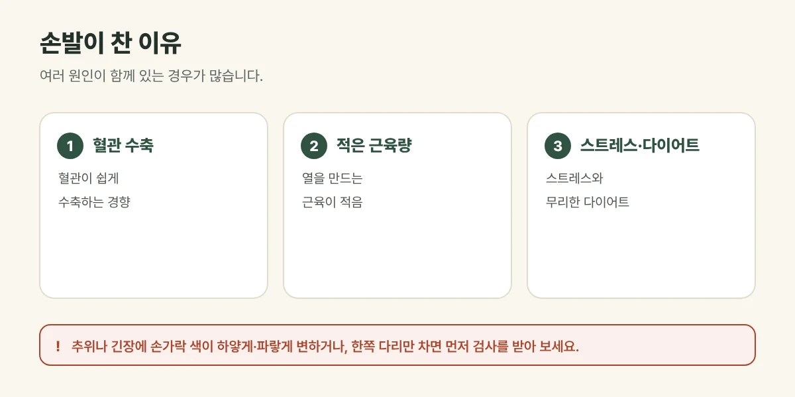

## 수족냉증은 어떤 상태인가요?

수족냉증은 다른 사람은 춥지 않은 온도에서도 **손과 발이 유난히 차고 시려** 일상이 불편한 상태를 말합니다. 손발뿐 아니라 아랫배, 무릎이 함께 찬 경우도 많고, 여성에게 더 흔합니다. 생리통이나 소화불량, 잦은 피로와 함께 나타나기도 합니다.

## 왜 손발이 찰까요?

- **혈관이 쉽게 수축:** 추위나 긴장에 손발 끝의 혈관이 쉽게 좁아져 피가 덜 갑니다.
- **적은 근육량:** 근육은 몸의 열을 만드는 곳이라 근육이 적으면 몸이 쉽게 식습니다.
- **스트레스와 긴장:** 긴장하면 자율신경이 혈관을 수축시켜 손발이 차가워집니다.
- **무리한 다이어트, 불규칙한 식사:** 열을 만들 에너지가 부족해집니다.
- **흡연, 꽉 끼는 옷과 신발:** 혈액순환을 방해합니다.

<figure style="margin: 8px 0 24px">

<figcaption style="margin-top: 8px; font-size: 14px; color: #5d655f">다른 사람은 춥지 않은 온도에서도 손발이 유난히 찬 상태입니다. (갈창림 한의원 제작 설명 그림)</figcaption>
</figure>

## 이런 증상이 나타납니다

- 손발이 차고 시리며, 양말을 신어야 잠들 수 있음
- 손발이 저리거나 감각이 둔함
- 아랫배와 무릎이 함께 차가움
- 추위를 많이 타고, 겨울이 유독 힘듦

## 진료실에서 자주 보는 경우

한여름에도 손발이 차서 양말을 신고 잔다고 오시는 분이 많습니다. 아랫배가 차고 소화가 잘 안 된다고 함께 말씀하시는 경우가 흔합니다.

## 이런 경우는 먼저 검사를 받아 보세요

- 추위나 긴장에 **손가락 색이 하얗게, 파랗게 변했다가 붉어지는** 경우 — 레이노 현상일 수 있어 류마티스 질환 등의 검사가 필요합니다.
- **한쪽 다리만** 차고, 걸을 때 종아리가 아파 쉬어야 하는 경우 — 말초혈관 질환 검사가 필요할 수 있습니다.
- 추위를 많이 타면서 붓고, 피곤하고, 체중이 느는 경우 — 갑상선 기능 검사를 받아 보세요.
- 어지럼과 숨참, 창백함이 함께 있는 경우 — 빈혈을 확인해 보세요.
- 당뇨가 있으면서 발이 저리고 감각이 떨어지는 경우 — 당뇨 신경병증을 확인해야 합니다.
- 손발 끝에 상처가 잘 낫지 않거나 색이 검게 변하는 경우 — 바로 진료를 받아 주세요.

## 갈창림 한의원의 수족냉증 치료

1. **침:** 손발과 몸의 순환과 관련된 자리에 침을 놓아 혈액순환을 돕습니다.
2. **뜸:** 아랫배와 손발에 따뜻한 자극을 주어 차가워진 몸을 데우고 순환을 돕습니다.
3. **부항:** 뭉친 어깨와 등, 허리의 긴장을 풀어 순환을 돕습니다.
4. **한약:** 몸이 전체적으로 찬지, 긴장과 스트레스로 손발만 찬지, 기운이 떨어졌는지, 소화가 약한지 등 몸 상태를 살펴 처방합니다.

## 생활 속 수족냉증 관리

- **근육 키우기:** 걷기, 계단 오르기, 스쿼트처럼 다리 근육을 쓰는 운동을 꾸준히 해 주세요.
- **따뜻하게 입기:** 목, 손목, 발목을 따뜻하게 하고, 꽉 끼는 옷과 신발은 피해 주세요.
- **족욕과 반신욕:** 따뜻한 물(약 40도)에 10~15분 정도가 좋습니다. 감각이 둔한 경우 너무 뜨거운 물은 화상을 입을 수 있어 주의해 주세요.
- 식사를 거르지 말고, 찬 음료보다 따뜻한 음료를 드세요.
- 담배는 혈관을 수축시키니 끊는 것이 좋습니다.

## 자주 묻는 질문

Q. 핫팩이나 전기장판을 계속 써도 되나요?
A. 잠깐 따뜻하게 하는 데는 도움이 되지만, 한곳에 오래 대고 있으면 낮은 온도에서도 화상을 입을 수 있습니다. 특히 감각이 둔한 손발에는 직접 오래 대지 마세요.

Q. 여름에도 손발이 차가워요.
A. 에어컨 바람과 찬 음식, 얇은 옷차림 때문에 여름에 더 심해지는 분도 많습니다. 계절과 상관없이 손발이 차다면 원인을 함께 살펴보는 것이 좋습니다.

Q. 얼마나 치료받아야 하나요?
A. 증상이 이어진 기간과 원인에 따라 다릅니다. 진찰 후 예상 기간을 안내해 드리며, 결과에는 개인차가 있습니다.
