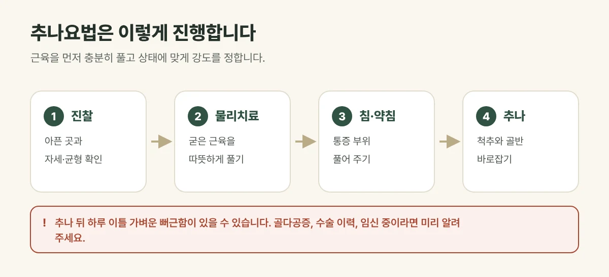

## 추나요법은 어떤 치료인가요?

추나요법은 한의사가 **손으로** 굳은 근육과 관절을 풀고, 틀어진 척추와 골반의 균형을 바로잡는 치료입니다. 근육을 부드럽게 늘려 주는 것부터 관절을 바로잡는 것까지, 상태에 맞게 강도와 방법을 정합니다.

## 건강보험이 적용됩니다

목·허리 통증, 디스크, 척추관협착증처럼 **근골격계 질환**으로 진찰을 받으면 추나요법에 건강보험이 적용됩니다.

| 알아 둘 것 | 내용 |
| --- | --- |
| 대상 | 근골격계 질환으로 한의사가 필요하다고 판단한 경우 |
| 횟수 | 1년에 20회까지 |
| 본인부담 | 단순추나, 복잡추나 등 추나 종류에 따라 비율이 다릅니다 |
| 교통사고 | 건강보험이 아닌 자동차보험으로 처리합니다 |

보험 기준은 바뀔 수 있어, 지금 받으실 추나의 본인부담은 내원하시면 정확히 안내해 드립니다.

## 진료실에서 자주 보는 경우

추나는 비싼 비보험 치료인 줄 알고 망설였다는 분이 많습니다. 다른 한의원에서 올해 추나를 받으셨다면 남은 횟수에 영향을 줄 수 있어, 미리 말씀해 주시면 안내에 도움이 됩니다.

## 이렇게 진행합니다

1. 아픈 곳과 자세, 몸의 균형을 진찰합니다.
2. 물리치료로 굳은 근육을 먼저 따뜻하게 풀어 줍니다.
3. 침·약침으로 통증 부위를 풀어 줍니다.
4. 근육이 충분히 풀린 상태에서 추나로 척추와 골반을 바로잡습니다.

<figure style="margin: 8px 0 24px">

<figcaption style="margin-top: 8px; font-size: 14px; color: #5d655f">건강보험 추나는 1년에 20회까지 받을 수 있고, 본인부담은 단순추나·복잡추나 등 추나 종류에 따라 다릅니다. (갈창림 한의원 제작 설명 그림)</figcaption>
</figure>

## 추나 전후 알아 두세요

- 추나 뒤 하루 이틀 **가벼운 뻐근함이나 근육통**이 있을 수 있습니다.
- 골다공증이 심하거나, 골절·수술 이력이 있거나, 임신 중이라면 미리 알려 주세요. 방법을 조절하거나 다른 치료를 권할 수 있습니다.
- 다리 힘이 빠지거나 대소변 이상이 있다면 추나보다 검사가 먼저입니다.

## 자주 묻는 질문

Q. 추나는 아프지 않나요?
A. 근육을 먼저 충분히 풀고 상태에 맞게 강도를 조절하므로 대부분 크게 아프지 않습니다. 불편하면 바로 말씀해 주세요.

Q. 추나만 받을 수도 있나요?
A. 상태에 따라 가능하지만, 침·약침과 물리치료를 함께 하면 근육이 충분히 풀려 추나가 더 편해지는 경우가 많습니다.
