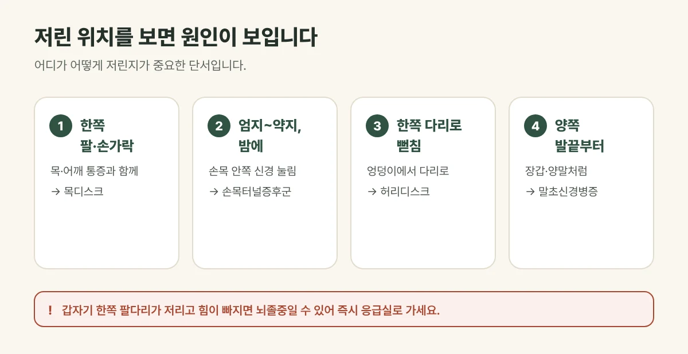

## 저린 위치를 보면 원인이 보입니다

| 저린 곳 | 생각해 볼 원인 |
| --- | --- |
| 한쪽 팔과 손가락, 목·어깨 통증과 함께 | 목디스크 |
| 엄지~약지, 밤에 심해짐 | 손목터널증후군 |
| 엉덩이에서 한쪽 다리로 뻗침 | 허리디스크 |
| 걸으면 양쪽 다리가 저려 쉬어야 함 | 척추관협착증 |
| **양쪽 발끝부터 장갑·양말처럼** 저림 | 당뇨 등으로 인한 말초신경병증 |
| 손발이 차고 하얗게·파랗게 변함 | 혈액순환 문제, 수족냉증 |

## 진료실에서 자주 보는 경우

혈액순환 문제인 줄 알았는데 한쪽 손이나 특정 손가락만 저리다고 오시는 분이 많습니다. 저린 위치를 여쭤 보면 목·허리나 손목에서 신경이 눌린 경우를 함께 살펴야 할 때가 많습니다.

<figure style="margin: 8px 0 24px">

<figcaption style="margin-top: 8px; font-size: 14px; color: #5d655f">손발 저림은 혈액순환보다 신경이 눌리거나 약해져 생기는 경우가 많습니다. (갈창림 한의원 제작 설명 그림)</figcaption>
</figure>

## 이런 경우는 바로 응급실로 가세요

- **갑자기 한쪽 팔다리가 저리면서 힘이 빠지는** 경우
- 말이 어눌해지거나 얼굴 한쪽이 처진 경우
- 갑자기 생긴 다리 힘 빠짐과 함께 대소변을 보기 어려운 경우

뇌졸중이나 신경이 크게 눌린 상태일 수 있어 지체 없이 응급 진료를 받아야 합니다.

## 이런 경우는 원인 검사를 먼저 받아 보세요

- 저림이 몇 주 이상 계속되거나 점점 넓어지는 경우
- 당뇨가 있거나, 갈증·잦은 소변·체중 감소가 함께 있는 경우
- 손발 근육이 마르거나 힘이 빠지는 경우

혈당, 비타민 B12, 갑상선 같은 혈액 검사나 신경 검사가 필요할 수 있습니다.

## 갈창림 한의원의 손발 저림 치료

원인을 확인한 뒤, 신경이 지나는 길의 긴장과 순환을 함께 살핍니다.

1. **침:** 목과 허리, 손목처럼 신경이 지나는 길의 굳은 근육과 관련된 자리에 침을 놓아 긴장을 풉니다.
2. **약침:** 신경 주변의 염증과 통증을 가라앉히는 데 도움을 줍니다.
3. **뜸:** 차가운 손발과 몸에 따뜻한 자극을 주어 순환을 돕습니다.
4. **한약:** 순환과 피로 등 몸 상태를 살펴 처방합니다.

## 생활 속 관리

- 같은 자세로 오래 있지 말고, 목과 손목, 허리를 자주 풀어 주세요.
- 손발을 따뜻하게 유지하고, 꽉 끼는 신발과 옷은 피해 주세요.
- 당뇨가 있다면 혈당 관리가 저림 관리의 기본입니다. 발에 상처가 나지 않았는지 매일 살펴 주세요.
- 금연과 절주가 신경과 혈관 건강에 도움이 됩니다.

## 자주 묻는 질문

Q. 자고 일어나면 손이 저린데 괜찮을까요?
A. 팔을 베고 자거나 손목이 꺾인 채 자면 잠깐 저릴 수 있습니다. 하지만 매일 밤 저려서 잠을 깬다면 손목터널증후군을 살펴봐야 합니다.

Q. 혈액순환제를 먹으면 저림이 좋아지나요?
A. 저림의 원인이 혈액순환이 아니라 신경이 눌리거나 약해진 것이라면 효과를 보기 어렵습니다. 원인을 먼저 확인하는 것이 중요합니다.

Q. 당뇨로 발이 저린데 치료받을 수 있나요?
A. 네. 혈당 관리를 함께하면서 저림과 차가움, 불편함을 줄이도록 관리합니다. 복용 중인 약을 알려 주세요.
