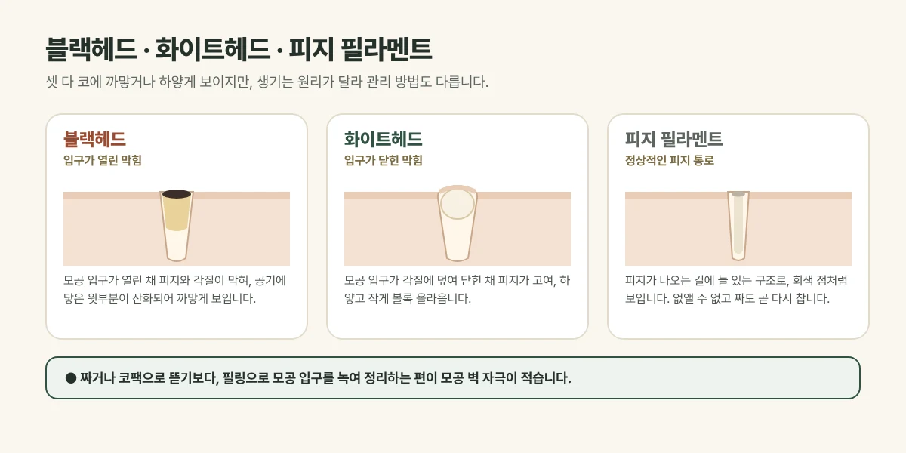

## 코의 까만 점, 모두 블랙헤드일까요?

경산·하양에서 피부 진료를 하다 보면 "코에 까만 점이 아무리 짜도 다시 생긴다"는 이야기를 정말 자주 듣습니다. 그런데 코에 보이는 점이 모두 같은 것은 아닙니다. 크게 **블랙헤드, 화이트헤드, 피지 필라멘트** 세 가지로 나뉘고, 무엇이냐에 따라 관리 목표가 달라집니다.

<figure style="margin: 8px 0 24px">

<figcaption style="margin-top: 8px; font-size: 14px; color: #5d655f">생기는 원리가 달라 관리 방법도 다릅니다. (갈창림 한의원 제작 설명 그림)</figcaption>
</figure>

- **블랙헤드:** 모공 입구가 열린 채 피지와 각질이 막혀 있고, 공기에 닿은 윗부분이 산화되어 까맣게 보입니다. 때가 낀 것이 아니라 산화된 피지입니다.
- **화이트헤드:** 모공 입구가 각질에 덮여 닫힌 상태라 피지가 안에 고여 하얗고 작게 볼록 올라옵니다. 염증이 생기면 여드름으로 이어지기도 합니다.
- **피지 필라멘트:** 피지가 피부 밖으로 나오는 길에 원래 있는 구조로, 코 전체에 고르게 퍼진 옅은 회색 점처럼 보입니다. **정상적인 구조라 없앨 수는 없고**, 짜거나 코팩으로 뜯어도 며칠이면 다시 찹니다. 목표는 '없애기'가 아니라 '덜 도드라지게 하기'입니다.

## 짜고, 뜯고, 문지르면 왜 안 좋을까요?

손으로 짜거나 코팩으로 뜯어내면 그 순간은 깨끗해 보이지만, 모공 벽이 반복해서 늘어나고 자극을 받아 **모공이 더 넓어 보이거나 붉어지고 염증이 생길 수** 있습니다. 알갱이 스크럽으로 세게 문지르는 것도 피부 표면에 작은 상처를 내기 쉽습니다.

필링은 막힌 것을 밖에서 밀어내는 대신 **필링제로 녹여서 정리**하는 방식이라, 모공 벽에 주는 물리적 자극이 적습니다.

## 집에서 쓰는 각질 제거제와 무엇이 다를까요?

요즘은 AHA·BHA가 든 토너나 패드를 집에서 쓰시는 분도 많습니다. 병원 필링과의 차이는 크게 세 가지입니다.

| 구분 | 집에서 쓰는 제품 | 한의원 필링 |
| --- | --- | --- |
| 농도·세기 | 매일 써도 되도록 낮게 만들어짐 | 피부 상태에 맞춰 필링제를 고름 |
| 시간 관리 | 바르고 그대로 둠 | 정해진 시간 동안 반응을 보며 두었다가 닦아 냄 |
| 피부 확인 | 스스로 판단 | 시술 전 피부 분석과 진찰로 예민도·염증 확인 |

집에서 쓰는 제품은 **유지 관리**에, 병원 필링은 **쌓인 각질과 막힌 모공을 한 번 정리**하는 데 알맞습니다. 다만 집에서 각질 제거를 매일 강하게 하면서 필링까지 받으면 피부 장벽이 약해질 수 있어, 필링 전후 며칠은 집에서의 각질 제거를 쉬도록 안내해 드립니다.

## 세 가지 필링, 어떻게 고를까요?

| 필링 | 이런 성분 | 주로 이런 피부에 |
| --- | --- | --- |
| AHA+BHA 필링 | 표면 각질을 녹이는 AHA, 모공 속 피지를 녹이는 BHA(살리실산) | 블랙헤드, 피지가 많은 지성 피부 |
| 밀크필 | 락틱애씨드(AHA)·살리실산(BHA) 같은 약산성 성분에 밀크 단백질·알로에·판테놀 같은 진정·보습 성분 | 피지·블랙헤드가 있으면서 예민한 피부, 들뜬 각질 |
| 레티놀필 | 비타민 A 유도체인 레티놀 | 거칠고 칙칙한 피부결, 각질이 두꺼운 피부 |

- **AHA와 BHA:** AHA는 물에 잘 녹아 피부 표면의 각질에, BHA는 기름에 잘 녹아 모공 속 피지에 잘 작용합니다. 두 성분을 함께 쓰면 표면과 모공 입구를 한 번에 정리할 수 있습니다.
- **밀크필:** 피지를 녹이는 성분이 들어 있어 지성 피부에도 쓸 수 있으면서, 진정·보습 성분이 함께 들어 있어 자극이 비교적 적습니다. 필링을 처음 받거나 피부가 쉽게 붉어지는 분께 먼저 권하는 경우가 많습니다.
- **레티놀필:** 피부가 새로 바뀌는 흐름을 도와, 시술 뒤 며칠에 걸쳐 각질이 눈에 띄게 벗겨지며 피부결과 톤이 정돈됩니다. 각질이 일어나는 기간이 있어 중요한 약속이 없는 주간에 받는 것이 좋습니다.

갈창림 한의원의 필링 종류별 시술 정보와 가격은 [피지·각질 진료 안내](peeling.html)에서 확인하실 수 있습니다.

## 톤까지 함께 고민이라면, GD토닝

피지·블랙헤드와 함께 칙칙한 피부톤이나 잡티가 고민이라면 **GD토닝**을 고려합니다. 골드 입자와 다이아몬드 결정 성분, 트라넥사믹애씨드·알부틴·나이아신아마이드가 담긴 앰플을 얼굴에 바른 뒤 큐스위치 Nd:YAG 레이저(큐마스터플러스)로 토닝합니다. 레이저 에너지를 받은 골드 입자가 열을 내며 각질층을 정리하고, 토닝이 피부톤을 관리해 **필링과 토닝을 한 번에** 받는 방식입니다.

## 언제, 얼마나 자주 받으면 좋을까요?

- **간격:** 보통 **2~4주 간격**으로 진행합니다. 피부가 회복할 시간을 두어야 다음 필링의 자극도 줄어듭니다.
- **횟수:** 한 번으로 끝내기보다 몇 차례 받으며 변화를 확인하고, 이후에는 피부 상태에 따라 간격을 늘려 유지합니다. 필요한 횟수는 개인차가 있습니다.
- **계절:** 여름에는 피지가 늘어 블랙헤드가 눈에 띄고, 가을·겨울에는 건조해 각질이 들뜹니다. 계절에 따라 고민이 달라지는 만큼 **필링 종류를 바꿔 가며** 관리합니다. 자외선이 강한 시기에는 자외선 차단을 더 꼼꼼히 해야 합니다.
- **다른 시술과 함께:** 여드름 압출, 레이저토닝, 스킨부스터 등과 함께 계획할 수 있습니다. 같은 날 여러 시술을 겹치면 자극이 커질 수 있어, 순서와 간격은 피부 상태를 보고 정합니다.

## 남성분이라면, 면도와의 간격

남성은 피지 분비가 많아 코와 턱의 블랙헤드로 오시는 경우가 많습니다. 면도 직후의 피부는 작은 자극이 남아 있어 필링제가 더 따갑게 느껴질 수 있습니다. **시술 당일 면도는 미리 해 두거나 다음 날로 미루고**, 시술 후 하루 이틀은 순한 면도 제품을 쓰시는 것이 좋습니다.

## 시술 전에 알려 주세요

- 임신 중이거나 계획 중인 경우, 수유 중인 경우 (레티놀필 등 일부 성분은 피합니다)
- 레티놀·레티노이드 연고나 각질 제거 제품을 쓰고 있는 경우
- 아스피린(살리실산) 알레르기가 있는 경우
- 시술 부위에 상처, 입술 물집(헤르페스), 심한 염증이 있는 경우

## 시술 후 관리와 홈케어

- 일어나는 각질은 억지로 뜯지 말고 자연스럽게 떨어지도록 두세요.
- 보습제를 충분히 바르고, 자외선 차단제를 꼼꼼히 발라 주세요.
- 시술 후 며칠간은 스크럽과 각질 제거 제품, 레티놀 제품을 쉬어 주세요.
- **세안:** 뜨거운 물보다 미지근한 물로, 거품을 충분히 내어 손으로 부드럽게 씻습니다. 피지가 많다고 하루에 여러 번 세게 씻으면 오히려 피부가 건조해지고 피지가 더 나올 수 있습니다.
- **화장품:** 피지가 많은 피부라면 모공을 막기 쉬운 무거운 오일 제품보다 가벼운 보습제가 좋습니다.

시술 중 따끔함이나 화끈함, 시술 뒤 가벼운 붉은 기와 각질은 흔한 반응으로 대부분 자연스럽게 가라앉습니다. 드물게 색소침착이나 접촉피부염이 생길 수 있어, 가렵거나 붓는 등 이상이 있으면 바로 연락해 주세요.

## 진료실에서 자주 보는 경우

코의 회색 점을 블랙헤드로 생각하고 매일 코팩을 붙이다가, 모공이 더 커 보이고 붉어져서 오시는 분이 많습니다. 확인해 보면 대부분 정상 구조인 피지 필라멘트인 경우가 많습니다. 이럴 때는 없애려고 애쓰기보다, 필링으로 모공 입구를 정리하고 **세안과 보습 습관을 바꾸는 것**이 오래가는 방법이라고 말씀드립니다. 실제로 짜는 습관만 줄여도 붉은 기와 넓어 보이는 모공이 한결 나아지는 경우가 많습니다.

## 자주 묻는 질문

Q. 필링을 받으면 피부가 얇아지나요?
A. 피부 상태에 맞춰 필링제와 간격을 정해 진행하므로 일반적으로 걱정하실 정도는 아닙니다. 다만 짧은 간격으로 지나치게 반복하거나 집에서 각질 제거를 함께 강하게 하지 않도록 안내해 드립니다.

Q. 지성 피부인데 밀크필도 괜찮나요?
A. 네. 밀크필에도 피지를 녹이는 살리실산(BHA)이 들어 있어 피지와 블랙헤드 관리에 쓸 수 있고, 자극이 비교적 적어 피지가 많으면서 예민한 피부에 잘 맞습니다.

Q. 각질이 안 일어나면 효과가 없는 건가요?
A. 아닙니다. AHA+BHA 필링이나 밀크필은 눈에 띄는 각질 없이 지나가는 경우도 많습니다. 각질이 일어나는 정도와 효과가 꼭 비례하지는 않으며, 레티놀필은 각질이 비교적 눈에 띄게 일어나는 편입니다.

Q. 피지 필라멘트도 필링으로 없어지나요?
A. 피지 필라멘트는 정상 구조라 없앨 수는 없습니다. 필링으로 모공 입구의 각질과 피지를 정리하면 덜 도드라져 보이게 하는 데 도움이 됩니다.
