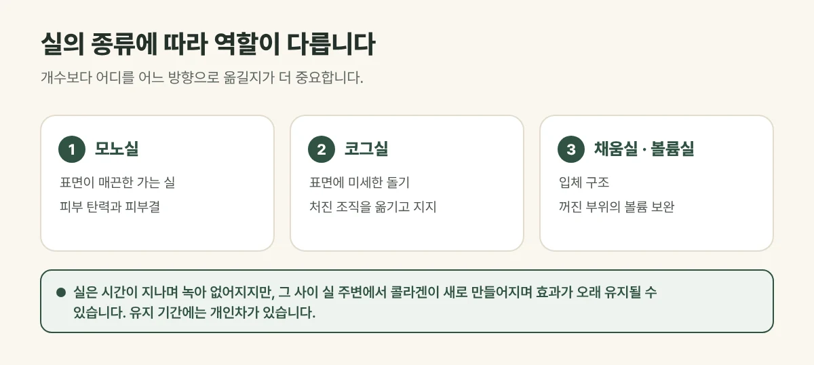

## 실의 종류에 따라 역할이 다릅니다

| 실 | 생김새 | 주된 역할 |
| --- | --- | --- |
| 모노실 | 표면이 매끈한 가는 실 | 피부 탄력과 피부결 개선 |
| 코그실 | 표면에 미세한 돌기 | 처진 조직을 원하는 방향으로 옮기고 지지 |
| 채움실 · 볼륨실 | 스프링·꼬임 같은 입체 구조 | 꺼진 부위의 볼륨 보완 |

갈창림 한의원은 처짐 정도, 피부 두께, 지방 분포, 볼륨이 줄어든 정도를 확인한 뒤 실의 종류와 넣는 방향을 사람마다 다르게 정합니다.

<figure style="margin: 8px 0 24px">

<figcaption style="margin-top: 8px; font-size: 14px; color: #5d655f">실의 종류와 넣는 방향은 처짐 정도와 피부 두께, 지방 분포에 따라 정합니다. (갈창림 한의원 제작 설명 그림)</figcaption>
</figure>

## 얼마나 유지될까요?

실은 시간이 지나며 몸속에서 **녹아 없어집니다.** 하지만 실이 녹는 동안 **실 주변에서 콜라겐이 새로 만들어지면서**, 실이 녹아 없어진 뒤에도 **효과가 오래 유지될 수 있습니다.** 보통 1회 시술 후 1년 이후에 상태를 다시 보며, 다음과 같은 요인에 따라 개인차가 큽니다.

- 실의 종류와 개수, 넣은 방향
- 피부 두께와 지방량, 처짐 정도
- 표정 습관, 체중 변화, 자외선과 흡연

## 진료실에서 자주 보는 경우

팔자와 턱선이 무거워 보여 실리프팅을 알아보시다가, 실 개수를 많이 넣을수록 오래간다고 생각하고 오시는 분이 많습니다. 실제로는 개수보다 **어디를 어느 방향으로 옮길지**가 더 중요해, 처짐의 방향을 먼저 함께 살펴봅니다.

## 시술 후 주의사항

- 약 1~2주는 입을 크게 벌리거나 얼굴을 세게 문지르지 마세요.
- 엎드려 자거나 얼굴을 강하게 누르는 자세를 피해 주세요.
- 며칠간 음주, 과격한 운동, 사우나를 피해 주세요.

부기와 멍, 당기는 느낌은 흔하며 보통 1~2주에 걸쳐 가라앉습니다. 드물게 실 돌출, 감염, 감각 이상이 생길 수 있어, 통증과 붓기가 점점 심해지면 바로 연락해 주세요.

## 자주 묻는 질문

Q. 심하게 처진 경우에도 실리프팅으로 될까요?
A. 처짐이 매우 심하거나 늘어진 피부가 많으면 실리프팅만으로는 원하는 만큼 개선하기 어려울 수 있습니다. 상담 때 기대할 수 있는 범위를 솔직하게 말씀드립니다.

Q. 장비 리프팅과 함께 받아도 되나요?
A. 네. 피부 탄력은 고주파·초음파 리프팅으로, 뚜렷한 처짐은 실리프팅으로 나누어 함께 계획하는 경우가 많습니다.
