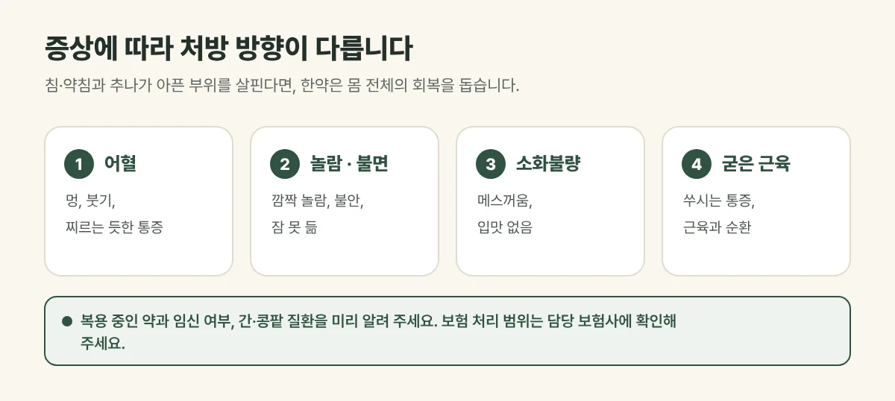

## 왜 한약을 함께 쓸까요?

교통사고는 짧은 순간 **몸 전체에 충격**이 전해지는 사고입니다. 그래서 부딪힌 곳의 통증 말고도 몸 안과 마음에 불편함이 함께 나타나기 쉽습니다. 침·약침과 추나가 아픈 부위를 직접 살핀다면, 한약은 **몸 전체의 회복**을 돕는 역할을 합니다.

## 증상에 따라 처방 방향이 다릅니다

| 사고 뒤 나타나는 증상 | 처방의 방향 |
| --- | --- |
| 멍, 붓기, 찌르는 듯한 통증 | 어혈을 풀어 줌 |
| 깜짝깜짝 놀람, 불안, 잠 못 듦 | 놀란 마음과 몸을 안정시킴 |
| 메스꺼움, 소화불량, 입맛 없음 | 위장 기능을 돕는 방향 |
| 굳은 근육, 쑤시는 통증 | 근육과 순환을 돕는 방향 |

같은 사고라도 사람마다 나타나는 증상이 달라, **진찰 뒤 지금 상태에 맞게** 처방합니다.

<figure style="margin: 8px 0 24px">

<figcaption style="margin-top: 8px; font-size: 14px; color: #5d655f">같은 사고라도 증상이 달라 진찰 뒤 지금 상태에 맞게 처방합니다. (갈창림 한의원 제작 설명 그림)</figcaption>
</figure>

## 진료실에서 자주 보는 경우

허리 통증으로 오셨는데 사고 뒤로 밤에 자꾸 깨고 밥맛이 없다는 분이 많습니다. 운전대를 잡으면 가슴이 두근거려 차를 타기 싫어졌다는 말씀도 자주 듣습니다.

## 자동차보험과 한약

교통사고 한약은 **자동차보험 진료 범위에서 처방**할 수 있습니다. 처방 기간과 범위는 상태와 보험 기준에 따라 정해지며, 보험 처리 범위는 담당 보험사에 확인해 주세요.

## 복용 전에 알려 주세요

- 지금 먹고 있는 약 (혈압약, 당뇨약, 혈액을 묽게 하는 약 등)
- 임신 중이거나 임신 가능성이 있는지
- 간·콩팥 질환이나 약을 먹고 불편했던 경험

복용 중 속이 불편하거나 피부에 이상이 생기면 복용을 멈추고 연락해 주세요.

## 자주 묻는 질문

Q. 정형외과 약과 함께 먹어도 되나요?
A. 함께 드시는 경우가 많지만, 드시는 약을 알려 주시면 복용 시간과 처방을 조절해 드립니다.

Q. 한약만 먹고 침은 안 맞아도 되나요?
A. 가능하지만, 아픈 부위가 뚜렷하다면 침·약침과 추나를 함께 하는 것이 회복에 도움이 되는 경우가 많습니다. 진찰 뒤 상태에 맞게 안내해 드립니다.
