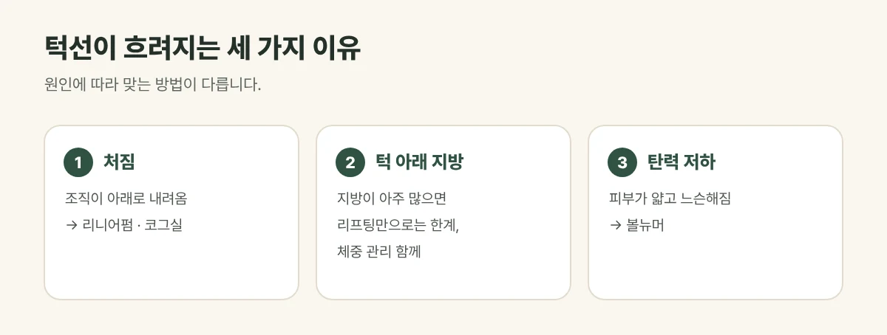

## 턱선이 흐려지는 세 가지 이유

- **조직이 아래로 처짐:** 볼과 턱 주변 조직이 내려오며 턱선의 경계가 흐려집니다.
- **턱 아래 지방:** 체중 증가나 체질로 턱 밑에 지방이 쌓여 이중턱이 생깁니다.
- **피부 탄력 저하:** 피부가 얇고 느슨해져 아래로 늘어집니다.

대부분 이 세 가지가 섞여 있어, 어떤 원인이 큰지 먼저 살펴야 맞는 방법을 고를 수 있습니다.

<figure style="margin: 8px 0 24px">

<figcaption style="margin-top: 8px; font-size: 14px; color: #5d655f">대부분 세 가지가 섞여 있어, 어떤 원인이 큰지 먼저 살핍니다. (갈창림 한의원 제작 설명 그림)</figcaption>
</figure>

## 진료실에서 자주 보는 경우

사진을 찍으면 턱선이 둥글게 보이고 고개를 숙이면 이중턱이 두드러져 오시는 분이 많습니다. 살이 빠지면 좋아질 줄 알았는데 체중을 줄여도 턱선이 그대로라며 처짐을 고민하시는 경우도 흔합니다.

## 원인에 따라 이렇게 접근합니다

| 원인 | 주로 쓰는 방법 |
| --- | --- |
| 처진 윤곽, 이중턱 주변 | 초음파 리프팅(리니어펌) — 정해진 깊이에 에너지를 모아 윤곽 정돈 |
| 뚜렷한 처짐 | 코그실 — 얼굴 아래쪽 조직을 다시 배치해 턱선 정리 |
| 피부의 느슨함 | 고주파 리프팅(볼뉴머) — 넓게 데워 탄력 개선 |

두 가지 이상이 함께 있으면 장비 리프팅과 실리프팅을 함께 계획하기도 합니다.

## 리프팅의 한계도 알아 두세요

- 턱 아래 **지방이 아주 많다면** 리프팅만으로 이중턱이 크게 줄기는 어렵습니다. 체중 관리가 함께 필요할 수 있습니다.
- **늘어진 피부가 많거나** 처짐이 매우 심하면 시술로 기대할 수 있는 변화에 한계가 있습니다.
- 얼굴 살이 적은 분은 깊은 에너지가 과하면 볼이 꺼져 보일 수 있어 부위를 나눠 조절합니다.

## 자주 묻는 질문

Q. 이중턱만 시술할 수도 있나요?
A. 네. 다만 턱선은 볼과 이어져 있어, 얼굴 아래쪽 전체의 균형을 함께 보고 범위를 정하는 것이 자연스럽습니다.

Q. 효과는 얼마나 가나요?
A. 시술 방법과 피부 상태, 체중 변화에 따라 개인차가 있습니다. 리니어펌은 처음 1달 간격 3회 뒤 6개월~1년마다 유지 시술을 권해 드립니다.
