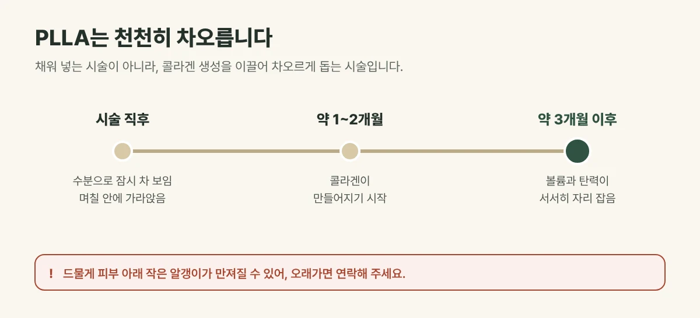

## 채워 넣는 시술이 아니라, 차오르게 돕는 시술입니다

PLLA는 몸속에서 서서히 분해되는 성분입니다. 진피에 들어간 미세 입자가 천천히 분해되는 동안 주변 조직을 자극해 **콜라겐 생성을 이끌고**, 그 결과 피부의 볼륨과 탄력이 자연스럽게 차오릅니다. 그래서 변화가 **천천히, 그리고 자연스럽게** 나타납니다.

## 시간에 따라 이렇게 달라집니다

| 시기 | 변화 |
| --- | --- |
| 시술 직후 | 함께 주입한 수분으로 잠시 차 보이며, 며칠 안에 가라앉음 |
| 약 1~2개월 | 입자 주변에서 콜라겐이 만들어지기 시작 |
| 약 3개월 이후 | 볼륨과 탄력이 서서히 자리 잡음 |

시술 직후 차 보였던 모습이 며칠 뒤 가라앉아 "효과가 없어졌다"고 느끼실 수 있지만, 실제 변화는 그 뒤에 천천히 나타납니다.

<figure style="margin: 8px 0 24px">

<figcaption style="margin-top: 8px; font-size: 14px; color: #5d655f">실제 변화는 시술 직후보다 그 뒤에 천천히 나타나며, 개인차가 있습니다. (갈창림 한의원 제작 설명 그림)</figcaption>
</figure>

## 진료실에서 자주 보는 경우

볼과 관자놀이가 꺼져 얼굴이 피곤해 보인다며 오시는 분이 많습니다. 필러처럼 갑작스럽게 달라 보이는 것은 부담스럽고, 주변에서 눈치채지 못하게 조금씩 좋아지길 원하는 분들이 특히 많이 찾으십니다.

## 권장 주기

- **4~6주 간격, 2~3회**를 기준으로 합니다.
- 콜라겐이 차오르는 속도와 피부 상태를 보며 횟수를 조정합니다.

## 시술 후 알아 두세요

- 안내받은 대로 시술 부위를 가볍게 마사지하면 입자가 고르게 퍼지는 데 도움이 됩니다.
- 붉음, 부기, 작은 멍은 흔하며 대부분 며칠 안에 가라앉습니다.
- 드물게 피부 아래 작은 알갱이(결절)가 만져질 수 있어, 오래가면 연락해 주세요.

## 자주 묻는 질문

Q. 필러와 무엇이 다른가요?
A. 필러는 주입한 물질이 바로 공간을 채우고, PLLA는 내 피부의 콜라겐이 차오르도록 이끄는 방식입니다. 그래서 변화가 천천히 나타납니다.

Q. 패인 여드름 흉터에도 쓰나요?
A. 진피의 콜라겐 생성을 돕기 때문에 흉터 치료와 함께 계획하기도 합니다. 흉터 모양에 따라 다른 치료와 조합합니다.
