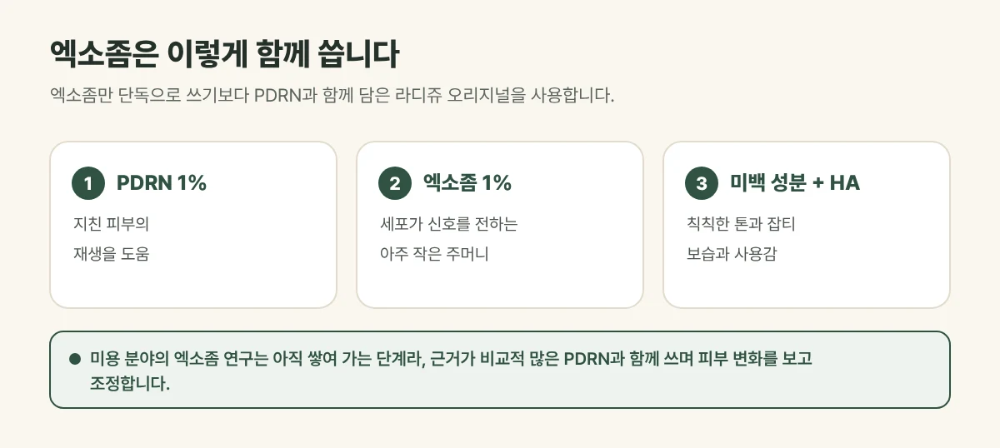

## 엑소좀은 무엇인가요?

엑소좀은 세포가 다른 세포에 신호를 전할 때 내보내는 **아주 작은 주머니**입니다. 안에는 단백질이나 유전 물질 같은 신호 물질이 담겨 있어, 피부에서는 지친 피부의 컨디션 회복을 돕는 목적으로 연구되고 있습니다.

## 갈창림 한의원에서는 이렇게 씁니다

엑소좀만 단독으로 쓰기보다, **PDRN과 엑소좀, 미백 성분을 함께 담은 라디쥬 오리지널**을 사용합니다. 여기에 HA(히알루론산) 앰플을 섞어 보습과 사용감을 높입니다.

- **이런 고민에:** 칙칙한 피부톤과 잡티, 지친 피부의 재생, 보습
- **권장 주기:** 2~4주 간격, 3~5회 (피부 상태에 따라 조정)
- **주입 방법:** 레이저·LDM 또는 손주사

<figure style="margin: 8px 0 24px">

<figcaption style="margin-top: 8px; font-size: 14px; color: #5d655f">권장 주기는 2~4주 간격 3~5회이며, 피부 상태에 따라 조정합니다. (갈창림 한의원 제작 설명 그림)</figcaption>
</figure>

## 진료실에서 자주 보는 경우

"엑소좀이 요즘 좋다던데"라며 이름을 듣고 오시는 분이 많습니다. 피부를 살펴보면 칙칙함과 건조함이 주된 고민인 분도 있고, 탄력이나 예민함이 먼저인 분도 있어, 목적에 맞는 구성을 함께 고릅니다.

## 연구는 아직 이어지는 단계입니다

엑소좀은 피부 재생과 관련해 관심을 받고 있지만, 미용 분야의 연구는 **아직 쌓여 가는 단계**입니다. 그래서 갈창림 한의원은 엑소좀 하나에 큰 기대를 걸기보다, 근거가 비교적 많이 쌓인 PDRN과 함께 쓰고 피부 변화를 보며 계획을 조정합니다.

## 시술 후 알아 두세요

작은 주입 자국, 오돌토돌함, 가벼운 붉음은 대부분 며칠 안에 가라앉습니다. 성분에 알레르기가 있거나 피부에 염증이 심하면 시술 전에 꼭 말씀해 주세요.

## 자주 묻는 질문

Q. 예민한 피부도 받을 수 있나요?
A. 피부 상태에 따라 다릅니다. 예민하거나 염증이 있는 피부는 진정과 재생에 초점을 맞춘 PDRN 단일 구성(라디쥬 퓨어)을 먼저 고려하기도 합니다.

Q. 미백 효과는 언제 느껴지나요?
A. 피부톤의 변화는 여러 번에 걸쳐 서서히 나타나며 개인차가 있습니다. 자외선 차단을 함께 지키는 것이 중요합니다.
