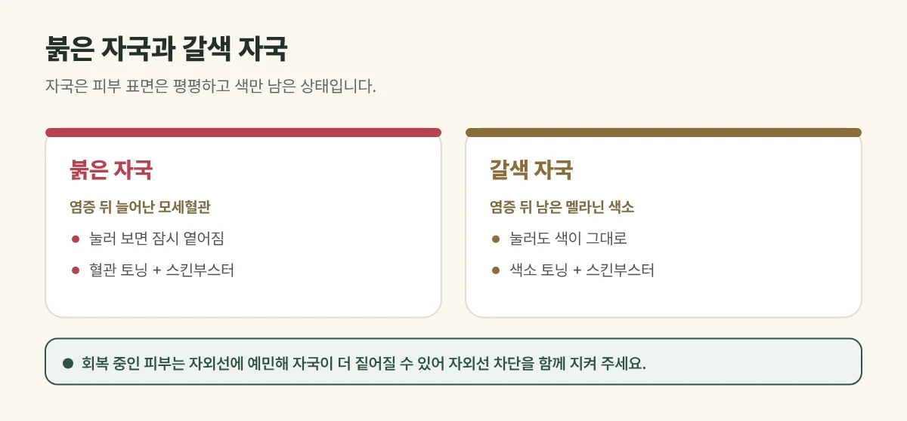

## 자국과 흉터는 다릅니다

여드름 **자국**은 피부 표면은 평평하고 **색만 남은** 상태입니다. 피부가 패여 그림자가 진다면 자국이 아니라 **흉터**로, 치료 방법이 다릅니다.

## 붉은 자국과 갈색 자국

| 구분 | 붉은 자국 | 갈색 자국 |
| --- | --- | --- |
| 원인 | 염증 뒤 늘어난 모세혈관 | 염증 뒤 남은 멜라닌 색소 |
| 눌러 보면 | 잠시 옅어짐 | 색이 그대로 |
| 잘 생기는 경우 | 피부가 얇고 붉은 기가 잘 도는 경우 | 자외선 노출이 많거나 피부톤이 어두운 경우 |
| 주로 쓰는 치료 | 혈관 토닝 + 스킨부스터 | 색소 토닝 + 스킨부스터 |

자국을 손가락으로 지그시 눌렀을 때 잠시 옅어지면 붉은 자국, 그대로면 갈색 자국에 가깝습니다.

<figure style="margin: 8px 0 24px">

<figcaption style="margin-top: 8px; font-size: 14px; color: #5d655f">자국의 색에 맞춰 토닝과 스킨부스터를 조합하며, 결과에는 개인차가 있습니다. (갈창림 한의원 제작 설명 그림)</figcaption>
</figure>

## 진료실에서 자주 보는 경우

여드름은 가라앉았는데 볼에 붉은 자국이 몇 달째 남아 있다며 오시는 분이 많습니다. 기다리면 없어진다는 말에 그냥 두었다가, 여름을 지나며 갈색으로 짙어져 오시는 경우도 있습니다.

## 이렇게 치료합니다

- **토닝:** 낮은 세기의 레이저를 얼굴 전체에 고르게 조사해 자극은 줄이면서 자국을 조금씩 옅게 합니다. 붉은 자국에는 혈관에 반응하는 설정을, 갈색 자국에는 멜라닌에 반응하는 1064nm를 씁니다.
- **스킨부스터:** 염증으로 지친 피부의 회복을 돕습니다.
- 권장 주기는 **2주 간격**이며 자국 상태에 따라 여러 회 진행합니다.

## 자외선은 자국을 짙게 만듭니다

회복 중인 피부는 자외선에 예민해, 붉은 자국이 갈색으로 착색되거나 갈색 자국이 더 오래 남을 수 있습니다. 치료와 함께 **자외선 차단**이 꼭 필요합니다.

## 자주 묻는 질문

Q. 그냥 두면 없어지나요?
A. 시간이 지나며 옅어지기도 하지만 몇 달 이상 걸릴 수 있고, 그 사이 자외선과 자극으로 더 짙어질 수 있습니다.

Q. 여드름이 아직 나는데 자국 치료를 해도 되나요?
A. 새 여드름이 계속 생기면 자국도 계속 생기므로, 여드름 치료를 함께 하는 것이 좋습니다.
