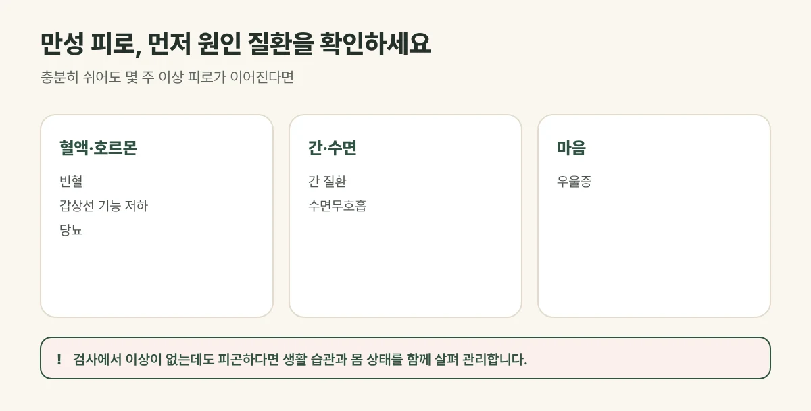

## 만성 피로는 어떤 상태인가요?

누구나 피곤할 때가 있지만, 충분히 자고 쉬어도 피로가 풀리지 않고 **일이나 집안일을 하기 힘들 정도의 피로가 몇 주 이상** 이어진다면 만성 피로를 살펴봐야 합니다. 아침에 일어나기 힘들고, 오후만 되면 기운이 빠지고, 집중이 잘 되지 않으며, 쉬는 날에도 누워만 있게 되는 경우가 많습니다.

## 진료실에서 자주 보는 경우

주말에 푹 쉬어도 피로가 풀리지 않고, 오후만 되면 기운이 떨어진다고 오시는 분이 많습니다. 혈액검사에서 큰 이상이 없다는 말을 들으신 경우가 흔합니다.

## 먼저 원인 질환을 확인하세요

피로 뒤에 원인이 되는 질환이 숨어 있는 경우가 있습니다. 아래에 해당하면 혈액 검사 등 기본 검사를 먼저 받아 보시기를 권합니다.

| 함께 나타나는 증상 | 생각해 볼 원인 |
| --- | --- |
| 어지럼, 숨참, 창백함 | 빈혈 |
| 추위를 타고 붓고 체중이 늘어남 | 갑상선 기능 저하 |
| 갈증, 잦은 소변, 체중 감소 | 당뇨 |
| 소화불량, 눈·피부가 노래짐 | 간 질환 |
| 심한 코골이, 자고 나도 개운하지 않음 | 수면무호흡 |
| 의욕이 없고 우울함이 2주 넘게 계속됨 | 우울증 |

이유 없는 체중 감소, 열, 밤에 흠뻑 젖도록 땀이 나는 경우에도 검사를 먼저 받아 보세요.

<figure style="margin: 8px 0 24px">

<figcaption style="margin-top: 8px; font-size: 14px; color: #5d655f">원인이 되는 질환이 숨어 있을 수 있어 기본 검사를 먼저 받아 보는 것이 좋습니다. (갈창림 한의원 제작 설명 그림)</figcaption>
</figure>

## 검사는 정상인데 계속 피곤하다면

검사에서 뚜렷한 이상이 없는데도 피곤하다면, 수면의 질, 스트레스, 불규칙한 식사, 운동 부족, 과로가 겹쳐 몸이 회복할 틈이 없는 경우가 많습니다. 소화가 안 되거나, 손발이 차거나, 잠을 설치는 등 함께 나타나는 불편을 살피면 피로를 키우는 원인이 보이기도 합니다.

## 갈창림 한의원의 만성 피로 치료

1. **침:** 굳은 목과 어깨, 등의 긴장을 풀고 몸의 순환을 돕는 자리에 침을 놓습니다.
2. **뜸:** 차갑고 지친 몸에 따뜻한 자극을 주어 순환과 회복을 돕습니다.
3. **한약:** 기운이 떨어졌는지, 소화가 약한지, 잠을 설치는지, 스트레스로 긴장되어 있는지 등 몸 상태를 살펴 처방합니다.

## 피로를 줄이는 생활 습관

- 매일 같은 시간에 자고 일어나 **수면 리듬**을 지켜 주세요.
- 아침을 거르지 말고, 단 음식과 카페인에 기대지 마세요.
- 피곤해도 하루 20~30분 걷는 가벼운 운동이 오히려 기운을 돋웁니다.
- 술을 줄이고, 일과 휴식의 경계를 정해 주세요.

## 자주 묻는 질문

Q. 피곤할 때 보약을 먹으면 좋아지나요?
A. 피로의 원인과 몸 상태에 따라 맞는 처방이 다릅니다. 원인 질환이 없는지 확인한 뒤, 지금 몸 상태에 맞춰 처방하는 것이 중요합니다.

Q. 영양제를 많이 먹고 있는데 괜찮을까요?
A. 드시는 영양제와 약을 알려 주시면 함께 확인합니다. 한약과 함께 드셔도 되는지도 안내해 드립니다.

Q. 얼마나 치료받아야 하나요?
A. 피로가 이어진 기간과 원인에 따라 다릅니다. 진찰 후 예상 기간을 안내해 드리며, 결과에는 개인차가 있습니다.
