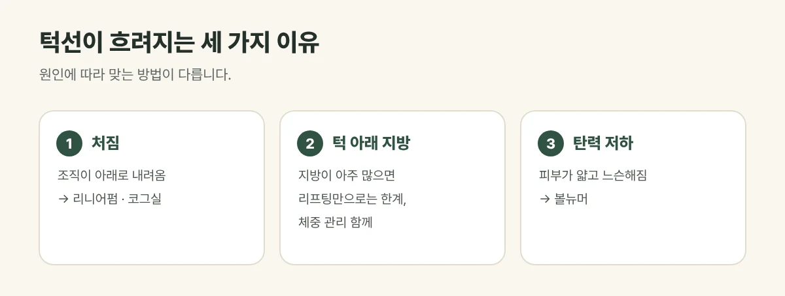

## 턱선이 흐려지는 세 가지 이유

- **조직이 아래로 처짐:** 볼과 턱 주변 조직이 내려오며 턱선의 경계가 흐려집니다.
- **턱 아래 지방:** 체중 증가나 체질로 턱 밑에 지방이 쌓여 이중턱이 생깁니다.
- **피부 탄력 저하:** 피부가 얇고 느슨해져 아래로 늘어집니다.

대부분 이 세 가지가 섞여 있어, 어떤 원인이 큰지 먼저 살펴야 맞는 방법을 고를 수 있습니다.

<figure style="margin: 8px 0 24px">

<figcaption style="margin-top: 8px; font-size: 14px; color: #5d655f">대부분 세 가지가 섞여 있어, 어떤 원인이 큰지 먼저 살핍니다. (갈창림 한의원 제작 설명 그림)</figcaption>
</figure>

## 진료실에서 자주 보는 경우

사진을 찍으면 턱선이 둥글게 보이고 고개를 숙이면 이중턱이 두드러져 오시는 분이 많습니다. 살이 빠지면 좋아질 줄 알았는데 체중을 줄여도 턱선이 그대로라며 처짐을 고민하시는 경우도 흔합니다.

## 원인에 따라 이렇게 접근합니다

| 원인 | 주로 쓰는 방법 |
| --- | --- |
| 처진 윤곽, 이중턱 주변 | 초음파 리프팅(리니어펌) — 정해진 깊이에 에너지를 모아 윤곽 정돈 |
| 뚜렷한 처짐 | 코그실 — 얼굴 아래쪽 조직을 다시 배치해 턱선 정리 |
| 피부의 느슨함 | 고주파 리프팅(볼뉴머) — 넓게 데워 탄력 개선 |

두 가지 이상이 함께 있으면 장비 리프팅과 실리프팅을 함께 계획하기도 합니다.

## 리프팅의 한계도 알아 두세요

- 턱 아래 **지방이 아주 많다면** 리프팅만으로 이중턱이 크게 줄기는 어렵습니다. 체중 관리가 함께 필요할 수 있습니다.
- **늘어진 피부가 많거나** 처짐이 매우 심하면 시술로 기대할 수 있는 변화에 한계가 있습니다.
- 얼굴 살이 적은 분은 깊은 에너지가 과하면 볼이 꺼져 보일 수 있어 부위를 나눠 조절합니다.

## 시술별 비용과 일정

턱선과 이중턱에 주로 쓰는 시술의 비용과 일정입니다. 모든 금액은 부가세 포함입니다.

| 시술 | 비용 | 일정 |
| --- | --- | --- |
| 리니어펌 (초음파) 500샷 | 1회 275,000원 · 3회 660,000원 | 1달 간격 3회 후 6개월~1년마다 |
| 볼뉴머 (고주파) | 300샷 440,000원 · 600샷 770,000원 | 1회 후 6개월~1년마다 |
| 볼뉴머 300샷 + 리니어펌 300샷 | 550,000원 | 같은 날 함께 |
| 실리프팅 | 트윙클 채움실 1개 110,000원 · 일반 모노실 1개 5,500원 | 1회 후 1년 이후 |

실리프팅은 들어가는 실의 종류와 개수에 따라 전체 금액이 달라져, 진찰 후 예상 비용을 미리 안내해 드립니다. 전체 금액은 [가격표](price.html#price-lifting)와 [리프팅 비용 칼럼](column-lifting-cost.html)에서 확인하실 수 있습니다.

## 턱선 리프팅은 이렇게 진행합니다

1. **피부 분석과 진찰:** 야누스프로로 좌우 균형과 처진 부위를 확인하고, 턱 아래를 손으로 집어 지방과 처짐 가운데 무엇이 큰지 봅니다.
2. **깊이 나누기:** 리니어펌은 2.0·3.0·4.5·6.0mm 카트리지를 처진 깊이에 맞춰 나누어 씁니다. 턱 아래와 턱선 경계에는 깊은 카트리지를, 피부 결에는 얕은 카트리지를 씁니다.
3. **볼륨 지키기:** 볼이 꺼질 수 있는 부위는 에너지를 줄이고 턱선 위주로 정돈합니다.
4. **시술 후:** 대부분 바로 일상생활이 가능하며, 며칠간 턱선을 누르면 뻐근할 수 있습니다.

장비별 특징은 [리니어펌](linearfirm.html), [볼뉴머](volnewmer.html) 장비 안내에서, 두 방식의 차이는 [초음파·고주파 리프팅 비교](column-ultrasound-vs-rf-lifting.html)에서 보실 수 있습니다. 볼이 꺼질까 걱정되신다면 [리프팅 후 볼 꺼짐 칼럼](column-lifting-volume-loss.html)도 참고해 주세요.

피부미용 시술은 대표원장이 진료하는 화~일요일(토·일 포함)에 받으실 수 있으며, 월요일은 시술하지 않습니다.

## 자주 묻는 질문

Q. 이중턱만 시술할 수도 있나요?
A. 네. 다만 턱선은 볼과 이어져 있어, 얼굴 아래쪽 전체의 균형을 함께 보고 범위를 정하는 것이 자연스럽습니다.

Q. 효과는 얼마나 가나요?
A. 시술 방법과 피부 상태, 체중 변화에 따라 개인차가 있습니다. 리니어펌은 처음 1달 간격 3회 뒤 6개월~1년마다 유지 시술을 권해 드립니다.

Q. 턱 아래 지방이 많은데 다이어트를 먼저 해야 하나요?
A. 지방이 많이 차지하는 이중턱은 체중 관리가 함께 필요할 수 있습니다. 진찰 때 지방과 처짐의 비중을 보고, 리프팅을 먼저 할지 체중 관리와 함께 계획할지 안내해 드립니다.

Q. 시술 시간은 얼마나 걸리나요?
A. 볼뉴머 600샷은 약 20~30분, 실리프팅은 마취를 포함해 약 20~40분 걸립니다. 리니어펌은 시술 범위에 따라 달라 진찰 때 안내해 드립니다.
