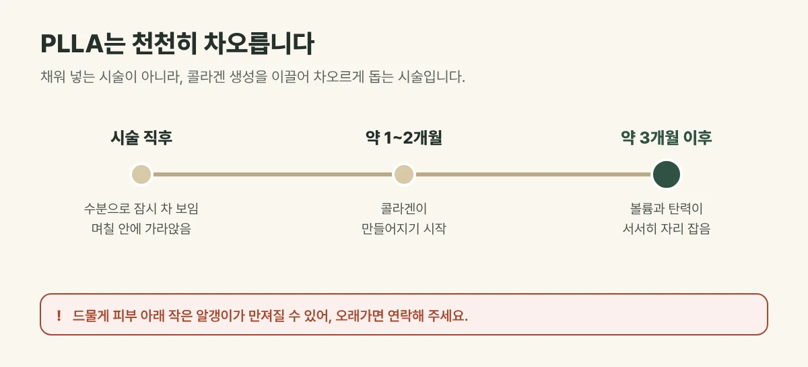

## 채워 넣는 시술이 아니라, 차오르게 돕는 시술입니다

PLLA는 몸속에서 서서히 분해되는 성분입니다. 진피에 들어간 미세 입자가 천천히 분해되는 동안 주변 조직을 자극해 **콜라겐 생성을 이끌고**, 그 결과 피부의 볼륨과 탄력이 자연스럽게 차오릅니다. 그래서 변화가 **천천히, 그리고 자연스럽게** 나타납니다.

## 시간에 따라 이렇게 달라집니다

| 시기 | 변화 |
| --- | --- |
| 시술 직후 | 함께 주입한 수분으로 잠시 차 보이며, 며칠 안에 가라앉음 |
| 약 1~2개월 | 입자 주변에서 콜라겐이 만들어지기 시작 |
| 약 3개월 이후 | 볼륨과 탄력이 서서히 자리 잡음 |

시술 직후 차 보였던 모습이 며칠 뒤 가라앉아 "효과가 없어졌다"고 느끼실 수 있지만, 실제 변화는 그 뒤에 천천히 나타납니다.

<figure style="margin: 8px 0 24px">

<figcaption style="margin-top: 8px; font-size: 14px; color: #5d655f">실제 변화는 시술 직후보다 그 뒤에 천천히 나타나며, 개인차가 있습니다. (갈창림 한의원 제작 설명 그림)</figcaption>
</figure>

## 진료실에서 자주 보는 경우

볼과 관자놀이가 꺼져 얼굴이 피곤해 보인다며 오시는 분이 많습니다. 필러처럼 갑작스럽게 달라 보이는 것은 부담스럽고, 주변에서 눈치채지 못하게 조금씩 좋아지길 원하는 분들이 특히 많이 찾으십니다.

## 권장 주기

- **4~6주 간격, 2~3회**를 기준으로 합니다.
- 콜라겐이 차오르는 속도와 피부 상태를 보며 횟수를 조정합니다.

## 시술 후 알아 두세요

- 안내받은 대로 시술 부위를 가볍게 마사지하면 입자가 고르게 퍼지는 데 도움이 됩니다.
- 붉음, 부기, 작은 멍은 흔하며 대부분 며칠 안에 가라앉습니다.
- 드물게 피부 아래 작은 알갱이(결절)가 만져질 수 있어, 오래가면 연락해 주세요.

## 비용과 시술 정보

| 항목 | 내용 |
| --- | --- |
| 비용 | 1회 385,000원 · 3회 990,000원 (부가세 포함) |
| 권장 주기 | 4~6주 간격, 2~3회 |
| 시술 시간 | 약 20~30분 (마취 포함) |
| 주입 방법 | 레이저·LDM 또는 손주사 |
| 회복 | 대부분 바로 일상생활 가능 |

3회 묶음은 권장 횟수에 맞춰 콜라겐이 차오르는 시간을 두고 나누어 받도록 구성했습니다. 다른 스킨부스터와의 비용 비교는 [스킨부스터 가격 칼럼](column-skin-booster-price.html)에 정리했습니다.

## 이런 경우에 함께 계획합니다

| 고민 | 함께 고려하는 시술 |
| --- | --- |
| 꺼진 볼·관자놀이와 처짐이 함께 | 볼뉴머·리니어펌 리프팅 (볼륨을 지킬 부위는 에너지를 줄여 설계) |
| 패인 여드름 흉터 | 서브시전·실펌X와 함께, 흉터 아래 진피를 채우는 용도 |
| 피부가 얇아지고 탄력이 떨어짐 | 진피 골격을 채우는 ECM 진피재생약침과 비교 |

리프팅 뒤 볼이 꺼질까 걱정되신다면 [리프팅 후 볼 꺼짐 칼럼](column-lifting-volume-loss.html)을, 흉터와 함께라면 [여드름 흉터 치료 비용 칼럼](column-acne-scar-cost.html)을, ECM과의 차이는 [ECM 진피재생약침 칼럼](column-ecm-booster.html)을 참고해 주세요. 자세한 시술 안내는 [PLLA 페이지](booster-plla.html)에 있습니다.

피부미용 시술은 대표원장이 진료하는 화~일요일(토·일 포함)에 받으실 수 있으며, 월요일은 시술하지 않습니다.

## 자주 묻는 질문

Q. 필러와 무엇이 다른가요?
A. 필러는 주입한 물질이 바로 공간을 채우고, PLLA는 내 피부의 콜라겐이 차오르도록 이끄는 방식입니다. 그래서 변화가 천천히 나타납니다.

Q. 패인 여드름 흉터에도 쓰나요?
A. 진피의 콜라겐 생성을 돕기 때문에 흉터 치료와 함께 계획하기도 합니다. 흉터 모양에 따라 다른 치료와 조합합니다.

Q. 한 번만 받아도 변화가 있나요?
A. PLLA는 콜라겐이 차오르도록 이끄는 방식이라 한 번보다 4~6주 간격으로 2~3회 나누어 받을 때 변화가 쌓입니다. 효과와 유지 기간에는 개인차가 있습니다.

Q. 마사지는 어떻게 하나요?
A. 시술 뒤 며칠 동안 안내받은 횟수와 방법으로 가볍게 문질러 주시면 됩니다. 세게 누르거나 오래 하지 않아도 되며, 방법은 시술 당일 안내해 드립니다.
