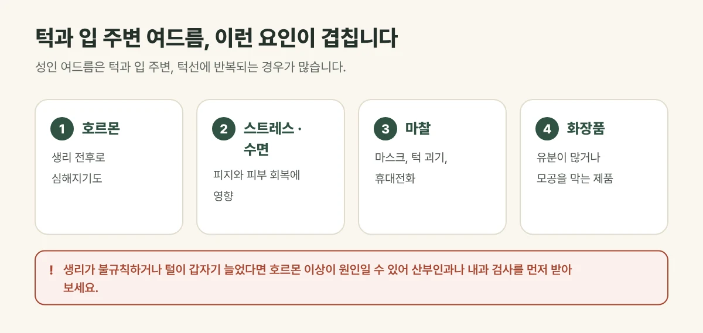

## 성인 여드름은 왜 턱에 잘 날까요?

사춘기 여드름이 이마와 코에 많다면, 성인 여드름은 **턱과 입 주변, 턱선**에 반복되는 경우가 많습니다. 다음과 같은 요인이 겹쳐 생깁니다.

- **호르몬 변화:** 생리 전후로 여드름이 심해지는 경우가 흔합니다.
- **스트레스와 수면 부족:** 피지 분비와 피부 회복에 영향을 줍니다.
- **마찰과 자극:** 마스크, 턱을 괴는 습관, 휴대전화가 닿는 자리
- **맞지 않는 화장품:** 유분이 많거나 모공을 막는 제품

<figure style="margin: 8px 0 24px">

<figcaption style="margin-top: 8px; font-size: 14px; color: #5d655f">모공 막힘, 피지, 염증 가운데 무엇이 큰지에 따라 치료를 조합합니다. (갈창림 한의원 제작 설명 그림)</figcaption>
</figure>

## 진료실에서 자주 보는 경우

학생 때는 괜찮았는데 직장 생활을 하며 턱에 여드름이 계속 올라온다며 오시는 분이 많습니다. 같은 자리에 붉고 깊은 여드름이 반복되다 보니 손으로 짜다가 자국이 남은 경우도 흔합니다.

## 원인에 맞춰 치료합니다

갈창림 한의원은 야누스프로로 피지와 포피린(여드름균이 만드는 물질), 모공 상태를 확인한 뒤 원인에 맞게 조합합니다.

| 원인 | 이런 상태 | 주로 쓰는 치료 |
| --- | --- | --- |
| 모공 막힘 | 좁쌀 여드름, 블랙헤드 | 압출 · 필링 |
| 피지 과다 | 같은 자리에 반복 | ALA-PDT · 골드PTT |
| 염증 | 붉게 붓거나 곪음 | 압출 · ALA-PDT |
| 지친 피부 | 염증 뒤 예민하고 회복이 더딤 | PDRN |

권장 주기는 **1주 간격**이며 피부 상태에 따라 조절합니다. ALA-PDT 뒤에는 하루 정도 빛을 피해야 합니다.

## 먼저 확인이 필요한 경우

- 생리 주기가 불규칙하거나, 얼굴·몸의 털이 갑자기 늘어난 경우
- 여드름이 갑자기 심해지고 다른 몸의 변화가 함께 있는 경우

호르몬 이상이 원인일 수 있어 산부인과나 내과 검사를 먼저 받아 보시기를 권합니다.

## 생활 속 관리

- 턱을 괴거나 여드름을 만지는 습관을 줄여 주세요.
- 마스크와 베갯잇은 자주 바꿔 주세요.
- 유분이 많은 제품보다 가벼운 제형을 쓰고, 세안은 순하게 해 주세요.

## 자주 묻는 질문

Q. 생리 전마다 올라오는 여드름도 치료가 되나요?
A. 호르몬 변화가 영향을 주는 여드름은 반복되기 쉬워, 치료와 함께 생활 관리를 이어 가는 것이 중요합니다. 생리 불순이 함께 있다면 검사를 먼저 받아 보세요.

Q. 짜면 빨리 낫지 않나요?
A. 손으로 짜면 염증이 깊어지거나 자국과 흉터가 남기 쉽습니다. 빼내야 하는 여드름은 소독한 기구로 피부 손상을 줄여 압출합니다.
