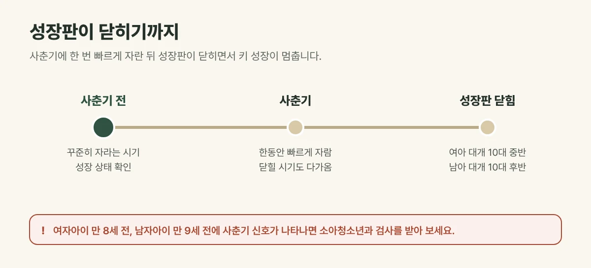

## 성장판은 뼈 끝의 자라는 부분입니다

팔다리 뼈의 양 끝에는 연골로 된 **성장판**이 있습니다. 이 부분이 자라며 뼈가 길어지고, 사춘기가 지나 성장판이 뼈로 바뀌어 **닫히면** 키는 더 이상 자라지 않습니다.

## 언제쯤 닫힐까요?

| 구분 | 사춘기 시작 (대략) | 성장판이 닫히는 시기 (대략) |
| --- | --- | --- |
| 여자아이 | 만 8~13세 무렵 가슴 발달 | 초경 뒤 2년 안팎, 대개 10대 중반 |
| 남자아이 | 만 9~14세 무렵 고환 커짐 | 대개 10대 후반 |

시기는 아이마다 차이가 큽니다. 같은 나이라도 **뼈 나이**가 달라, 정확한 상태는 엑스레이로 확인해야 합니다.

<figure style="margin: 8px 0 24px">

<figcaption style="margin-top: 8px; font-size: 14px; color: #5d655f">시기는 아이마다 차이가 크며, 정확한 상태는 엑스레이로 뼈 나이를 확인해야 합니다. (갈창림 한의원 제작 설명 그림)</figcaption>
</figure>

## 사춘기가 빠르면 자랄 기간이 짧아질 수 있습니다

사춘기가 시작되면 한동안 키가 빠르게 자라지만, 성장판이 닫히는 시기도 함께 다가옵니다. 사춘기가 일찍 오면 **자랄 수 있는 전체 기간이 짧아질 수** 있습니다. 소아 비만은 사춘기를 앞당기는 요인이 될 수 있습니다.

## 진료실에서 자주 보는 경우

초경을 했는데 키가 더 클 수 있냐며 급하게 오시는 경우가 많습니다. 초경 뒤에도 자라기는 하지만 남은 기간이 길지 않아, **사춘기 신호가 보이기 전에** 아이의 성장 상태를 한 번 확인해 보시기를 권합니다.

## 이런 경우는 소아청소년과 검사를 받아 보세요

- 여자아이가 만 8세 전, 남자아이가 만 9세 전에 사춘기 신호가 나타난 경우
- 만 4세 이후 1년에 4cm도 자라지 않는 경우
- 같은 성별·나이 100명 중 작은 순서로 3번째 안에 들 만큼 키가 작은 경우

한의원에서는 엑스레이 촬영을 하지 않습니다. 성장판이나 뼈 나이 확인이 필요하면 검사할 수 있는 병원을 안내해 드리고, 그 결과를 함께 보며 상담합니다.

## 성장판이 열려 있는 동안 챙길 것

- 밤늦게 자지 않도록 잠드는 시간을 일정하게
- 단백질, 우유, 채소를 골고루, 단 음료와 과자는 줄이기
- 매일 땀이 날 만큼 뛰어놀기
- 잦은 감기·비염, 약한 소화처럼 성장을 방해하는 요인 살피기

## 자주 묻는 질문

Q. 성장판이 닫힌 뒤에도 키가 클 수 있나요?
A. 성장판이 완전히 닫히면 뼈의 길이는 더 자라지 않습니다. 그래서 열려 있는 동안 성장을 방해하는 요인을 줄이는 것이 중요합니다.

Q. 손을 보면 성장판을 알 수 있나요?
A. 손과 손목 엑스레이로 뼈 나이를 확인합니다. 겉으로 보거나 만져서 알 수는 없습니다.
