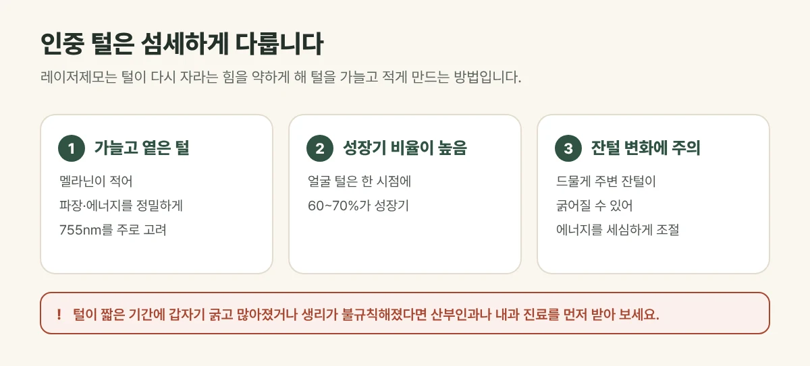

## 면도와 왁싱, 왜 불편할까요?

인중 털을 면도하면 금방 다시 자라 거뭇해 보이고, 왁싱이나 족집게로 뽑으면 피부가 붉어지고 모낭염이 생기기 쉽습니다. 레이저제모는 털이 다시 자라는 힘을 약하게 해 **털을 가늘고 적게** 만드는 방법입니다.

## 인중 털은 섬세하게 다뤄야 합니다

- **가늘고 옅은 털이 많습니다.** 멜라닌이 적어 레이저 반응이 약한 편이라, 파장과 에너지, 조사 시간을 더 정밀하게 맞춥니다. 갈창림 한의원은 가늘고 옅은 털에 반응이 좋은 755nm를 주로 고려합니다.
- **성장기 털의 비율이 높습니다.** 인중·턱 같은 얼굴 털은 한 시점에 성장기인 털이 60~70% 정도로 많아, 몸의 털보다 변화를 빨리 느끼는 분도 있습니다.
- **잔털이 굵어지는 현상에 주의합니다.** 얼굴·목처럼 가는 털이 많은 부위에서는 드물게 주변 잔털이 오히려 굵어지거나 늘어날 수 있어(역설적 다모증), 에너지를 세심하게 조절합니다.

<figure style="margin: 8px 0 24px">

<figcaption style="margin-top: 8px; font-size: 14px; color: #5d655f">털 상태에 따라 횟수를 조정하며, 결과에는 개인차가 있습니다. (갈창림 한의원 제작 설명 그림)</figcaption>
</figure>

## 진료실에서 자주 보는 경우

화장할 때 인중이 거뭇해 보여 신경 쓰이고, 족집게로 뽑다가 오돌토돌해져서 오시는 분이 많습니다. 출산이나 갱년기 무렵 얼굴 털이 늘었다고 느끼시는 경우도 흔합니다.

## 먼저 확인이 필요한 경우

- 얼굴과 몸의 털이 **짧은 기간에 갑자기 굵고 많아진** 경우
- 생리가 불규칙해지거나 여드름이 함께 심해진 경우

이런 경우는 호르몬 변화가 원인일 수 있어 산부인과나 내과 진료를 먼저 받아 보시기를 권합니다.

## 시술 일정과 관리

- 기본 일정은 **4주 간격 6회(1사이클)** 이며, 털 상태에 따라 횟수를 조정합니다.
- 시술 기간에는 면도는 괜찮지만 **뽑거나 왁싱하지 마세요.**
- 시술 뒤 붉어짐은 대부분 금방 가라앉으며, 자외선 차단제를 꼭 발라 주세요.

## 자주 묻는 질문

Q. 솜털처럼 아주 가는 털도 되나요?
A. 가능합니다. 다만 가늘고 옅을수록 반응이 약해 횟수가 더 필요할 수 있고, 아주 옅은 털은 효과에 한계가 있을 수 있습니다.

Q. 인중만 하면 경계가 생기지 않나요?
A. 털이 줄어드는 정도에 따라 주변과 달라 보일 수 있어, 필요하면 턱이나 입가까지 범위를 함께 정합니다.
