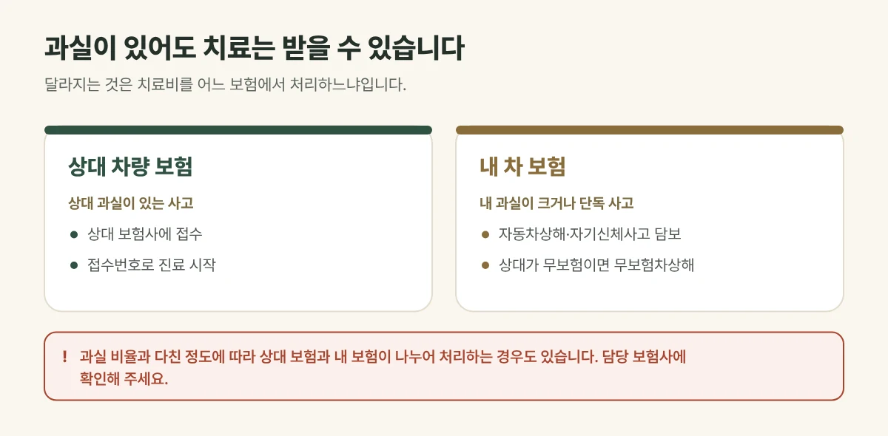

## 과실이 있어도 치료는 받을 수 있습니다

"제 잘못도 있는 사고라 치료받기가 망설여져요"라는 말씀을 자주 듣습니다. 과실이 있더라도 **다쳤다면 치료는 받을 수 있습니다**. 달라지는 것은 치료를 받을 수 있느냐가 아니라, **치료비를 어느 보험에서 처리하느냐**입니다.

## 어느 보험으로 처리될까요?

| 상황 | 접수하는 곳 (일반적인 경우) |
| --- | --- |
| 상대 과실이 있는 사고 | 상대 차량 보험사 |
| 내 과실이 큰 사고, 단독 사고 | 내 차 보험의 자동차상해 또는 자기신체사고 담보 |
| 상대 차량이 보험에 들지 않은 경우 | 내 차 보험의 무보험차상해 담보 |

과실 비율과 다친 정도에 따라 **상대 보험과 내 보험이 나누어 처리**하는 경우도 있습니다. 가입한 담보와 처리 방식은 사람마다 달라, **접수 전에 담당 보험사에 꼭 확인**해 주세요.

<figure style="margin: 8px 0 24px">

<figcaption style="margin-top: 8px; font-size: 14px; color: #5d655f">가입한 담보와 처리 방식은 사람마다 달라 접수 전에 담당 보험사에 확인해 주세요. (갈창림 한의원 제작 설명 그림)</figcaption>
</figure>

## 진료실에서 자주 보는 경우

과실 비율이 정해지지 않아 치료를 미루다 목과 허리 통증이 굳어서 오시는 분이 있습니다. 과실 비율은 사고 처리 과정에서 정해지므로, 그사이 아프다면 보험사와 상의해 **치료를 먼저 시작하시는 것이 좋습니다**.

## 접수 전에 보험사에 확인할 것

- 상대 보험과 내 보험 가운데 어디로 접수할지
- 내 차 보험에 자동차상해, 자기신체사고 담보가 있는지
- 치료가 길어질 때 필요한 서류가 있는지

접수번호를 받으셨다면 신분증과 함께 내원해 주세요. 한의원에서 보험사에 확인한 뒤 자동차보험으로 진료를 시작합니다.

## 치료는 같은 기준으로 합니다

어느 보험으로 접수했는지와 관계없이, 사고 상황과 지금 아픈 곳을 진찰한 뒤 **침·약침, 추나, 한약, 뜸·부항·물리치료요법**을 상태에 맞게 조합합니다.

## 이런 경우는 먼저 큰 병원에서 확인하세요

- 의식을 잃었거나, 머리를 부딪힌 뒤 두통과 구토가 점점 심해지는 경우
- 팔다리에 힘이 빠지거나 감각이 둔해진 경우, 말이 어눌해진 경우
- 뼈가 부러진 것처럼 붓고 움직이기 어려운 경우
- 숨쉬기 어렵거나 가슴·배 통증이 심한 경우

## 자주 묻는 질문

Q. 과실 비율이 아직 안 정해졌는데 치료를 시작해도 되나요?
A. 보험사 접수번호가 나왔다면 진료를 시작할 수 있습니다. 처리 방식은 담당 보험사와 상의해 주세요.

Q. 자동차보험으로 진료하면 본인부담금이 있나요?
A. 자동차보험으로 접수하면 진료비는 보험사가 지급하므로 한의원에서 따로 내시는 본인부담금은 없습니다. 접수한 보험 종류와 보장 범위는 담당 보험사에 확인해 주세요.
