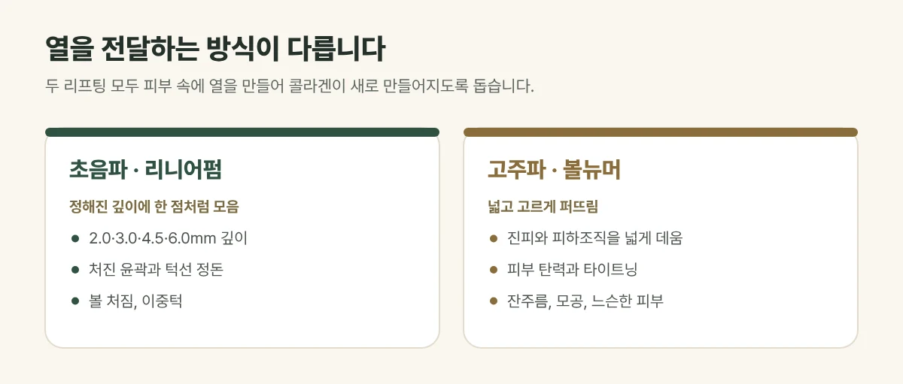

## 열을 전달하는 방식이 다릅니다

두 리프팅 모두 피부 속에 열을 만들어 조직을 수축시키고 콜라겐이 새로 만들어지도록 돕는다는 점은 같습니다. 다른 점은 **열을 어디에, 어떻게 전달하느냐**입니다.

| 구분 | 초음파 리프팅 (리니어펌) | 고주파 리프팅 (볼뉴머) |
| --- | --- | --- |
| 에너지 | 집속형 초음파(HIFU) | 모노폴라 고주파(RF) |
| 열 전달 | 정해진 깊이에 한 점처럼 모음 | 넓고 고르게 퍼뜨림 |
| 주된 목적 | 처진 윤곽과 턱선 정돈 | 피부 탄력과 타이트닝 |
| 이런 고민에 | 볼 처짐, 이중턱, 흐려진 턱선 | 잔주름, 모공, 느슨해진 피부 |
| 시술 느낌 | 깊은 곳의 찌릿함, 뻐근함 | 따뜻한 열감 |

초음파는 돋보기로 햇빛을 한곳에 모으듯 에너지를 정해진 깊이에 집중시킵니다. 리니어펌은 2.0·3.0·4.5·6.0mm 카트리지로 깊이를 나누어 시술합니다. 고주파는 진피와 피하조직을 넓게 데워 피부 바탕을 탄탄하게 하며, 볼뉴머는 수냉식 쿨링과 진동으로 열감을 조절합니다.

<figure style="margin: 8px 0 24px">

<figcaption style="margin-top: 8px; font-size: 14px; color: #5d655f">두 고민이 함께 있다면 복합 시술을 설계하며, 결과에는 개인차가 있습니다. (갈창림 한의원 제작 설명 그림)</figcaption>
</figure>

## 진료실에서 자주 보는 경우

"어떤 리프팅이 더 좋아요?"라는 질문을 가장 많이 받습니다. 얼굴을 살펴보면 턱선이 아래로 처진 분도 있고, 처짐보다 피부가 얇아지고 잔주름이 늘어난 분도 있어 맞는 시술이 다릅니다.

## 이렇게 고릅니다

- 볼과 턱선이 **아래로 처진 느낌**이라면 → 리니어펌을 먼저 고려합니다.
- 피부가 **얇아지고 느슨해진 느낌**이라면 → 볼뉴머를 먼저 고려합니다.
- 두 고민이 함께 있다면 → 볼뉴머로 피부 바탕을 다지고, 리니어펌으로 처진 부위를 정리하는 **복합 시술**을 설계합니다.

얼굴 살이 적은 분은 깊은 초음파를 모든 부위에 강하게 쓰면 더 말라 보일 수 있어, 지방량과 피부 두께에 맞춰 에너지와 깊이, 부위를 나눕니다.

## 시술 후 알아 두세요

붉어짐, 열감, 부기와 누르면 아픈 느낌은 흔하며 대부분 며칠 안에 가라앉습니다. 드물게 화상, 물집, 줄 모양 자국, 일시적인 감각 둔해짐이 생길 수 있어 이상이 있으면 바로 연락해 주세요.

## 자주 묻는 질문

Q. 같은 날 두 가지를 함께 받을 수 있나요?
A. 피부 두께와 처짐 정도에 따라 함께 시술할 수 있습니다. 얼굴 살이 적거나 피부가 예민하면 에너지를 낮추거나 간격을 두기도 합니다.

Q. 효과는 언제부터 느껴지나요?
A. 시술 직후 탄탄해진 느낌을 받을 수 있고, 콜라겐이 새로 만들어지면서 수주에서 수개월에 걸쳐 서서히 변화가 나타납니다. 정도에는 개인차가 있습니다.
