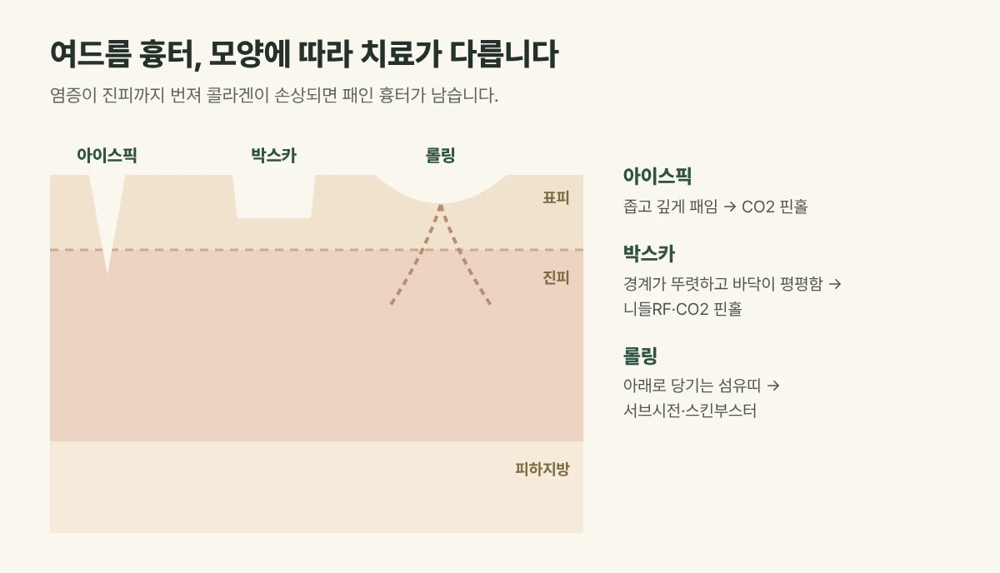

## 흉터는 왜 생길까요?

여드름 염증이 깊어져 **진피까지 번지면**, 피부를 아래에서 받쳐 주던 콜라겐이 손상됩니다. 손상된 자리가 제대로 채워지지 못하면 피부가 패인 채로 남는 것이 여드름 흉터입니다. 색만 남은 **자국**과 달리, 흉터는 피부 표면이 실제로 패여 그림자가 집니다.

## 모양에 따라 세 가지로 나눕니다

| 흉터 | 모양 | 주로 쓰는 치료 |
| --- | --- | --- |
| 아이스픽 | 좁고 깊게 송곳처럼 패임 | CO2 핀홀 |
| 박스카 | 경계가 뚜렷하고 바닥이 평평함 | 니들RF · CO2 핀홀 |
| 롤링 | 넓고 완만하게 물결치듯 패임 | 서브시전 · 스킨부스터 |

한 얼굴에 여러 모양이 섞여 있는 경우가 많아, **한 가지 시술보다 조합**이 중요합니다.

<figure style="margin: 8px 0 24px">

<figcaption style="margin-top: 8px; font-size: 14px; color: #5d655f">한 얼굴에 여러 모양이 섞인 경우가 많아 조합해 치료하며, 개선 정도에는 개인차가 있습니다. (갈창림 한의원 제작 설명 그림)</figcaption>
</figure>

## 치료는 이렇게 작용합니다

- **서브시전:** 가는 바늘로 피부를 아래로 잡아당기는 섬유띠를 끊어, 묶여 있던 피부가 올라오게 합니다.
- **니들RF(실펌X):** 가는 바늘로 원하는 깊이에 고주파 열을 전달해 진피 재생을 이끌고 패인 바닥을 끌어올립니다.
- **CO2 핀홀:** 좁고 깊은 흉터 안에 미세 구멍을 내어 재생을 유도합니다.
- **스킨부스터:** 생긴 공간과 진피를 채우고 회복을 돕습니다.

## 진료실에서 자주 보는 경우

볼에 여러 모양의 흉터가 섞여 있어 화장으로도 가려지지 않는다며 오시는 분이 많습니다. 몇 년 된 흉터라 늦은 게 아니냐고 물으시는데, 오래된 흉터도 모양에 맞춰 단계적으로 개선을 시도할 수 있습니다.

## 일정과 회복

- 보통 **4주 간격**으로 흉터 상태에 따라 여러 회 진행합니다.
- 마취 크림을 바르고 약 30~40분 걸리며, 다음 날부터 일상생활이 가능합니다.
- 붉음과 미세 딱지가 약 3~7일 이어질 수 있습니다.
- 회복 중 피부는 자외선에 예민해 자외선 차단이 꼭 필요합니다.

드물게 오래가는 붉음, 색소침착, 감염이 생길 수 있어 이상이 있으면 연락해 주세요.

## 자주 묻는 질문

Q. 흉터가 완전히 없어지나요?
A. 패인 깊이를 줄이고 피부결을 고르게 하는 것이 목표이며, 흉터를 완전히 없애기는 어렵습니다. 개선 정도는 흉터의 모양과 깊이에 따라 개인차가 있습니다.

Q. 여드름이 아직 나는데 흉터 치료를 해도 되나요?
A. 염증이 활발하면 여드름 치료를 먼저 해 새 흉터가 생기지 않게 한 뒤 흉터 치료를 진행하는 것이 좋습니다.
