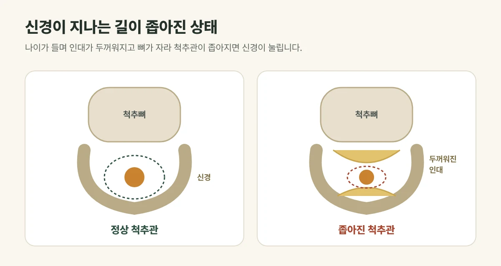

## 신경이 지나는 길이 좁아진 상태입니다

척추 뼈 안에는 신경이 지나가는 통로(척추관)가 있습니다. 나이가 들며 **인대가 두꺼워지고 뼈가 자라나** 이 통로가 좁아지면, 신경이 눌려 엉덩이와 다리까지 저림과 통증이 생깁니다. 주로 50대 이후에 많습니다.

<figure style="margin: 8px 0 24px">

<figcaption style="margin-top: 8px; font-size: 14px; color: #5d655f">걸으면 다리가 저려 쉬었다 가야 하고, 허리를 숙이면 편해지는 것이 특징입니다. (갈창림 한의원 제작 설명 그림)</figcaption>
</figure>

## 허리디스크와는 어떻게 다를까요?

| 구분 | 척추관협착증 | 허리디스크 |
| --- | --- | --- |
| 흔한 나이 | 50대 이후 | 20~40대에도 흔함 |
| 걸을 때 | 걸으면 다리가 저려 쉬었다 가야 함 | 걷는 것보다 앉아 있을 때 더 아픈 경우가 많음 |
| 자세 | 허리를 숙이거나 앉으면 편해짐 | 숙이면 더 아픈 경우가 많음 |

두 가지가 함께 있는 경우도 있어, 정확한 진단에는 영상 검사가 필요합니다.

## 진료실에서 자주 보는 경우

시장을 보러 가면 10분도 못 걷고 벤치에 앉아 쉬어야 한다는 분, 카트를 밀고 걸으면 그나마 편하다는 분이 많습니다. 허리를 숙이면 척추관이 조금 넓어져 덜 아프기 때문입니다.

## 바로 큰 병원으로 가야 하는 경우

- 다리에 힘이 빠져 발목을 들기 어렵거나 자주 넘어지는 경우
- 대소변 조절이 어렵거나 엉덩이·사타구니 감각이 둔해진 경우
- 통증이 점점 심해져 걷기 자체가 어려운 경우

## 이렇게 치료합니다

- **침·약침:** 허리와 엉덩이 주변의 굳은 근육과 통증을 풀어 줍니다.
- **추나:** 허리와 골반의 균형을 살펴 무리 없는 범위에서 바로잡습니다.
- **한약:** 통증과 저림, 나이가 들며 약해진 근력과 순환을 함께 살핍니다.
- 다른 병원에서 받은 **영상 검사 결과**가 있으면 가져와 주세요. 진료에 도움이 됩니다.

## 생활 속 관리

- 아프지 않은 범위에서 조금씩 자주 걸어 주세요. 쉬었다 다시 걸어도 괜찮습니다.
- 허리를 뒤로 젖히는 동작은 증상을 심하게 할 수 있어 피해 주세요.
- 실내 자전거처럼 상체를 약간 숙이는 운동이 편한 경우가 많습니다.

## 자주 묻는 질문

Q. 협착증은 꼭 수술해야 하나요?
A. 많은 경우 수술 없이 먼저 치료와 생활 관리를 해 봅니다. 다만 힘이 빠지거나 대소변 장애가 있으면 수술 여부를 판단할 수 있는 병원 진료가 먼저입니다.

Q. 많이 걸으면 좋아지나요?
A. 무리하게 오래 걷기보다, 아프지 않은 범위에서 쉬어 가며 자주 걷는 것이 좋습니다.
