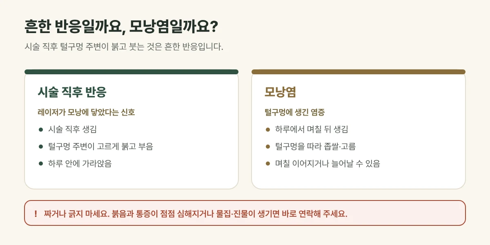

## 시술 직후의 붉은 오돌토돌함은 흔한 반응입니다

레이저제모 직후 털구멍을 중심으로 **붉어지고 살짝 부어오르는 반응**(모낭주위 홍반·부종)이 생길 수 있습니다. 레이저 열이 모낭에 닿았다는 신호로 흔하며, 대부분 **몇 시간에서 하루 안에** 가라앉습니다. 냉찜질로 열감을 식혀 주세요.

## 모낭염은 이렇게 다릅니다

| 구분 | 시술 직후 반응 | 모낭염 |
| --- | --- | --- |
| 생기는 때 | 시술 직후 | 보통 하루에서 며칠 뒤 |
| 모양 | 털구멍 주변이 고르게 붉고 부음 | 털구멍을 따라 좁쌀·고름이 잡힘 |
| 경과 | 하루 안에 가라앉음 | 며칠 이어지거나 늘어날 수 있음 |

모낭염은 털구멍에 세균 등이 자라 염증이 생긴 것으로, 레이저제모 뒤 **가끔** 생길 수 있습니다. 땀이 많고 마찰이 잦은 겨드랑이, 면도 자극이 있는 부위에 더 잘 생깁니다.

<figure style="margin: 8px 0 24px">

<figcaption style="margin-top: 8px; font-size: 14px; color: #5d655f">반응의 정도와 회복에는 개인차가 있습니다. (갈창림 한의원 제작 설명 그림)</figcaption>
</figure>

## 진료실에서 자주 보는 경우

시술 며칠 뒤 다리나 겨드랑이에 좁쌀이 몇 개 올라와 손으로 짰다가 더 붉어져서 오시는 분이 있습니다. 대부분은 깨끗하게 관리하면 가라앉지만, 짜거나 긁으면 자국이 남기 쉽습니다.

## 이렇게 관리해 주세요

- **짜거나 긁지 마세요.** 염증이 깊어지고 자국이 남을 수 있습니다.
- 시술 부위를 깨끗하고 건조하게 유지하고, 꽉 끼는 옷은 피해 주세요.
- 며칠은 사우나, 땀을 많이 흘리는 운동, 수영장은 피해 주세요.
- 다음 면도는 붉음이 가라앉은 뒤, 새 면도날로 털이 자란 방향을 따라 해 주세요.

## 이런 경우는 바로 연락해 주세요

- 붉음과 통증, 열감이 **점점 심해지는** 경우
- 고름이 커지거나 여러 곳으로 번지는 경우
- **물집이나 진물**이 생긴 경우 (화상일 수 있습니다)
- 붉음이나 부기가 이틀 넘게 이어지는 경우

## 자주 묻는 질문

Q. 모낭염이 생기면 다음 제모를 미뤄야 하나요?
A. 염증이 가라앉은 뒤 시술합니다. 다음 예약 전에 상태를 말씀해 주시면 간격과 설정을 조정합니다.

Q. 모낭염이 자주 생기는 체질도 있나요?
A. 땀과 피지가 많거나 면도 자극에 예민한 피부에서 더 잘 생깁니다. 시술 전후 관리 방법을 피부에 맞춰 안내해 드립니다.
