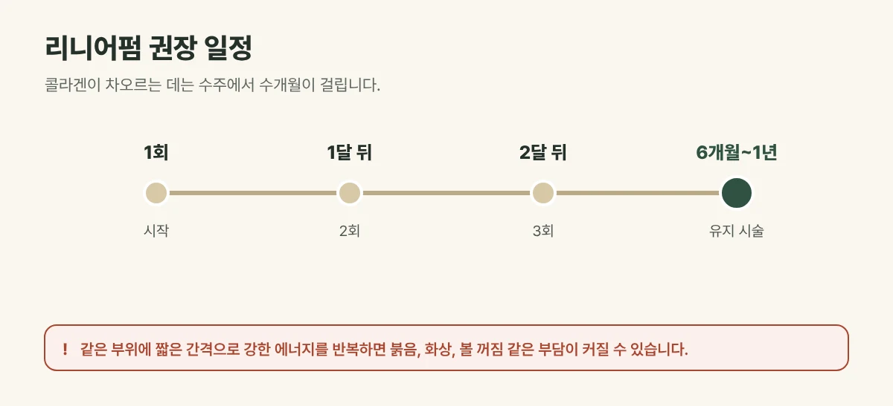

## 권장 주기는 이렇습니다

| 시술 | 처음 | 이후 유지 |
| --- | --- | --- |
| 리니어펌 (초음파) | 1달 간격 3회 | 6개월~1년마다 |
| 볼뉴머 (고주파) | 1회 | 6개월~1년마다 |

피부 상태와 처짐 정도에 따라 상담 때 조정합니다.

<figure style="margin: 8px 0 24px">

<figcaption style="margin-top: 8px; font-size: 14px; color: #5d655f">볼뉴머는 1회 뒤 6개월~1년마다 받으며, 피부 상태에 따라 상담 때 조정합니다. (갈창림 한의원 제작 설명 그림)</figcaption>
</figure>

## 왜 간격을 두고 받을까요?

리프팅은 피부 속에 열을 만들어 조직을 수축시키고, 그 자리에 **콜라겐이 새로 만들어지도록** 돕는 시술입니다. 콜라겐이 차오르는 데는 수주에서 수개월이 걸리므로, 너무 자주 받기보다 회복과 재생의 시간을 두는 것이 좋습니다. 같은 부위에 짧은 간격으로 강한 에너지를 반복하면 붉음, 화상, 볼 꺼짐 같은 부담이 커질 수 있습니다.

## 진료실에서 자주 보는 경우

한 번 받고 좋았다며 한두 달 만에 다시 오시는 분이 있습니다. 대부분은 아직 콜라겐이 차오르는 중이라 조금 더 기다려도 되고, 그 사이 자외선 차단과 보습을 잘 챙기시도록 안내해 드립니다.

## 유지 기간에 영향을 주는 것

- **피부 두께와 탄력**, 처짐 정도
- 시술한 **에너지와 샷 수**, 시술한 부위
- **자외선**, 흡연, 급격한 체중 변화
- 나이와 생활 습관

리프팅은 노화를 멈추는 시술이 아니라 늦추고 정돈하는 시술이라, 시간이 지나면 다시 처짐이 진행됩니다. 그래서 일정한 간격으로 유지 시술을 받는 분이 많습니다.

## 유지에 도움이 되는 습관

- 자외선 차단제를 매일 바르세요.
- 시술 후 약 1주일은 사우나, 과음, 강한 얼굴 마사지를 피해 주세요.
- 보습을 꼼꼼히 하고, 충분히 주무세요.

## 자주 묻는 질문

Q. 리니어펌을 3회 꼭 받아야 하나요?
A. 처음에 1달 간격으로 나누어 받으면 깊이와 부위를 단계적으로 조절할 수 있어 권해 드립니다. 피부 상태에 따라 횟수를 조정할 수 있습니다.

Q. 리프팅을 그만두면 더 처지나요?
A. 리프팅을 그만둔다고 원래보다 더 처지지는 않습니다. 시술로 얻은 변화가 시간이 지나며 자연스러운 노화 속도에 맞춰 줄어드는 것입니다.
