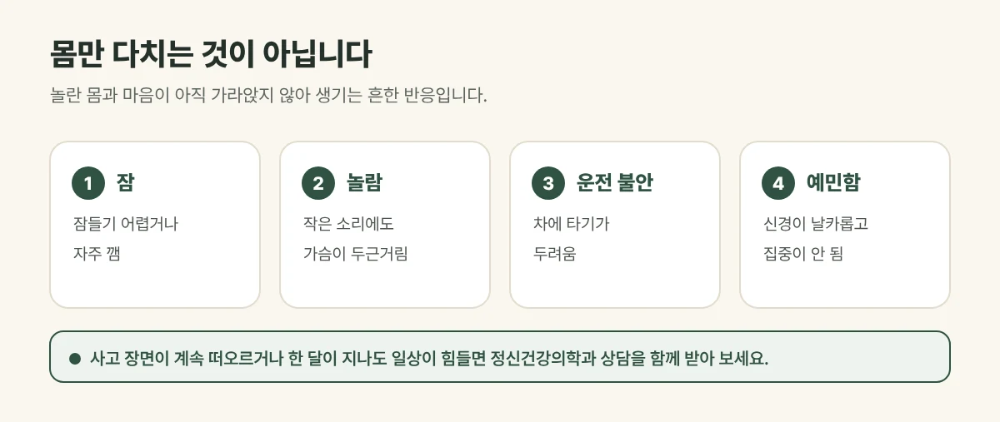

## 몸만 다치는 것이 아닙니다

교통사고는 예상하지 못한 순간 크게 놀라는 사고입니다. 그래서 몸의 통증과 함께 이런 반응이 나타나기 쉽습니다.

- 잠들기 어렵거나 자주 깸
- 작은 소리에도 깜짝 놀라고 가슴이 두근거림
- 운전대를 잡거나 차에 타기가 두려움
- 신경이 날카로워지고 집중이 잘 안 됨

이것은 의지가 약해서가 아니라, **놀란 몸과 마음이 아직 가라앉지 않아** 생기는 흔한 반응입니다.

<figure style="margin: 8px 0 24px">

<figcaption style="margin-top: 8px; font-size: 14px; color: #5d655f">대부분 시간이 지나며 줄어들지만, 통증과 겹치면 함께 살피는 것이 좋습니다. (갈창림 한의원 제작 설명 그림)</figcaption>
</figure>

## 진료실에서 자주 보는 경우

목과 허리 치료를 받으러 오셨다가, 사실 사고 뒤로 잠을 제대로 못 잔다고 말씀하시는 분이 많습니다. 잠을 못 자면 통증도 더 크게 느껴지고 회복이 더뎌, 통증과 잠을 **함께 살피는 것이 중요**합니다.

## 이렇게 치료합니다

- **한약:** 크게 놀란 뒤 불안하고 잠 못 드는 상태를 안정시키는 방향으로 처방합니다.
- **침:** 긴장된 몸을 풀어 주고 통증 치료와 함께 진행합니다.
- 아픈 부위가 있다면 침·약침, 추나, 뜸·부항·물리치료요법을 함께 조합합니다.

## 생활 속 관리

- 잠자리에 드는 시간과 일어나는 시간을 일정하게 지켜 주세요.
- 늦은 오후부터는 커피와 술을 줄여 주세요.
- 운전이 두렵다면 처음엔 짧은 거리, 익숙한 길부터 다시 시작해 보세요.
- 가족이나 가까운 사람에게 지금의 불편함을 이야기해 주세요.

## 이런 경우는 전문 상담을 받아 보세요

- 사고 장면이 계속 떠오르거나 악몽이 반복되는 경우
- 한 달이 지나도 불안과 불면이 줄지 않고 일상이 힘든 경우
- 기분이 계속 가라앉고 아무것도 하기 싫은 경우

이런 경우는 정신건강의학과 상담을 함께 받아 보시기를 권합니다.

## 자주 묻는 질문

Q. 시간이 지나면 저절로 좋아지나요?
A. 많은 경우 시간이 지나며 줄어들지만, 통증과 겹치거나 오래 이어지면 치료를 함께 받는 것이 좋습니다.

Q. 불면도 자동차보험으로 치료받을 수 있나요?
A. 사고 뒤 생긴 증상으로 진찰한 경우 교통사고 진료 안에서 함께 살펴봅니다. 보험 처리 범위는 담당 보험사에 확인해 주세요.
