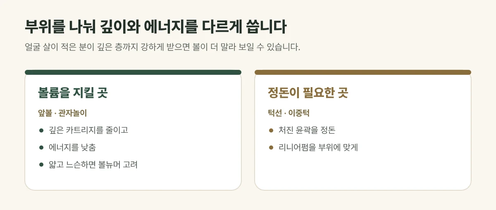

## 왜 볼이 꺼져 보일까요?

초음파 리프팅은 피부 속 정해진 깊이에 열을 모아 조직을 수축시킵니다. 얼굴 살이 넉넉한 분에게는 윤곽을 정돈하는 효과로 보이지만, **얼굴 살이 적거나 볼이 이미 꺼진 분**이 깊은 층까지 강하게 받으면 볼과 관자놀이가 더 말라 보일 수 있습니다. 리프팅의 가능한 부작용 가운데 하나로, 드물지만 미리 조심해야 하는 부분입니다.

## 진료실에서 자주 보는 경우

"리프팅 받으면 얼굴 살이 빠진다던데요" 하며 망설이시는 분이 많습니다. 원래 얼굴이 마른 편인데 처짐도 고민인 분들이 특히 걱정하시는데, 이런 분일수록 부위를 나눠 설계하는 것이 중요합니다.

## 이렇게 조절합니다

- **먼저 확인합니다.** 야누스프로 분석과 상담으로 얼굴 지방량, 피부 두께, 처진 부위를 봅니다.
- **부위를 나눕니다.** 볼륨을 지켜야 할 앞볼·관자놀이와, 정돈이 필요한 턱선·이중턱을 구분합니다.
- **깊이와 에너지를 다르게 씁니다.** 얼굴 살이 적은 곳은 깊은 카트리지를 줄이고 에너지를 낮춥니다.
- **고주파를 활용합니다.** 피부가 얇고 느슨한 경우에는 넓게 데워 탄력을 주는 볼뉴머가 더 잘 맞을 수 있습니다.

<figure style="margin: 8px 0 24px">

<figcaption style="margin-top: 8px; font-size: 14px; color: #5d655f">부위별로 깊이와 에너지를 다르게 쓰며, 결과에는 개인차가 있습니다. (갈창림 한의원 제작 설명 그림)</figcaption>
</figure>

## 볼륨이 함께 줄었다면

나이가 들면 처짐과 함께 볼륨도 줄어듭니다. 이런 경우에는 리프팅만으로는 아쉬울 수 있어 다음을 함께 고려합니다.

- **PLLA 스킨부스터:** 진피에서 콜라겐 생성을 이끌어 볼륨과 탄력이 서서히 차오르도록 돕습니다.
- **채움실(볼륨실):** 꺼진 부위의 볼륨을 보완하는 데 중점을 둔 실입니다.

## 자주 묻는 질문

Q. 볼뉴머도 얼굴 살이 빠지나요?
A. 볼뉴머는 지방을 직접 없애는 시술이 아니라 고주파 열로 피부 탄력을 높이는 시술입니다. 다만 에너지를 지나치게 높이거나 한 부위에 몰아서 시술하면 원치 않는 볼륨 변화가 생길 수 있어 세심하게 조절합니다.

Q. 이미 볼이 꺼졌는데 리프팅을 받아도 되나요?
A. 받을 수 있습니다. 다만 볼륨을 지켜야 할 부위는 피하거나 약하게 하고, 필요하면 볼륨 보완을 함께 계획합니다.
