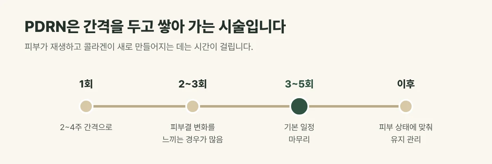

## PDRN은 어떤 성분인가요?

PDRN(폴리데옥시리보뉴클레오타이드)은 **연어에서 얻은 DNA 성분**으로, 손상된 피부의 재생을 돕는 성분입니다. 주로 진피층에 작용해 콜라겐 생성을 도와 피부 탄력과 결을 관리하는 데 씁니다.

## 왜 여러 번 받을까요?

피부가 재생하고 콜라겐이 새로 만들어지는 데는 시간이 걸립니다. 한 번 맞고 바로 끝나는 시술이라기보다, **간격을 두고 여러 번 쌓아 가는 시술**입니다.

- 권장 주기는 **2~4주 간격, 3~5회**입니다.
- 이후에는 피부 상태에 맞춰 유지 관리를 이어 갑니다.
- 간격과 횟수는 피부 상태와 목적에 따라 조정합니다.

<figure style="margin: 8px 0 24px">

<figcaption style="margin-top: 8px; font-size: 14px; color: #5d655f">간격과 횟수는 피부 상태와 목적에 따라 조정하며, 결과에는 개인차가 있습니다. (갈창림 한의원 제작 설명 그림)</figcaption>
</figure>

## 라디쥬, 세 가지 중에서 고릅니다

| 구성 | 성분 | 초점 |
| --- | --- | --- |
| 라디쥬 오리지널 | PDRN 1% + 엑소좀 1% + 미백 성분 (+ HA 앰플) | 미백과 보습 |
| 라디쥬 플러스 | PDRN 2% + HA 1% | 탄력과 모공 |
| 라디쥬 퓨어 | PDRN 2.5% 단일 | 진정과 재생, 예민·염증 피부 |

## 진료실에서 자주 보는 경우

첫 회 뒤 피부가 촉촉해진 느낌에 만족하시다가, 2~3회째부터 피부결이 부드러워지는 변화를 더 느끼시는 경우가 많습니다. 반대로 한 번만 받고 변화가 적다며 아쉬워하시는 분도 있어, 처음에 일정을 함께 정해 두는 것이 좋습니다.

## 시술 후 알아 두세요

- 주입 방법에 따라 작은 주입 자국, 오돌토돌함, 가벼운 붉음이 생길 수 있으며 대부분 며칠 안에 가라앉습니다.
- 당일은 사우나와 과격한 운동, 음주를 피해 주세요.
- 연어 등 성분에 알레르기가 있다면 시술 전에 꼭 말씀해 주세요.

## 자주 묻는 질문

Q. 다른 시술과 함께 받아도 되나요?
A. 리프팅이나 색소 레이저 등 다른 시술과 함께 계획할 수 있습니다. 피부 상태에 맞춰 순서와 간격을 정합니다.

Q. 바로 화장해도 되나요?
A. 주입 방법에 따라 다릅니다. 시술 후 피부 상태를 보고 안내해 드립니다.
