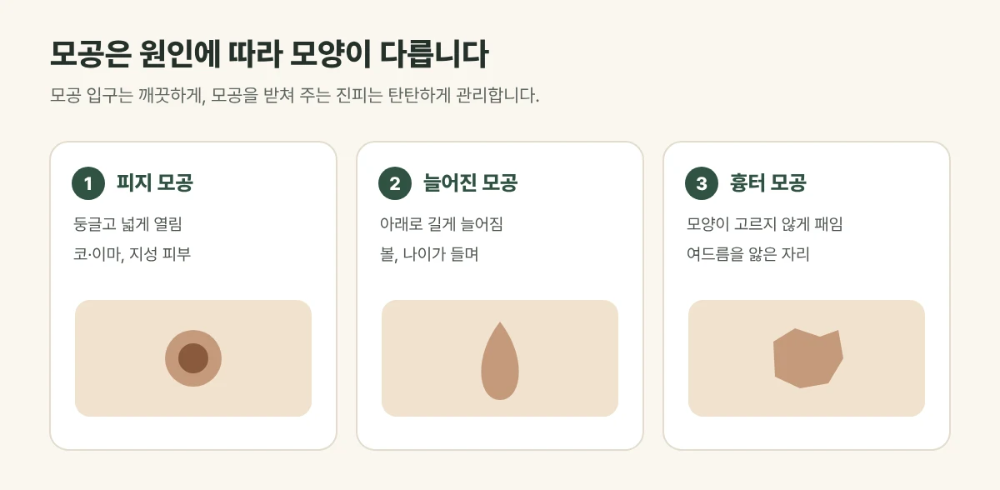

## 모공이 넓어지는 세 가지 이유

| 모공 | 모양 | 잘 생기는 경우 | 주로 쓰는 치료 |
| --- | --- | --- | --- |
| 피지 모공 | 둥글고 넓게 열림 | 코·이마, 지성 피부 | 제네시스 토닝 · 필링 · 니들RF |
| 늘어진 모공 | 아래로 길게 늘어진 물방울 모양 | 볼, 나이가 들며 | 니들RF · 스킨부스터 |
| 흉터 모공 | 모양이 고르지 않게 패임 | 여드름을 앓은 자리 | 니들RF · 스킨부스터 |

모공 입구는 깨끗하게, 모공을 받쳐 주는 진피는 탄탄하게 관리하는 것이 핵심입니다.

<figure style="margin: 8px 0 24px">

<figcaption style="margin-top: 8px; font-size: 14px; color: #5d655f">원인이 다르면 맞는 시술도 달라 모공에 맞게 조합합니다. (갈창림 한의원 제작 설명 그림)</figcaption>
</figure>

## 치료는 이렇게 작용합니다

- **니들RF(실펌X):** 가는 바늘로 모공 주변 진피까지 고주파 열을 전달해 콜라겐 재생을 이끕니다. 늘어지거나 패인 모공에 특히 씁니다. 보통 4주 간격입니다.
- **제네시스 토닝:** 1064nm 롱펄스 레이저를 여러 번 나누어 진피를 고르게 데워 모공과 피부결을 정돈합니다. 보통 1~2주 간격입니다.
- **스킨부스터:** 진피를 채워 모공을 받쳐 주는 바탕을 탄탄하게 합니다.
- **필링:** 모공 입구를 막는 각질과 피지를 정리합니다.

## 진료실에서 자주 보는 경우

코와 볼 모공이 화장해도 도드라져 보인다며 오시는 분이 많습니다. 블랙헤드를 매일 짜거나 스크럽으로 세게 문질렀더니 오히려 더 넓어진 것 같다는 말씀도 자주 듣습니다.

## 집에서 피해야 할 습관

- 블랙헤드를 손으로 짜거나 도구로 세게 누르기
- 스크럽으로 매일 강하게 문지르기
- 모공 팩을 자주 붙였다 떼기

모공 벽이 자극을 받으면 오히려 넓어질 수 있습니다. 피지가 많다면 순한 세안과 보습, 자외선 차단을 기본으로 지켜 주세요.

## 자주 묻는 질문

Q. 모공이 완전히 좁아지나요?
A. 모공은 피지가 나오는 정상적인 통로라 없앨 수는 없습니다. 넓어진 모공을 덜 도드라져 보이게 하는 것이 목표이며 개선 정도에는 개인차가 있습니다.

Q. 니들RF 뒤 바로 출근할 수 있나요?
A. 붉음이 1~2일 이어질 수 있지만 대부분 일상생활은 가능합니다. 일정에 맞춰 시술 날짜를 정해 드립니다.
