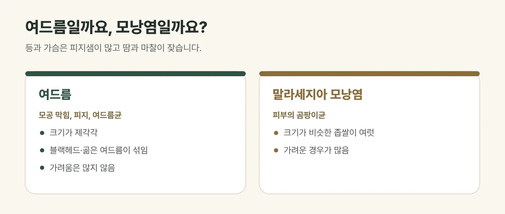

## 등과 가슴은 여드름이 생기기 쉬운 곳입니다

등과 가슴은 얼굴처럼 **피지샘이 많고**, 옷과 가방끈에 늘 쓸리며 땀이 차기 쉬운 부위입니다. 모공이 막히고 피지가 고이면 얼굴 여드름과 같은 원리로 염증이 생깁니다.

## 이런 습관이 영향을 줍니다

- 땀에 젖은 옷을 오래 입고 있기
- 꽉 끼거나 통풍이 안 되는 옷, 무거운 가방끈의 마찰
- 샤워할 때 샴푸·린스가 등에 남는 것
- 유분이 많은 바디 제품

## 진료실에서 자주 보는 경우

여름이나 운동을 시작한 뒤 등에 여드름이 늘었다며 오시는 분이 많습니다. 등은 손이 잘 닿지 않아 몰래 짜다가 자국이 많이 남은 경우도 흔합니다.

## 비슷해 보이는 모낭염과 구분해야 합니다

| 구분 | 여드름 | 말라세지아 모낭염 |
| --- | --- | --- |
| 모양 | 크기가 제각각, 블랙헤드·곪은 여드름이 섞임 | 크기가 비슷한 좁쌀이 여럿 |
| 가려움 | 많지 않음 | 가려운 경우가 많음 |
| 원인 | 모공 막힘, 피지, 여드름균 | 피부의 곰팡이균 |

곰팡이균에 의한 모낭염은 여드름 관리만으로 잘 낫지 않아, 진료로 먼저 구분하는 것이 중요합니다.

<figure style="margin: 8px 0 24px">

<figcaption style="margin-top: 8px; font-size: 14px; color: #5d655f">곰팡이균에 의한 모낭염은 여드름 관리만으로 잘 낫지 않아 진료로 먼저 구분합니다. (갈창림 한의원 제작 설명 그림)</figcaption>
</figure>

## 생활 속 관리

- 운동 후에는 바로 샤워하고 젖은 옷을 갈아입어 주세요.
- 샴푸와 린스는 먼저 헹구고, 마지막에 몸을 씻어 주세요.
- 통풍이 잘되는 면 소재 옷을 입어 주세요.
- 짜거나 긁지 마세요. 등은 자국이 오래 남기 쉽습니다.

## 진료가 필요한 경우

- 붉고 깊은 여드름이 계속 생기거나 자국과 흉터가 남는 경우
- 가렵고 비슷한 크기의 좁쌀이 퍼지는 경우

진찰로 여드름인지 모낭염인지 확인한 뒤 상태에 맞는 치료를 안내해 드립니다.

## 자주 묻는 질문

Q. 등 여드름 자국도 옅어질까요?
A. 붉은 자국과 갈색 자국은 시간이 지나며 옅어지기도 하지만 오래 걸릴 수 있습니다. 자국의 색에 맞춰 관리 방법을 안내해 드립니다.

Q. 바디 스크럽을 자주 하면 도움이 되나요?
A. 세게 문지르면 오히려 자극이 되어 염증이 심해질 수 있습니다. 순하게 씻는 것이 좋습니다.
